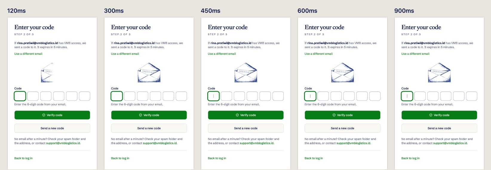
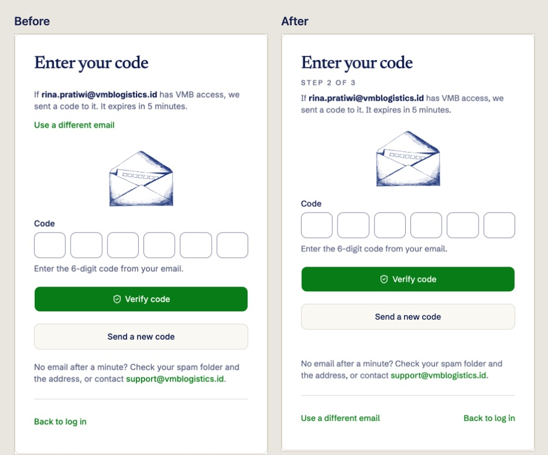

# Impeccable on the auth pages — design round

This round was a refinement of `/login` and `/activate`. It kept the etched look from [etched login](../etched-login/README.md) and was the pilot for the Skills section of the [design workflow](../../agents/design-workflow.md), run on 2026-10-06 with impeccable 4.5.0. It had two goals:

- type that doesn't feel generic;
- micro-interactions within [ADR-0040](../../adr/0040-css-and-svelte-built-ins-for-motion.md) for four moments: a code sent, the submit state, show/hide password, and the change from code entry to setting a password.

Password reset is `/activate` (`GLOSSARY.md`), so there are no register or forgot-password pages.

## Steps

| Step          | What ran                                                                                           | What it produced                                                                                                                                                                      |
| ------------- | -------------------------------------------------------------------------------------------------- | ------------------------------------------------------------------------------------------------------------------------------------------------------------------------------------- |
| Init          | `/impeccable init`                                                                                 | `apps/web/PRODUCT.md`, which pins the etched look as a binding brand commitment. The auth surface brief is in `apps/web/.impeccable/surfaces/`: Operate mode, refinement only.        |
| Critique      | `/impeccable critique`, run as two isolated agents: a design review, and the detector plus browser | 29/40 ("Good"). Three P1 issues: one shared progress flag showed "Verifying…" during a resend; "code sent" and "code confirmed" were silent; the sheet's type was the shadcn default. |
| Typeset       | `/impeccable typeset`, two rounds of real-page renders                                             | [ADR-0046](../../adr/0046-schibsted-newsreader-display-cut-and-jetbrains-mono.md), app-wide.                                                                                          |
| Animate       | `/impeccable animate`                                                                              | See _Motion_ below.                                                                                                                                                                   |
| Step 6 checks | `interfaces:better-accessibility`, `interfaces:better-colors`                                      | One accessibility fix. No colour findings.                                                                                                                                            |
| Polish        | `/impeccable polish`                                                                               | See _Polish_ below.                                                                                                                                                                   |

**Owner rulings in this round:**

- **"Nothing moves near a focused field" covers ambient art only.** One-shot feedback for the user's own action may play there. The Rules in the design workflow now say so.
- **The sheet may speak the engraved voice, sparingly.** That allowed the step folio in the masthead's tracked capitals. Running text stays in the UI face: a description that wraps to two lines in the display face read badly.

## Type

Every candidate was rendered on the real pages by injecting `@font-face` through Playwright. The renders are in `captures/type-*.jpg`.

- **Round 1** compared three pairings: Newsreader + Libre Franklin, Bodoni Moda + Archivo, and Newsreader + Schibsted Grotesk. None was chosen. The owner asked to compare each axis separately instead, against references of their own.
- **Round 2** compared one axis at a time:
  - Display: Newsreader's optical-size cut, Marcellus, Forum and Asul.
  - UI: Inter, Switzer, Rethink Sans and Schibsted Grotesk.
  - Mono: none, JetBrains Mono, IBM Plex Mono, Red Hat Mono and Martian Mono.

The owner chose **Newsreader's optical-size cut, Schibsted Grotesk and JetBrains Mono**. ADR-0046 records the rejected options and the reasons for them:

- Larken is a paid face.
- Switzer's licence forbids redistribution.
- Libre Franklin's subset has no tabular figures.
- Marcellus and Bodoni wrap the brand line to three lines.

**Inside the sheet:**

- **Step folio:** "Step 2 of 3" sits under the heading in the masthead's tracked caps. It replaces the Inter "Get a code" h2. It goes under the heading rather than beside it: a long or translated heading would wrap on some steps and not others, and the folio would jump during the step transition. It isn't an eyebrow either, which the craft floor bans.
- **Code boxes:** JetBrains Mono at 22px, weight 500, tabular figures.
- **Sheet heading:** 24px below `sm`, so it doesn't twin the 32px brand line.

## Motion

The thesis: **the mark is printed.** When the user's action brings a step (a code sent, a code confirmed, a new code sent), the step's etched mark draws in left to right with the plate's press-roller mask sweep:

- `EtchedMark`'s new `reveal` option runs once over `--duration-etch-print` (640ms) with `--easing-reveal`.
- A mark that is there on arrival, such as after a reload, doesn't move.

| Moment             | Before                                                                                         | After                                                                                                                                                                                                                                                                  |
| ------------------ | ---------------------------------------------------------------------------------------------- | ---------------------------------------------------------------------------------------------------------------------------------------------------------------------------------------------------------------------------------------------------------------------- |
| Code sent          | The sheet morphs; focus goes to the code field.                                                | The envelope prints in. The code field's description includes "If … has VMB access, we sent a code to it". A resend prints the envelope again, shows "New code sent at 14:02." under the button, and announces "A new code is on its way."                             |
| Submit             | One progress flag drives every form on the page. Buttons fade to 50% and drop focus to `body`. | `createSubmission` names the form in flight and turns a second send away. `SubmitButton` keeps the pressed button at full colour with focus and `aria-busy`. After 8 seconds it reads "Still working…" and fills a status line that is mounted empty for that purpose. |
| Show/hide password | The icon swaps instantly. A tap moves focus, which closes a phone's keyboard.                  | `EyeToggleIcon` draws its slash over `--duration-icon` and lifts it over `--duration-exit`. A press while typing keeps focus and the caret in the field; from the keyboard, focus stays on the toggle.                                                                 |
| Code → password    | The sheet morphs.                                                                              | The padlock prints in, and the vendored moving `check` draws beside "Code confirmed for …", which is in the new password field's description.                                                                                                                          |

`EyeToggleIcon` departs from ADR-0035 rule 3 (vendored moving icons): the registry's `eye` blinks on hover and its `eye-off` shakes, which reads as an error. It is CSS only, with its gap cut through an SVG mask so it reads on any field colour. Reduced motion collapses every one of these, and the print finishes in 0.01ms (measured).

## Polish

- **Resend wait:** the countdown left the disabled button, where it sat at 50% opacity. It is now a full-contrast line under the button with tabular mono figures, and its height is reserved so the help text below doesn't jump when the wait ends.
- **Use a different email:** moved from between the step's status and its field to the footer, beside "Back to log in".
- **Step status:** the code and password steps' status sentence now sits in `AuthCard`'s description slot, so heading → folio → description spacing is the same on every step.
- **Strength bar:** animates `clip-path` on `--duration-feedback` instead of `width`, which the detector flagged as a layout transition.
- **Login notice:** the notice shown on arrival ("Your password is set…") is now the description of the focused heading, because a status region that arrives already filled is often not read out.

## Measured

**Page height** (`scrollHeight`, Chromium, desktop pointer) against `master` (8efcf09), served from a temporary worktree:

| State         | 1920 × 1080 | 1440 × 900         | 1366 × 768       | 1024 × 923 | 390 × 844   |
| ------------- | ----------- | ------------------ | ---------------- | ---------- | ----------- |
| Login         | fits        | fits               | 773 (master 773) | fits       | 956 (960)   |
| Email step    | fits        | fits               | fits             | fits       | 878 (888)   |
| Code step     | fits        | 934 (master 940)   | 934 (940)        | 934 (940)  | 1137 (1147) |
| Password step | fits        | fits (master fits) | 856 (890)        | fits       | 1039 (1077) |

No state got taller. The code step already scrolled at 1440 × 900 on `master`.

**Rendered contrast:** the background was read from screenshot pixels with the element's ink hidden. Light / dark:

| Pair                        | Light                    | Dark    |
| --------------------------- | ------------------------ | ------- |
| Step folio and status lines | 6.37:1                   | 7.62:1  |
| Code digits                 | 16.37:1                  | 11.27:1 |
| "Still working…" label      | 6.34:1 on the hover fill | 8.90:1  |
| Moving check (non-text)     | 5.38:1                   | 8.01:1  |
| Eye icon (non-text)         | 6.37:1                   | 5.84:1  |

The brand supporting line is 6.00:1 and 8.45:1 over bare paper only. That makes axe's 2.47:1 flag on it a false positive: axe reads the masked etching layer's fill as the background. The flag is also present on `master`.

**Other checks:**

- axe (WCAG 2.2 A/AA) on every state, light and dark: the only result is that false positive.
- A keyboard tab walk shows a focus ring at every stop. The code field's ring is drawn on the active box.
- `pnpm typecheck`, `pnpm lint` and `pnpm test` in `apps/web` all pass.
- The impeccable detector on every changed UI file reports no findings.

## Not yet checked

- A real activation and log-in against the API. Step replies were stubbed in Playwright as SvelteKit action results.
- Real VoiceOver and NVDA output. The accessible names and descriptions were read from the DOM.
- 200% zoom.
- Firefox and WebKit.
- The design-workflow step 7 owner review in the owner's own browser.

## Follow-ups

- **`build-brand-assets.mjs` draws the link-preview image from the shipped plate.** Since #243 that plate has its moving parts cut out, so a rebuild loses the trucks on the bridge. `og-image.jpg` was left as it was, with its Inter kicker. The script needs to composite the parts back before the image is rebuilt with Schibsted.
- **After activation, `/login` opens with an empty email field.** It could prefill the email.
- **Activation link on `/login`.** Its only link is the 14px "Activate your account" in the footer.
- **Code step at 1366 × 768 and below.** It still scrolls, as it did before this round.

## Pilot notes for the design workflow

- **Per-axis renders on the real page decided the type, not pairings.** The owner rejected all three of round 1's pairings, then chose quickly once each axis was shown separately.
- **Licences need checking before rendering.** Larken (paid) and Switzer (no redistribution) both surfaced only on inspection.
- **The craft floor's eyebrow ban overruled an option the owner had approved.** The folio moved under the heading instead. Expect impeccable's bans to bind even when the brief asks for the pattern.
- **Running the critique as two isolated assessments was worth it.** The detector found nothing in the source and only intentional or false-positive patterns in the browser. Every real issue came from the design review.
