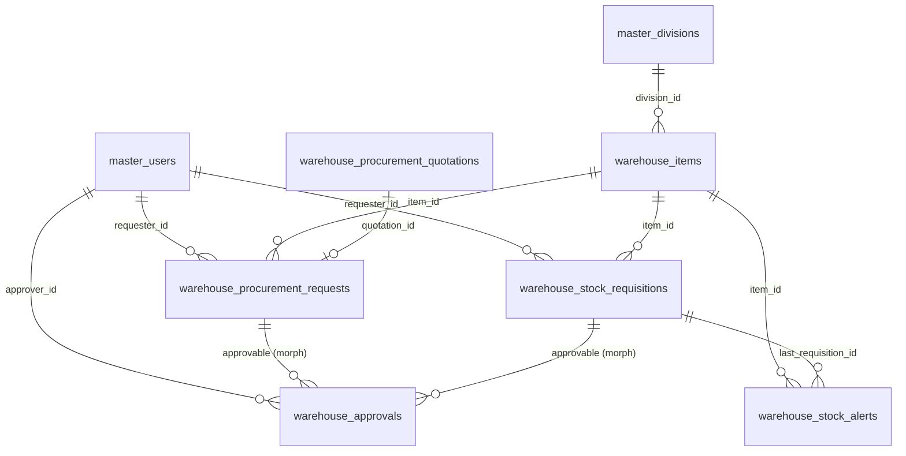
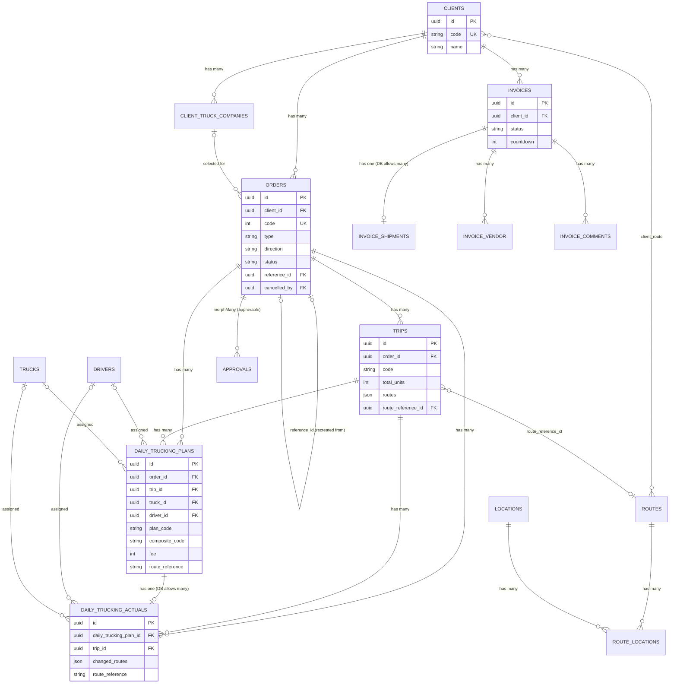
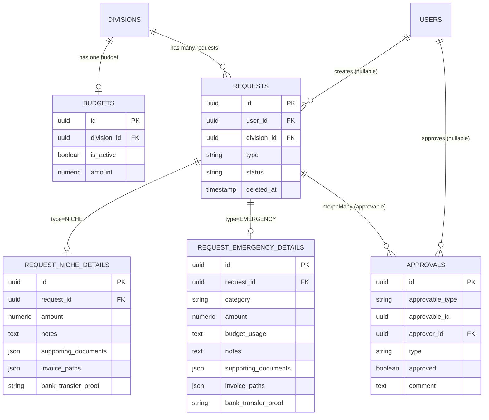

# Legacy schema inventory — method & scope

Raw material for [#5](https://github.com/ubeann/vmb/issues/5) (database schema design) and [#18](https://github.com/ubeann/vmb/issues/18) (dev data import).

## Primary source

`github.com/ubeann/vmb-warehouse` — local clone read at `/Volumes/Gawean/vmb-warehouse`.

- Working tree clean, branch `gitbutler/workspace` at `d8018ab2`, **1 commit ahead of `origin/development` and 173 ahead of `origin/production`**.
- Therefore this inventory documents the **development schema**, with a separate drift section (see `05-drift.md`) enumerating what production does _not_ have.
- **Read-only**: nothing in the legacy repo was modified.

## What "the schema" means here

- Tables live in Postgres **schemas** (`public`, `spatie`, `master`, `auth`, `trucking`, `warehouse`, `expense`) per `config/schema.php`; migrations use `database/abstracts/BaseSchemaMigration.php`.
- The inventory reflects the schema after **replaying every migration in filename order** (creates + alters + drops + renames), not just the initial `create_*` migration.
- Per table: columns/types/nullability/defaults, PK, FKs, indexes/uniques, model relationships, legacy quirks, and improvement candidates split into **mechanical** (safe to apply during the port) vs **semantic** (defer to a migration over loaded data).

## Headline findings

- **43 tables** in the development schema across 6 Postgres schemas (`public`, `spatie`, `master`, `auth`, `warehouse`, `trucking`, `expense`): Master/Auth/Infra 16, Warehouse 6, Trucking 17 (+1 dropped), Expense 5.
- **`origin/production` is a dead scaffold.** It is the `Initialize Project using Laravel 11.x` commit (2024-08-19), 3 migrations, 8 `public` tables — it has **never advanced**. `legacy-reference.md`'s claim that it is the parity baseline is incorrect. Deployment (`deployment/deploy.sh:100`) runs `migrate --force` against a live `vmb_prod` DB, so **only a live `pg_dump --schema-only` of `vmb_prod` establishes the true production shape.** See `05-drift.md`.
- **Systemic quirks, repeated across domains:**
  - Status columns whose DB `default` is not a valid value of the PHP enum that casts them → hydration errors (Warehouse, Expense, Trucking/Invoices).
  - **No DB foreign keys** on many declared Eloquent relationships; almost no indexes beyond PKs (Laravel/Postgres do not auto-index FKs).
  - String-typed enums/status columns with no CHECK constraints and sometimes _multiple_ competing vocabularies for the same field.
  - Denormalised snapshots/JSON columns (routes, allowances) and money stored as both integer and numeric, with casts that truncate cents.
  - "Phantom" columns referenced by code but absent from the DB (and vice-versa: columns in `$fillable` that no longer exist).
- **Highest cutover risks:** `users.id` / `sessions.user_id` are `bigint → uuid` between the old scaffold and dev; invoice/DTP/DTA tables and `orders` churn exist only in dev; the production DB shape is unproven from git.

## Sections

- `01-master-auth-infra.md`
- `02-warehouse.md`
- `03-trucking.md`
- `04-expense.md`
- `05-drift.md` — production↔development schema drift, and why it constrains the cutover ETL.

# 01 — Master, Auth & Laravel infrastructure

Source root: `/Volumes/Gawean/vmb-warehouse` (Laravel 12 + Filament monolith, PostgreSQL).
All `path:line` citations below are relative to that legacy repo root.

---

## Domain summary

**Table count:** 16.

**Schemas involved** (from `config/schema.php`):

| Config key | Schema   | Notes                                                                                                                                             |
| ---------- | -------- | ------------------------------------------------------------------------------------------------------------------------------------------------- |
| `laravel`  | `public` | `config/schema.php:19`; schema-creation migration is a no-op for `public` (`database/migrations/0001_01_01_000000_create_laravel_schema.php:17`). |
| `spatie`   | `spatie` | `config/schema.php:35`.                                                                                                                           |
| `master`   | `master` | `config/schema.php:52`.                                                                                                                           |
| `auth`     | `auth`   | `config/schema.php:68`.                                                                                                                           |

Final tables: `master.users`, `master.divisions`, `master.roles`, `master.permissions`, `spatie.model_has_roles`, `spatie.model_has_permissions`, `spatie.role_has_permissions`, `auth.sessions`, `auth.password_reset_tokens`, `auth.two_factors`, `public.cache`, `public.cache_locks`, `public.jobs`, `public.job_batches`, `public.failed_jobs`, `public.migrations`.

**Note on naming:** there is **no** `auth.password_resets` and **no** `public.sessions`. The reset table is `auth.password_reset_tokens` (`config/auth.php:96`), and the session table is `auth.sessions`, not `public.sessions` (`config/session.php:89`) — the users migration passes schema key `laravel`/`public` but the table name already contains a dot, so `BaseSchemaMigration::getQualifiedTableName()` returns it verbatim (`database/abstracts/BaseSchemaMigration.php:89`).

**Cross-table patterns**

- PKs are **UUIDv4** (`HasUuids`) for all domain/master tables; only framework tables (`public.jobs`, `public.failed_jobs`, `public.migrations`) use bigint auto-increment. `auth.sessions.id` is a varchar string session id, `auth.password_reset_tokens.email` is the PK.
- Every table has `created_at`/`updated_at` except the framework cache/session/queue tables and `spatie.role_has_permissions`/pivot tables.
- **Soft deletes** only on `master.users` and `master.divisions`. `master.roles`, `master.permissions`, and all pivots hard-delete.
- `master.roles` + `master.permissions` physically live in the `master` schema even though they are Spatie package tables; only the three pivot tables live in `spatie` (`config/permission.php:39-71`).
- No teams/multi-tenancy in RBAC (`config/permission.php:123`), so no `team_id` columns.
- Migrations use a custom base class whose `dropAndRecreateTable()` **drops and recreates** tables rather than `alter`ing them (`database/abstracts/BaseSchemaMigration.php:30-42`); the schema is effectively defined by the latest full-create migration, and no later migration alters any master/auth/infra table.

**Mapping onto the new stack**

- Laravel session storage (`auth.sessions`), Laravel password broker (`auth.password_reset_tokens`), and custom TOTP 2FA (`auth.two_factors`) are **replaced by Better Auth** (session + email verification + `twoFactor` plugin). These three tables become **drop candidates**, but data migration must be considered: no portable hashes for sessions/reset tokens (discard), TOTP secrets are Laravel-`APP_KEY`-encrypted and must be re-enrolled rather than migrated.
- Spatie RBAC (`master.roles`, `master.permissions`, `spatie.*`) is **replaced by a new RBAC layer**; all five tables are drop candidates. Role→user and role→permission mappings must be exported for the new RBAC seed, since `master.roles` carries app-specific `level`/`is_system`/`color_hex`/`icon_name` semantics that the new model may want to preserve.
- `master.users` and `master.divisions` are domain data and survive; Better Auth will own the credential columns (`password`, `email_verified_at`, possibly `remember_token`).
- `public.cache`, `public.cache_locks`, `public.jobs`, `public.job_batches`, `public.failed_jobs`, `public.migrations` are pure Laravel infrastructure. The new stack will not reuse them (cache store / queue driver / migration repo differ) — **all drop candidates**.

---

### `master.users`

**Purpose:** Application user accounts (Better Auth "user" table analogue).
**Migrations:** create: `database/migrations/2024_08_20_151533_create_users_table.php`. alters: none.
**Model:** `app/Models/Master/User.php`

| Column               | Type                      | Null | Default    | Notes                                                                                                                                              |
| -------------------- | ------------------------- | ---- | ---------- | -------------------------------------------------------------------------------------------------------------------------------------------------- |
| `id`                 | uuid                      | no   | —          | PK; `HasUuids` (`app/Models/Master/User.php:21`, `:105`).                                                                                          |
| `name`               | varchar(255)              | no   | —          |                                                                                                                                                    |
| `status`             | varchar(255) + CHECK enum | no   | `'active'` | `$table->enum('status', ['active','inactive','suspended'])` (`create_users_table.php:27`); cast to `App\Enums\Master\UserStatus` (`User.php:186`). |
| `division_id`        | uuid                      | yes  | —          | FK → `master.divisions(id)`, `ON UPDATE cascade`, `ON DELETE set null` (`create_users_table.php:30-35`).                                           |
| `phone`              | varchar(20)               | yes  | —          | Filament forces `+62` Indonesian format (`UserResource.php:123-143`).                                                                              |
| `email`              | varchar(255)              | no   | —          | unique.                                                                                                                                            |
| `email_verified_at`  | timestamp                 | yes  | —          | Not editable in Filament; shown as a boolean "Verified" column (`UserResource.php:270-276`).                                                       |
| `profile_photo_path` | varchar(255)              | yes  | —          | Seeder stores an external dicebear URL, but Filament `FileUpload` expects a local disk path (`UsersSeeder.php:127`, `UserResource.php:97`).        |
| `password`           | varchar(255)              | no   | —          | Bcrypt; `'hashed'` cast (`User.php:185`).                                                                                                          |
| `remember_token`     | varchar(100)              | yes  | —          | `rememberToken()` (`create_users_table.php:43`).                                                                                                   |
| `created_at`         | timestamp                 | yes  | —          |                                                                                                                                                    |
| `updated_at`         | timestamp                 | yes  | —          |                                                                                                                                                    |
| `deleted_at`         | timestamp                 | yes  | —          | SoftDeletes (`User.php:122`).                                                                                                                      |

**PK:** `id`.
**FKs:** `division_id` → `master.divisions(id)`.
**Indexes / unique:** unique(`email`); FK on `division_id` (no explicit secondary index; PostgreSQL does not auto-index FK columns).
**Relationships:** `belongsTo(Division)` (`User.php:204`); `hasMany(ProcurementRequest, 'requester_id')` (`:214`); `hasMany(StockRequisition, 'requester_id')` (`:224`); `hasOne(TwoFactor)` (`:234`); Spatie `HasRoles` trait adds `roles`/`permissions` many-to-many (`:79`).
**Quirks:**

- `division_id` is nullable in the DB but `required()` in Filament (`UserResource.php:155`).
- `status` is a native Postgres enum created via Laravel `enum()` (varchar + CHECK), so adding statuses requires an `ALTER TYPE`/constraint change — not represented in any later migration.
- `email_verified_at` / `remember_token` are never surfaced as form fields; `remember_token` is hidden from serialization (`User.php:171-174`).
- Global scope `UserSensitiveFilterScope` hides users holding the `Super Admin` role from non-super-admins (`app/Scopes/Master/UserSensitiveFilterScope.php:28-31`).
- Super-admin identity is dual-sourced: `id === env('ID_SUPER_ADMIN')` **or** role name `'Super Admin'` (`app/Traits/Users/HasSuperAdmin.php:32-36`) — fragile and env-dependent.
  **Improvement candidates:** mechanical: rename `division_id` FK column / add index; split phone/format concerns out of the resource. semantic: replace `status` enum + role-name super-admin check with Better Auth roles/claims; drop `remember_token` if Better Auth session semantics replace it; decide whether `profile_photo_path` becomes an object-storage key.

---

### `master.divisions`

**Purpose:** Organisational divisions (grouping for users, warehouse items, budgets).
**Migrations:** create: `database/migrations/2024_08_20_151453_create_divisions_table.php`. alters: none.
**Model:** `app/Models/Master/Division.php`

| Column        | Type         | Null | Default                      | Notes                                                                                                                        |
| ------------- | ------------ | ---- | ---------------------------- | ---------------------------------------------------------------------------------------------------------------------------- |
| `id`          | uuid         | no   | —                            | PK.                                                                                                                          |
| `name`        | varchar(255) | no   | —                            | unique.                                                                                                                      |
| `code`        | varchar(255) | yes  | —                            | unique, nullable (`create_divisions_table.php:17`); Filament requires it and caps 3–5 chars (`DivisionResource.php:97-104`). |
| `description` | varchar(255) | yes  | —                            | Filament allows up to 1000 chars (`DivisionResource.php:106`) despite a 255 DB column.                                       |
| `color_hex`   | varchar(255) | no   | `'#000000'`                  | Used to generate Filament palette (`DivisionResource.php:193`).                                                              |
| `icon_name`   | varchar(255) | no   | `'heroicon-o-rocket-launch'` | Heroicon name.                                                                                                               |
| `is_active`   | boolean      | no   | `true`                       | boolean cast (`Division.php:116`).                                                                                           |
| `created_at`  | timestamp    | yes  | —                            |                                                                                                                              |
| `updated_at`  | timestamp    | yes  | —                            |                                                                                                                              |
| `deleted_at`  | timestamp    | yes  | —                            | SoftDeletes (`Division.php:66`).                                                                                             |

**PK:** `id`.
**FKs:** none in DB (other tables point at it).
**Indexes / unique:** unique(`name`), unique(`code`).
**Relationships:** `hasMany(User)` (`Division.php:175`); `hasOne(Budget)` (`:185`); `hasMany(Expense\Request)` (`:195`); `hasMany(Warehouse\Item)` (`:205`). Reverse of `users.division_id`.
**Quirks:** `description` varchar(255) but Filament validates max 1000 (`DivisionResource.php:106`) — silent truncation/DB error risk. `code` is unique+nullable, so multiple `NULL` codes are allowed. `getPreviewAttribute`/`getNameWithIconAttribute` are presentation-only accessors (`Division.php:126-139`).
**Improvement candidates:** mechanical: widen `description` to text, make `code` non-null/`NOT NULL` if it is effectively required. semantic: none major — this is durable domain reference data (seeded with 6 divisions, `DivisionsSeeder.php:56-99`).

---

### `master.permissions`

**Purpose:** Spatie permission catalogue, extended with `code`/`group`/`metadata`. **RBAC replacement candidate.**
**Migrations:** create: `database/migrations/2024_08_20_151433_create_permission_tables.php`. alters: none.
**Model:** `app/Models/Master/Permission.php` (extends `Spatie\Permission\Models\Permission`).

| Column        | Type         | Null   | Default | Notes                                                                                                                         |
| ------------- | ------------ | ------ | ------- | ----------------------------------------------------------------------------------------------------------------------------- |
| `uuid`        | uuid         | no     | —       | PK (non-standard Spatie name; `create_permission_tables.php:32-35`).                                                          |
| `code`        | varchar(255) | no     | —       | e.g. `view_any`, `delete_any` (`PermissionRegistry.php:100-112`).                                                             |
| `group`       | varchar(255) | no     | —       | Stored as `"{metadata.group}-{permission.group}"` (`PermissionRegistry.php:103`).                                             |
| `name`        | varchar(255) | no     | —       | e.g. `master-users.view`; unique with `guard_name`.                                                                           |
| `guard_name`  | varchar(255) | no     | —       | `'web'`.                                                                                                                      |
| `is_active`   | boolean      | no     | `true`  |                                                                                                                               |
| `description` | varchar(255) | **no** | —       | **Not nullable** (`create_permission_tables.php:43`) although the model docblock claims `string\|null` (`Permission.php:21`). |
| `metadata`    | json         | yes    | —       | e.g. `is_super_admin`, `sort`, `group`, `class` (`RoleFormBuilder.php:175`, `:186`).                                          |
| `created_at`  | timestamp    | yes    | —       |                                                                                                                               |
| `updated_at`  | timestamp    | yes    | —       |                                                                                                                               |

**PK:** `uuid`.
**FKs:** none (referenced by pivots).
**Indexes / unique:** unique(`name`, `guard_name`); unique on `uuid` (redundant with PK).
**Relationships:** Spatie `permissions`/`roles` many-to-many via `spatie.role_has_permissions`; `role_has_permissions` pivot uses `permission_uuid` (`config/permission.php:79`).
**Quirks:** `code` is neither unique nor constrained. `group` is pre-composited into a display string by the seeder, so it is denormalized. `PermissionRegistry::sync()` **hard-deletes any permission row not found in the registry** on every seed/save (`app/Permissions/PermissionRegistry.php:117`) — destructive and registry-coupled. `description` non-null vs. docblock mismatch. Team columns absent (`config/permission.php:123`).
**Improvement candidates:** mechanical: enforce unique(`code`) or drop it; make `description` nullable or always populate. semantic: whole table is a drop candidate under the new RBAC layer; export `name`→`role_uuid` mappings from `spatie.role_has_permissions` first.

---

### `master.roles`

**Purpose:** Spatie roles, extended with `level`, `is_system`, visual attributes. **RBAC replacement candidate.**
**Migrations:** create: `database/migrations/2024_08_20_151433_create_permission_tables.php`. alters: none.
**Model:** `app/Models/Master/Role.php` (extends `Spatie\Permission\Models\Role`).

| Column        | Type         | Null | Default                      | Notes                                                                                                                                         |
| ------------- | ------------ | ---- | ---------------------------- | --------------------------------------------------------------------------------------------------------------------------------------------- |
| `uuid`        | uuid         | no   | —                            | PK (non-standard Spatie name; `create_permission_tables.php:54-57`).                                                                          |
| `name`        | varchar(255) | no   | —                            | unique with `guard_name`.                                                                                                                     |
| `guard_name`  | varchar(255) | no   | —                            | `'web'`.                                                                                                                                      |
| `level`       | integer      | no   | `0`                          | Cast to `App\Enums\Master\RoleAccessLevel` (0 Basic, 1 Supervisor, 2 Manager, 3 Administrator) (`Role.php:109`, `RoleAccessLevel.php:20-41`). |
| `is_active`   | boolean      | no   | `true`                       | Not cast; Filament treats as bool (`RoleResource.php:123`).                                                                                   |
| `is_system`   | boolean      | no   | `false`                      | System roles excluded from queries unless super-admin.                                                                                        |
| `color_hex`   | varchar(255) | no   | `'#000000'`                  |                                                                                                                                               |
| `icon_name`   | varchar(255) | no   | `'heroicon-o-rocket-launch'` |                                                                                                                                               |
| `description` | varchar(255) | yes  | —                            |                                                                                                                                               |
| `metadata`    | json         | yes  | —                            | Populated by model docblock but never in create migration examples; no seeder writes it.                                                      |
| `created_at`  | timestamp    | yes  | —                            |                                                                                                                                               |
| `updated_at`  | timestamp    | yes  | —                            |                                                                                                                                               |

**PK:** `uuid`.
**FKs:** none.
**Indexes / unique:** unique(`name`, `guard_name`); unique on `uuid` (redundant with PK).
**Relationships:** Spatie `permissions` (via `spatie.role_has_permissions`, pivot keys `role_uuid`/`permission_uuid`), `users` (via `spatie.model_has_roles`, pivot key `role_uuid`).
**Quirks:**

- No soft deletes / no `deleted_at`, yet the Filament UI presents a "Restore" concept is absent here — deletion is permanent.
- `ExcludeSystemRoleScope` uses `orWhere('is_system', false)` without grouping (`app/Scopes/Master/ExcludeSystemRoleScope.php:28`), which is a latent query-grouping bug when combined with other where clauses.
- `is_system` rows are additionally hard-blocked by `RolePolicy::view/update/delete` (`app/Policies/Models/Master/RolePolicy.php:42,64,78`).
- **Filament Shield mismatch:** `config/filament-shield.php:37` defines super-admin name `'super_admin'` and `:49` `'panel_user'`, but the app seeds/checks role `'Super Admin'` (`RolesSeeder.php:48`, `HasSuperAdmin.php:36`), and `auth_provider_model.fqcn` points at `App\Models\User` which does not exist (real class is `App\Models\Master\User`, `config/filament-shield.php:27`). The configured panel shows roles via the custom `RoleResource`, not Shield.
  **Improvement candidates:** mechanical: add DB check constraints on `level`; make `is_system` an actual guarded state. semantic: drop under new RBAC; carry over `level` semantics only if the new RBAC models hierarchy.

---

### `spatie.model_has_roles`

**Purpose:** Assignment of roles to users (Spatie polymorphic pivot). **Drop candidate.**
**Migrations:** create: `database/migrations/2024_08_20_151433_create_permission_tables.php`. alters: none.
**Model:** none (Spatie trait internal).

| Column       | Type         | Null | Default | Notes                                                                                                                                    |
| ------------ | ------------ | ---- | ------- | ---------------------------------------------------------------------------------------------------------------------------------------- |
| `role_uuid`  | uuid         | no   | —       | FK → `master.roles(uuid)`, `ON DELETE cascade` (`create_permission_tables.php:133-136`). Renamed pivot key (`config/permission.php:78`). |
| `model_type` | varchar(255) | no   | —       | Stores FQCN, e.g. `App\Models\Master\User` (`UsersSeeder.php:114`).                                                                      |
| `model_id`   | uuid         | no   | —       | Polymorphic target id (`config/permission.php:89`).                                                                                      |

**PK:** composite(`role_uuid`, `model_id`, `model_type`) (`create_permission_tables.php:147-150`).
**FKs:** `role_uuid` → `master.roles(uuid)` cascade delete.
**Indexes / unique:** index(`model_id`, `model_type`).
**Relationships:** Spatie `User::roles()`; reverse `Role::users`.
**Quirks:** `model_id` has **no FK** (polymorphic by design). No `team_id` (`teams=false`). No FK/constraint tying `model_type` to an allowed class.
**Improvement candidates:** mechanical: none needed. semantic: export `(model_id → role_uuid)` to seed the new RBAC, then drop.

---

### `spatie.model_has_permissions`

**Purpose:** Direct permission grants to models (unused by current seeders/UI but present). **Drop candidate.**
**Migrations:** create: `database/migrations/2024_08_20_151433_create_permission_tables.php`. alters: none.
**Model:** none.

| Column            | Type         | Null | Default | Notes                                                                              |
| ----------------- | ------------ | ---- | ------- | ---------------------------------------------------------------------------------- |
| `permission_uuid` | uuid         | no   | —       | FK → `master.permissions(uuid)`, cascade (`create_permission_tables.php:101-104`). |
| `model_type`      | varchar(255) | no   | —       |                                                                                    |
| `model_id`        | uuid         | no   | —       |                                                                                    |

**PK:** composite(`permission_uuid`, `model_id`, `model_type`) (`create_permission_tables.php:115-118`).
**FKs:** `permission_uuid` → `master.permissions(uuid)` cascade delete.
**Indexes / unique:** index(`model_id`, `model_type`).
**Relationships:** Spatie `HasPermissions` direct-permission path.
**Quirks:** The app always assigns permissions to **roles**, never directly to users (`RolesSeeder.php:49-70`), so this table is almost certainly empty — pure package cruft.
**Improvement candidates:** semantic: drop with the rest of Spatie; verify emptiness before dropping.

---

### `spatie.role_has_permissions`

**Purpose:** Role→permission mapping (Spatie pivot). **Drop candidate.**
**Migrations:** create: `database/migrations/2024_08_20_151433_create_permission_tables.php`. alters: none.
**Model:** none.

| Column            | Type | Null | Default | Notes                                                                              |
| ----------------- | ---- | ---- | ------- | ---------------------------------------------------------------------------------- |
| `permission_uuid` | uuid | no   | —       | FK → `master.permissions(uuid)`, cascade (`create_permission_tables.php:161-164`). |
| `role_uuid`       | uuid | no   | —       | FK → `master.roles(uuid)`, cascade (`create_permission_tables.php:165-168`).       |

**PK:** composite(`permission_uuid`, `role_uuid`) (`create_permission_tables.php:171`).
**FKs:** both columns cascade-delete to `master.permissions`/`master.roles`.
**Indexes / unique:** PK only.
**Relationships:** Spatie `Role::permissions`.
**Quirks:** Seeder inserts directly via query builder (`RolesSeeder.php:49-70`) rather than the Spatie API, bypassing cache invalidation; permission cache key is `spatie.permission.cache` (`config/permission.php:176`).
**Improvement candidates:** semantic: **must be exported before dropping** — it is the authoritative role→permission matrix for migration.

---

### `auth.sessions`

**Purpose:** Laravel database session store, extended with device/location/activity metadata. **Replaced by Better Auth → drop candidate.**
**Migrations:** create: `database/migrations/2024_08_20_151533_create_users_table.php` (table name from `config/session.php:89`). alters: none.
**Model:** `app/Models/Authentication/Session.php`

| Column          | Type          | Null | Default | Notes                                                           |
| --------------- | ------------- | ---- | ------- | --------------------------------------------------------------- |
| `id`            | varchar(255)  | no   | —       | PK; session string id (`create_users_table.php:57`).            |
| `user_id`       | uuid          | yes  | —       | **No FK** — only `->index()` (`create_users_table.php:58`).     |
| `ip_address`    | varchar(45)   | yes  | —       | Standard Laravel column.                                        |
| `device_type`   | varchar(30)   | yes  | —       | **Non-standard**, unused by Laravel's session driver.           |
| `device_model`  | varchar(50)   | yes  | —       | Non-standard.                                                   |
| `client_type`   | varchar(30)   | yes  | —       | Non-standard.                                                   |
| `client_name`   | varchar(50)   | yes  | —       | Non-standard.                                                   |
| `os`            | varchar(30)   | yes  | —       | Non-standard.                                                   |
| `user_agent`    | text          | yes  | —       | Not written by stock session driver (it writes `payload` only). |
| `location`      | json          | yes  | —       | Non-standard; array cast (`Session.php:93`).                    |
| `payload`       | text/longtext | no   | —       | Standard; serialized session data.                              |
| `is_active`     | boolean       | no   | `true`  | Non-standard.                                                   |
| `last_activity` | integer       | no   | —       | Standard; indexed.                                              |

**PK:** `id`.
**FKs:** none in DB (despite `user_id` clearly referencing `master.users.id`).
**Indexes / unique:** index(`user_id`), index(`last_activity`).
**Relationships:** model declares `belongsTo(User)` (`Session.php:131-134`) but the DB has no FK and the relation is wired to `App\Models\Authentication\User` (does not exist) rather than `Master\User` — broken relation.
**Quirks:**

- The migration comment claims `user_id` "References the user" (`create_users_table.php:58`) but `->constrained()` was omitted → **missing FK**.
- Extensive non-standard session columns are never populated by Laravel's `database` session driver; they are nullable so writes succeed and reads are `NULL`. Any "session list" UI would show empty device info.
- `Session::users()` is misnamed/plural and points to a non-existent `Authentication\User` class (`Session.php:131`).
  **Improvement candidates:** mechanical: add FK to `master.users` with `ON DELETE cascade`. semantic: no migration needed for Better Auth — sessions are ephemeral; **drop table**.

---

### `auth.password_reset_tokens`

**Purpose:** Laravel password broker reset tokens. **Replaced by Better Auth → drop candidate.**
**Migrations:** create: `database/migrations/2024_08_20_151533_create_users_table.php` (table from `config/auth.php:96`). alters: none.
**Model:** none (Laravel `DatabaseTokenRepository`).

| Column       | Type         | Null | Default | Notes                                                                 |
| ------------ | ------------ | ---- | ------- | --------------------------------------------------------------------- |
| `email`      | varchar(255) | no   | —       | PK (`create_users_table.php:50`).                                     |
| `token`      | varchar(255) | no   | —       | Hashed broker token.                                                  |
| `created_at` | timestamp    | yes  | —       | Expiry configured at 60 min, throttle 60 s (`config/auth.php:97-98`). |

**PK:** `email`.
**FKs:** none.
**Indexes / unique:** PK only.
**Relationships:** none.
**Quirks:** No FK to `master.users` (by email, which is unique). Note the migration's `down()` drops this table under the **wrong schema** — `getQualifiedTableName($auth['passwords']['users']['table'], 'master')` (`create_users_table.php:84`) — a rollback bug that would try `master.auth.password_reset_tokens`; it does not affect the final schema.
**Improvement candidates:** semantic: Better Auth verification tokens replace this; **drop table** (tokens are ephemeral).

---

### `auth.two_factors`

**Purpose:** Custom TOTP two-factor authentication records. **Replaced by Better Auth `twoFactor` plugin → drop candidate.**
**Migrations:** create: `database/migrations/2024_10_20_161212_create_auth_two_factors_table.php`. alters: none.
**Model:** `app/Models/Authentication/TwoFactor.php`

| Column           | Type      | Null | Default | Notes                                                                                                          |
| ---------------- | --------- | ---- | ------- | -------------------------------------------------------------------------------------------------------------- |
| `id`             | uuid      | no   | —       | PK.                                                                                                            |
| `user_id`        | uuid      | no   | —       | FK → `master.users(id)`, `ON UPDATE cascade`, `ON DELETE cascade` (`create_auth_two_factors_table.php:21-25`). |
| `secret`         | text      | yes  | —       | Encrypted TOTP secret; `SafeEncrypted` cast (`TwoFactor.php:102`).                                             |
| `recovery_codes` | text      | yes  | —       | Encrypted JSON array of 8 codes; `SafeEncrypted:array` cast (`TwoFactor.php:103`).                             |
| `confirmed_at`   | timestamp | yes  | —       | Set when 2FA confirmed.                                                                                        |
| `created_at`     | timestamp | yes  | —       |                                                                                                                |
| `updated_at`     | timestamp | yes  | —       |                                                                                                                |

**PK:** `id`.
**FKs:** `user_id` → `master.users(id)` cascade.
**Indexes / unique:** **none** beyond PK/FK — no unique on `user_id`, so multiple 2FA rows per user are possible (`User.php:234` uses `hasOne`, masking duplicates).
**Relationships:** `belongsTo(User)` (`TwoFactor.php:179`); reverse `User::twoFactor()` hasOne (`User.php:234`).
**Quirks:**

- **Double-encryption bug risk:** `HasTwoFactor::enableTwoFactor()` pre-encrypts with `encrypt()` (`app/Traits/Users/HasTwoFactor.php:71`) and then the `SafeEncrypted` cast encrypts again on `set()` (`app/Casts/SafeEncrypted.php:86-95`); recovery codes likewise (`HasTwoFactor.php:110`). Reads decrypt once, yielding ciphertext for secrets set through that path.
- `SafeEncrypted` silently returns `''`/`[]` on `DecryptException` (e.g. `APP_KEY` rotation) and logs a warning (`SafeEncrypted.php:64-74`) — silently breaks 2FA rather than surfacing an error.
- `HasTwoFactor` also stores encrypted strings directly while `TwoFactor` accessors assume the cast already decrypted (`TwoFactor.php:116-132`).
- No `used_at`/last-used tracking; recovery-code invalidation is a full JSON re-encrypt (`HasTwoFactor.php:130-145`).
  **Improvement candidates:** mechanical: unique(`user_id`); remove manual `encrypt()` calls. semantic: Better Auth 2FA plugin replaces; **drop table** and require re-enrolment (secrets are non-portable).

---

### `public.cache`

**Purpose:** Laravel `database` cache store. **Infra → drop candidate.**
**Migrations:** create: `database/migrations/0001_01_01_000001_create_cache_table.php`. alters: none.
**Model:** none.

| Column       | Type         | Null | Default | Notes           |
| ------------ | ------------ | ---- | ------- | --------------- |
| `key`        | varchar(255) | no   | —       | PK.             |
| `value`      | mediumtext   | no   | —       | Cache payload.  |
| `expiration` | integer      | no   | —       | Unix timestamp. |

**PK:** `key`.
**FKs:** none.
**Indexes / unique:** PK only.
**Relationships:** none.
**Quirks:** Only created if the cache store driver is `database` (`create_cache_table.php:19`); default store is `database` (`config/cache.php:18`), so it exists. Permission/RBAC caching also targets this store (`config/permission.php:184`).
**Improvement candidates:** semantic: do not port cache contents; new stack should use its own cache/KV. **Drop.**

---

### `public.cache_locks`

**Purpose:** Laravel atomic cache locks. **Infra → drop candidate.**
**Migrations:** create: `database/migrations/0001_01_01_000001_create_cache_table.php`. alters: none.
**Model:** none.

| Column       | Type         | Null | Default | Notes           |
| ------------ | ------------ | ---- | ------- | --------------- |
| `key`        | varchar(255) | no   | —       | PK.             |
| `owner`      | varchar(255) | no   | —       | Lock owner id.  |
| `expiration` | integer      | no   | —       | Unix timestamp. |

**PK:** `key`.
**FKs:** none.
**Indexes / unique:** PK only.
**Relationships:** none.
**Quirks:** Same conditional creation as `cache`; lock table name from `config/cache.php:46`.
**Improvement candidates:** semantic: **drop**.

---

### `public.jobs`

**Purpose:** Laravel database queue. **Infra → drop candidate.**
**Migrations:** create: `database/migrations/0001_01_01_000002_create_jobs_table.php`. alters: none.
**Model:** none.

| Column         | Type             | Null | Default        | Notes                                   |
| -------------- | ---------------- | ---- | -------------- | --------------------------------------- |
| `id`           | bigint unsigned  | no   | auto-increment | PK.                                     |
| `queue`        | varchar(255)     | no   | —              | Indexed.                                |
| `payload`      | longtext         | no   | —              | Serialized job.                         |
| `attempts`     | tinyint unsigned | no   | —              |                                         |
| `reserved_at`  | int unsigned     | yes  | —              |                                         |
| `available_at` | int unsigned     | no   | —              |                                         |
| `created_at`   | int unsigned     | no   | —              | Note: integer epoch, **not** timestamp. |

**PK:** `id`.
**FKs:** none.
**Indexes / unique:** index(`queue`).
**Relationships:** none.
**Quirks:** `created_at` is an epoch integer, unlike Eloquent timestamps. Default queue connection is `database` (`config/queue.php:16`).
**Improvement candidates:** semantic: new queue backend replaces; **drop**.

---

### `public.job_batches`

**Purpose:** Laravel job batching state. **Infra → drop candidate.**
**Migrations:** create: `database/migrations/0001_01_01_000002_create_jobs_table.php`. alters: none.
**Model:** none.

| Column           | Type         | Null | Default | Notes           |
| ---------------- | ------------ | ---- | ------- | --------------- |
| `id`             | varchar(255) | no   | —       | PK.             |
| `name`           | varchar(255) | no   | —       |                 |
| `total_jobs`     | integer      | no   | —       |                 |
| `pending_jobs`   | integer      | no   | —       |                 |
| `failed_jobs`    | integer      | no   | —       |                 |
| `failed_job_ids` | longtext     | no   | —       | Serialized ids. |
| `options`        | mediumtext   | yes  | —       |                 |
| `cancelled_at`   | integer      | yes  | —       |                 |
| `created_at`     | integer      | no   | —       | Epoch integer.  |
| `finished_at`    | integer      | yes  | —       |                 |

**PK:** `id`.
**FKs:** none.
**Indexes / unique:** PK only.
**Relationships:** none.
**Quirks:** Table name from `config/queue.php:90`; created unconditionally by the jobs migration.
**Improvement candidates:** semantic: **drop**.

---

### `public.failed_jobs`

**Purpose:** Laravel failed job log. **Infra → drop candidate.**
**Migrations:** create: `database/migrations/0001_01_01_000002_create_jobs_table.php`. alters: none.
**Model:** none.

| Column       | Type            | Null | Default             | Notes                                        |
| ------------ | --------------- | ---- | ------------------- | -------------------------------------------- |
| `id`         | bigint unsigned | no   | auto-increment      | PK.                                          |
| `uuid`       | varchar(255)    | no   | —                   | unique.                                      |
| `connection` | text            | no   | —                   |                                              |
| `queue`      | text            | no   | —                   |                                              |
| `payload`    | longtext        | no   | —                   |                                              |
| `exception`  | longtext        | no   | —                   |                                              |
| `failed_at`  | timestamp       | no   | `CURRENT_TIMESTAMP` | `useCurrent()` (`create_jobs_table.php:51`). |

**PK:** `id`.
**FKs:** none.
**Indexes / unique:** unique(`uuid`).
**Relationships:** none.
**Quirks:** Failed driver `database-uuids` (`config/queue.php:107`).
**Improvement candidates:** semantic: **drop**.

---

### `public.migrations`

**Purpose:** Laravel migration repository (bookkeeping only).
**Migrations:** not created by any migration file — Laravel's migrator creates it on first run using `config/database.php:128-131` and the connection `search_path = public` (`config/database.php:96`).
**Model:** none.

| Column      | Type             | Null | Default        | Notes                      |
| ----------- | ---------------- | ---- | -------------- | -------------------------- |
| `id`        | integer unsigned | no   | auto-increment | PK.                        |
| `migration` | varchar(255)     | no   | —              | Migration class/file name. |
| `batch`     | integer          | no   | —              | Batch number.              |

**PK:** `id`.
**FKs:** none.
**Indexes / unique:** PK only.
**Relationships:** none.
**Quirks:** Schema never changes; entirely replay tooling. Because custom migrations use `dropAndRecreateTable()` (`BaseSchemaMigration.php:30`), re-running a create migration is destructive rather than idempotent.
**Improvement candidates:** semantic: replaced by the new stack's migration tool; **drop**.

---

## Quick drop-candidate list (for downstream work)

| Table                                                     | Reason                         | Migration action                            |
| --------------------------------------------------------- | ------------------------------ | ------------------------------------------- |
| `auth.sessions`                                           | Better Auth owns sessions      | export nothing (ephemeral)                  |
| `auth.password_reset_tokens`                              | Better Auth verification       | export nothing                              |
| `auth.two_factors`                                        | Better Auth `twoFactor` plugin | re-enrol users (secrets non-portable)       |
| `spatie.model_has_roles`                                  | new RBAC                       | export `(model_id → role_uuid)`             |
| `spatie.role_has_permissions`                             | new RBAC                       | export `role_uuid → permission_uuid`        |
| `spatie.model_has_permissions`                            | new RBAC, likely empty         | verify then drop                            |
| `master.roles`                                            | new RBAC                       | export name/level/is_system/visual metadata |
| `master.permissions`                                      | new RBAC                       | export name/code/group/capability mapping   |
| `public.cache`, `public.cache_locks`                      | new cache backend              | export nothing                              |
| `public.jobs`, `public.job_batches`, `public.failed_jobs` | new queue backend              | export nothing                              |
| `public.migrations`                                       | new migration tool             | export nothing                              |

**Retained / reshaped:** `master.users` (auth columns change under Better Auth; domain columns retained), `master.divisions` (durable reference data, seeded with 6 rows).

# 02 — Warehouse

## Domain summary

**Tables: 6**, all in the Postgres schema `warehouse` (schema name from `config/schema.php:116`, created by `database/migrations/2024_09_03_022920_create_warehouse_schema.php:17`). Every table is created via `dropAndRecreateTable()` (`database/abstracts/BaseSchemaMigration.php:30`), i.e. re-running a create migration drops and recreates the table, and the `down()` methods are simple `dropIfExists`.

| Table                              | Purpose                                                                    | Rows created by                       |
| ---------------------------------- | -------------------------------------------------------------------------- | ------------------------------------- |
| `warehouse.items`                  | Catalogue of stock items per division, with denormalised on-hand stock     | Filament `ManageItems`                |
| `warehouse.approvals`              | Polymorphic approval records for procurement requests & stock requisitions | Model `setStatus()`                   |
| `warehouse.procurement_quotations` | Vendor quotation + payment/receipt evidence for a procurement request      | Submit Quotation page                 |
| `warehouse.procurement_requests`   | Purchase request workflow (7-stage + completed/rejected)                   | Create Procurement Request page       |
| `warehouse.stock_requisitions`     | Internal stock draw-down workflow (3-stage + rejected)                     | Create Stock Requisition page         |
| `warehouse.stock_alerts`           | Snapshot logged when a requisition drives an item to/below reorder level   | `StockRequisition::completeRequest()` |

### Cross-table patterns

- **Items are the hub.** `procurement_requests`, `stock_requisitions` and `stock_alerts` all carry `item_id → warehouse.items`. Items are division-scoped (`items.division_id → master.divisions`) and every query on Item/ProcurementRequest/StockRequisition is filtered by the authenticated user's division via `UserDivisionFilterScope` (`app/Scopes/UserDivisionFilterScope.php:27`, applied at `Item.php:39`, `ProcurementRequest.php:48`, `StockRequisition.php:49`).
- **Approvals attach polymorphically** to _both_ procurement requests and stock requisitions via `approvals.approvable_type` + `approvable_id` (morph map), with one row per approval level (`division` / `finance` / `director`, `app/Enums/Warehouse/ApprovalType.php:19-37`). A single `approved` boolean records approve _or_ reject — there is no separate reject row/flag.
- **Quotations attach 1:1 to a procurement request** through `procurement_requests.quotation_id → procurement_quotations.id` (the owning FK is on the request, not the quotation). The quotation stores the whole vendor/payment/receipt lifecycle in one row, mutated by three separate Filament pages (quotation → budget transfer → fulfillment).
- **Stock alerts hang off both an item and the requisition that triggered them** (`stock_alerts.item_id → items`, `last_requisition_id → stock_requisitions`). They are created only inside `StockRequisition::completeRequest()` when the post-draw stock crosses `reorder_level` (`StockRequisition.php:330-336`).
- **Stock levels are denormalised onto `items.current_stock`**, mutated only by `Item::addStock()` / `Item::removeStock()` (`Item.php:188-236`). There is no stock-movement ledger, so `current_stock` is the single source of truth and `completed_at`/`stock_on_hand` is the only historical trace.



### Eloquent relationships with no DB foreign key

Almost every Eloquent relationship is backed by a real FK. The exception:

- `Approval::approvable()` — `morphTo()` (`app/Models/Warehouse/Approval.php:117`). `approvable_id` is a plain `uuid` with only a non-unique composite index; there is intentionally no FK (polymorphic). This is the only relationship gap.
- Secondary gap: `ProcurementQuotation::procurementRequest()` is declared `hasOne` (`ProcurementQuotation.php:132`) but `procurement_requests.quotation_id` has **no `UNIQUE`**, so the 1:1 is not enforceable and nothing stops two requests pointing at one quotation.

### Recurring quirks (detail per table below)

1. **String-typed status columns with an invalid DB default.** Both workflow tables default `status` to `'pending'`, but the PHP enums use `'pending_approval'`; `'pending'` is not a valid `ProcurementStatus`/`RequisitionStatus` case and will throw on cast if ever read raw (`procurement_requests` migration:40, `stock_requisitions` migration:40 vs `ProcurementStatus.php:21`, `RequisitionStatus.php:20`).
2. **No soft deletes anywhere** in the warehouse domain (unlike `master.*`).
3. **No DB-level enum/check constraints** on `status`, `type`, or the polymorphic `approvable_type`.
4. **No warehouse seeders or factories.** The only warehouse references in `database/seeders/` are permission strings in `Master/RolesSeeder.php:145-221`; there is no `ItemSeeder`.

---

### `warehouse.items`

**Purpose:** Per-division warehouse item catalogue with current stock and reorder threshold.
**Migrations:** create: `2024_09_03_022927_create_warehouse_items_table.php`
**Model:** `app/Models/Warehouse/Item.php`

| Column          | Type         | Null | Default           | Notes                                                                                   |
| --------------- | ------------ | ---- | ----------------- | --------------------------------------------------------------------------------------- |
| `id`            | uuid         | no   | —                 | PK, `HasUuids`                                                                          |
| `division_id`   | uuid         | no   | —                 | FK → `master.divisions(id)`; onUpdate cascade, onDelete **cascade** (`migration:21-25`) |
| `name`          | varchar(255) | no   | —                 |                                                                                         |
| `code`          | varchar(255) | yes  | —                 | UNIQUE; Filament enforces 3 letters + 3 digits, 3–6 chars (`ItemResource.php:99-107`)   |
| `description`   | text         | yes  | —                 |                                                                                         |
| `icon_name`     | varchar(255) | no   | `heroicon-o-cube` | Heroicon/`tomato-php/filament-icons` picker                                             |
| `current_stock` | integer      | no   | `0`               | Denormalised, mutated only via model helpers                                            |
| `reorder_level` | integer      | no   | `0`               | `isLowOnStock()` is `current_stock <= reorder_level` (`Item.php:177-180`)               |
| `created_at`    | timestamp    | yes  | —                 |                                                                                         |
| `updated_at`    | timestamp    | yes  | —                 |                                                                                         |

**PK:** `id`
**FKs:** `division_id → master.divisions(id)` (cascade both ways)
**Indexes / unique:** PK; `items_code_unique` on `code`
**Relationships:** `division()` belongsTo `master.divisions` (`Item.php:127`); `procurementRequests()` hasMany `warehouse.procurement_requests` (item_id) (`Item.php:137`); `stockRequisitions()` hasMany `warehouse.stock_requisitions` (item_id) (`Item.php:147`); `stockAlerts()` hasMany `warehouse.stock_alerts` (item_id) (`Item.php:157`); inverse `Division::warehouseItems()` hasMany (`Division.php:205`).
**Quirks:**

- `code` is nullable yet surfaced/required in Filament; a nullable unique business key.
- `current_stock` is the sole inventory record — no ledger, no optimistic locking; concurrent `addStock`/`removeStock` are non-atomic read-modify-write (`Item.php:192`, `:220`).
- `icon_name` never surfaced in list except as an `IconColumn`; not enum-driven.
- `addStock`/`removeStock` return `false` and `Log::error` on exception, but `Log` is not imported/documented — relies on the global alias (`Item.php:199`, `:227`).
- `available_quantity` is a computed accessor = `current_stock - reorder_level` (`Item.php:108-111`), **not** `current_stock`.
  **Improvement candidates:**
- mechanical: type `current_stock`/`reorder_level` as non-negative check; make `code` NOT NULL if business key; convert `icon_name` to a constrained picker value.
- semantic: introduce an append-only stock-movement ledger and derive `current_stock`; move stock mutations into an atomic/transactional service (`SELECT … FOR UPDATE`); reconsider `available_quantity` semantics.

---

### `warehouse.approvals`

**Purpose:** Polymorphic approval/rejection record for procurement requests and stock requisitions.
**Migrations:** create: `2024_09_03_201153_create_warehouse_approvals_table.php`
**Model:** `app/Models/Warehouse/Approval.php`

| Column            | Type         | Null | Default | Notes                                                                                |
| ----------------- | ------------ | ---- | ------- | ------------------------------------------------------------------------------------ |
| `id`              | uuid         | no   | —       | PK, `HasUuids`                                                                       |
| `approvable_type` | varchar(255) | no   | —       | Morph class string                                                                   |
| `approvable_id`   | uuid         | no   | —       | Morph UUID                                                                           |
| `approver_id`     | uuid         | yes  | —       | FK → `master.users(id)`; onUpdate cascade, onDelete **set null** (`migration:26-31`) |
| `type`            | varchar(255) | no   | —       | Cast to `ApprovalType`: `division`\|`finance`\|`director` (`Approval.php:98-101`)    |
| `approved`        | boolean      | no   | `false` | `true` = approved, `false` = rejected                                                |
| `comment`         | text         | yes  | —       | Never populated by current UI actions                                                |
| `created_at`      | timestamp    | yes  | —       |                                                                                      |
| `updated_at`      | timestamp    | yes  | —       |                                                                                      |

**PK:** `id`
**FKs:** `approver_id → master.users(id)` (onDelete set null); no FK for morph pair.
**Indexes / unique:** PK; non-unique `approvable_index` on `(approvable_type, approvable_id)` (`migration:23`).
**Relationships:** `approvable()` morphTo (`Approval.php:117`); `approver()` belongsTo `master.users` (`Approval.php:127`). Inverse `ProcurementRequest::approvals()` / `StockRequisition::approvals()` morphMany (`ProcurementRequest.php:200`, `StockRequisition.php:188`), plus computed `division_approval`/`finance_approval`/`director_approval` accessors that query by `type` (`ProcurementRequest.php:129-152`).
**Quirks:**

- No unique constraint on `(approvable_type, approvable_id, type)`; the model only _checks_ for an existing approval before creating (`ProcurementRequest.php:246-253`, `StockRequisition.php:256-263`), so races/direct writes can duplicate approvals.
- `comment` is offered throughout the Filament approval UI (`ProcurementRequestInfoBuilder.php:305`, `:690`) but **never written** — no Filament action sets it, and there is no reject action, so `approved=false` is effectively unreachable through the UI.
- `approvable_type` stores the full class name (no morph map) — renaming the model breaks historical rows.
  **Improvement candidates:**
- mechanical: add partial unique index on `(approvable_type, approvable_id, type)`; add a `CHECK (type IN (...))`.
- semantic: model rejection explicitly (status/reason), either a separate status column or a `decision` enum plus a first-class reject action; normalise `approvable_type` via a morph map.

---

### `warehouse.procurement_quotations`

**Purpose:** Vendor quotation and the payment/receipt evidence for a procurement request.
**Migrations:** create: `2024_09_03_231153_create_warehouse_procurement_quotations_table.php`; alters: `2025_05_22_155737_set_optional_vendor_phone_on_warehouse_procurement_table.php`
**Model:** `app/Models/Warehouse/ProcurementQuotation.php`

| Column               | Type          | Null    | Default | Notes                                                                         |
| -------------------- | ------------- | ------- | ------- | ----------------------------------------------------------------------------- |
| `id`                 | uuid          | no      | —       | PK, `HasUuids`                                                                |
| `quoted_price`       | numeric(10,2) | no      | —       | Cast `decimal:2` (`ProcurementQuotation.php:100-102`)                         |
| `vendor_name`        | varchar(255)  | no      | —       |                                                                               |
| `vendor_website`     | varchar(255)  | no      | —       | URL or Maps link                                                              |
| `vendor_phone`       | varchar(255)  | **yes** | —       | Was NOT NULL; altered to nullable (`2025_05_22_...:15`)                       |
| `invoice_url`        | varchar(255)  | yes     | —       | Mutually exclusive with file in UI                                            |
| `invoice_file_path`  | varchar(255)  | yes     | —       | Public disk; accessor `invoice_file_url` (`ProcurementQuotation.php:107-110`) |
| `payment_account`    | varchar(255)  | no      | —       | Digits only, 16+ chars in UI (`ProcurementRequestFormBuilder.php:199-207`)    |
| `payment_proof_path` | varchar(255)  | yes     | —       | Public disk image                                                             |
| `payment_date`       | timestamp     | yes     | —       | Set to `now()` by budget-transfer page (`SubmitProcurementBudget.php:119`)    |
| `receipt_proof_path` | varchar(255)  | yes     | —       | Public disk image                                                             |
| `receipt_date`       | timestamp     | yes     | —       | Set to `now()` by fulfillment page (`SubmitProcurementFulfillment.php:120`)   |
| `created_at`         | timestamp     | yes     | —       |                                                                               |
| `updated_at`         | timestamp     | yes     | —       |                                                                               |

**PK:** `id`
**FKs:** none in DB (table is the target of `procurement_requests.quotation_id`).
**Indexes / unique:** PK only.
**Relationships:** `procurementRequest()` hasOne `warehouse.procurement_requests` (quotation_id) (`ProcurementQuotation.php:132-135`).
**Quirks:**

- The quotation row is **mutated in place** across the whole workflow: created on quotation submit, then `payment_proof_path`/`payment_date` set later, then `receipt_proof_path`/`receipt_date`. "Current quotation" state is spread across nullable columns rather than an event table.
- UI code references `quotation->payment_proof_url` and `quotation->receipt_proof_url` (`ProcurementRequestInfoBuilder.php:805`, `:837`) but **only `invoice_file_url` is defined** (`ProcurementQuotation.php:105-118`) — those two accessors are missing, so the image URLs resolve to null.
- `quoted_price` has no explicit tax/line-item breakdown; no currency column (IDR implied by `Rp` prefixes, e.g. `ProcurementRequestResource.php:175`).
- `payment_account` is NOT NULL but is free-form (could be bank/virtual account/e-wallet).

**Improvement candidates:**

- mechanical: add the missing `payment_proof_url` / `receipt_proof_url` accessors (or fix UI); add currency; make `quotation_id` UNIQUE on the request side.
- semantic: split quotation vs payment vs receipt into distinct records/events; store money as `numeric` with currency code; consider separate evidence attachments table.

---

### `warehouse.procurement_requests`

**Purpose:** Purchase request with a 7-stage approval/fulfilment workflow.
**Migrations:** create: `2024_09_03_232058_create_warehouse_procurement_requests_table.php`
**Model:** `app/Models/Warehouse/ProcurementRequest.php`

| Column               | Type          | Null | Default     | Notes                                                                                  |
| -------------------- | ------------- | ---- | ----------- | -------------------------------------------------------------------------------------- |
| `id`                 | uuid          | no   | —           | PK, `HasUuids`                                                                         |
| `request_number`     | varchar(255)  | no   | —           | UNIQUE; generated `DIV/ITEM/YYMMXXXX` (`CreateProcurementRequest.php:41`)              |
| `requester_id`       | uuid          | no   | —           | FK → `master.users(id)`; cascade (`migration:26-30`)                                   |
| `item_id`            | uuid          | no   | —           | FK → `warehouse.items(id)`; cascade (`migration:33-37`)                                |
| `status`             | varchar(255)  | no   | `'pending'` | Cast `ProcurementStatus`; **default is not a valid enum value**                        |
| `unit_price`         | numeric(10,2) | no   | —           | Cast `decimal:2`                                                                       |
| `requested_quantity` | integer       | no   | —           |                                                                                        |
| `total_amount`       | numeric(12,2) | no   | —           | Computed `qty * unit_price` in page/model                                              |
| `justification`      | text          | no   | —           |                                                                                        |
| `quotation_id`       | uuid          | yes  | —           | FK → `warehouse.procurement_quotations(id)`; onDelete **set null** (`migration:47-52`) |
| `created_at`         | timestamp     | yes  | —           |                                                                                        |
| `updated_at`         | timestamp     | yes  | —           |                                                                                        |
| `completed_at`       | timestamp     | yes  | —           | Set only when stock is added on completion (`ProcurementRequest.php:319`)              |

**PK:** `id`
**FKs:** `requester_id → master.users(id)` (cascade); `item_id → warehouse.items(id)` (cascade); `quotation_id → warehouse.procurement_quotations(id)` (set null).
**Indexes / unique:** PK; `procurement_requests_request_number_unique`; implicit non-unique index on each FK.
**Relationships:** `requester()` belongsTo `master.users` (`ProcurementRequest.php:168`); `item()` belongsTo `warehouse.items` — **with `withoutGlobalScope(UserDivisionFilterScope)`** (`ProcurementRequest.php:178-183`); `quotation()` belongsTo `warehouse.procurement_quotations` (`ProcurementRequest.php:190`); `approvals()` morphMany `warehouse.approvals` (`ProcurementRequest.php:200`); computed `division_approval`/`finance_approval`/`director_approval` (`ProcurementRequest.php:129-152`); inverse `User::procurementRequests()` hasMany (requester_id) (`User.php:214`).
**Quirks:**

- **Status is a string but cast to a backed enum.** Migration default `'pending'` (`migration:40`) is _not_ a case in `ProcurementStatus` (`pending_approval`, `division_approved`, `finance_approved`, `quotation_submitted`, `budget_transferred`, `fulfillment_evidence_received`, `director_approved`, `rejected`, `completed` — `ProcurementStatus.php:21-77`). Any raw-insert without explicit status yields a row that throws on hydration.
- **`setStatus()` enforces strictly increasing order** (`ProcurementRequest.php:239`) using `getOrder()`, whose order array **excludes `REJECTED`** (`ProcurementStatus.php:140-152`). So `REJECTED` gets `getOrder() === false` and can never be assigned — the rejected state is dead code reachable only by a raw update.
- **`COMPLETED` is not reached by an explicit transition.** The action transitions to `DIRECTOR_APPROVED`; because that is `COMPLETED->previous()`, `setStatus()` immediately calls `completeRequest()`, which adds stock and overwrites status to `COMPLETED` + sets `completed_at` (`ProcurementRequest.php:260-262`, `:310-321`). The record therefore never persists as `DIRECTOR_APPROVED`.
- `unit_price`/`total_amount` can drift from `quotation.quoted_price`; nothing reconciles them.
- `item()` explicitly removes the division scope, so a request can load an item from another division; the division filter lives only on the request's own query.
- Approval rows are auto-created with `approved=true` inside `setStatus()` (no rejected path) and are only created if an approval of that `type` is absent (`ProcurementRequest.php:246-253`).
  **Improvement candidates:**
- mechanical: change default to `pending_approval`; add `CHECK (status IN (...))` or a Postgres enum; add `CHECK (total_amount = requested_quantity * unit_price)`; index `status`, `created_at`.
- semantic: make the state machine a first-class table/transitions (including rejection) instead of order-array arithmetic; store explicit `director_approved_at`/`completed_at` rather than collapsing states; add currency and quotation/request amount reconciliation.

---

### `warehouse.stock_requisitions`

**Purpose:** Internal request to draw stock down from an item.
**Migrations:** create: `2024_10_06_052352_create_warehouse_stock_requisitions_table.php`
**Model:** `app/Models/Warehouse/StockRequisition.php`

| Column               | Type         | Null | Default     | Notes                                                                                               |
| -------------------- | ------------ | ---- | ----------- | --------------------------------------------------------------------------------------------------- |
| `id`                 | uuid         | no   | —           | PK, `HasUuids`                                                                                      |
| `requisition_number` | varchar(255) | no   | —           | UNIQUE; generated `STCK/DIV/ITEM/YYMMXXXX` (`CreateStockRequisition.php:41`)                        |
| `requester_id`       | uuid         | no   | —           | FK → `master.users(id)`; cascade (`migration:26-30`)                                                |
| `item_id`            | uuid         | no   | —           | FK → `warehouse.items(id)`; cascade (`migration:33-37`)                                             |
| `status`             | varchar(255) | no   | `'pending'` | Cast `RequisitionStatus`; **default is not a valid enum value**                                     |
| `requested_quantity` | integer      | no   | —           |                                                                                                     |
| `stock_on_hand`      | integer      | yes  | —           | Snapshot of `item.current_stock` taken _before_ the draw at completion (`StockRequisition.php:323`) |
| `purpose`            | text         | no   | —           |                                                                                                     |
| `created_at`         | timestamp    | yes  | —           |                                                                                                     |
| `updated_at`         | timestamp    | yes  | —           |                                                                                                     |
| `completed_at`       | timestamp    | yes  | —           | Set on completion (`StockRequisition.php:340`)                                                      |

**PK:** `id`
**FKs:** `requester_id → master.users(id)` (cascade); `item_id → warehouse.items(id)` (cascade).
**Indexes / unique:** PK; `stock_requisitions_requisition_number_unique`; implicit FK indexes.
**Relationships:** `requester()` belongsTo `master.users` (`StockRequisition.php:166`); `item()` belongsTo `warehouse.items` with `withoutGlobalScope` (`StockRequisition.php:176-181`); `approvals()` morphMany `warehouse.approvals` (`StockRequisition.php:188`); `stockAlerts()` hasMany `warehouse.stock_alerts` (last_requisition_id) (`StockRequisition.php:198`); computed `division_approval` accessor (`StockRequisition.php:126`); inverse `User::stockRequisitions()` hasMany (requester_id) (`User.php:224`).
**Quirks:**

- Same invalid `'pending'` default and same dead-`REJECTED` ordering problem as procurement requests: order array is `[PENDING_APPROVAL, DIVISION_APPROVED, COMPLETED]` with `REJECTED` excluded (`RequisitionStatus.php:101-108`), and `setStatus()` requires strictly increasing order (`StockRequisition.php:237`), so rejection is unreachable.
- No dedicated Filament page drives the `COMPLETED` transition; the only action is `DIVISION_APPROVED` (`StockRequisitionActionBuilder.php:22-27`, `:47`). Completion (stock removal + alert) only happens because `RequisitionStatus::COMPLETED->previous()` is `DIVISION_APPROVED` (`StockRequisition.php:270-272`, `:320-342`), so approving once also draws down stock and (if low) creates an alert.
- `stock_on_hand` name is misleading: it is the pre-draw stock, while `stock` accessor prefers `stock_on_hand` over live `current_stock` (`StockRequisition.php:136-139`); `percentage` = `requested_quantity / stock * 100` (`StockRequisition.php:147-150`) can exceed 100.
- `available_quantity` used in validation subtracts the reorder level, so users can never request down to the reorder level from the requisition path, even though `isLowOnStock` triggers at `<=`.
- `StockRequisitionFormBuilder.php:169` references `StockRequisitionStatus::COMPLETED` — a class that does not exist (should be `RequisitionStatus`); latent fatal if that hint branch runs.
  **Improvement candidates:**
- mechanical: fix default/CHECK, fix the `StockRequisitionStatus` typo, index `status`/`created_at`; rename `stock_on_hand` to `stock_before` (or document).
- semantic: make completion a distinct transition/action rather than an implicit side-effect of approval; record both before/after stock; move alert generation into a stock service.

---

### `warehouse.stock_alerts`

**Purpose:** Low-stock event logged when an item is at/below reorder level after a requisition.
**Migrations:** create: `2024_10_22_000230_create_warehouse_stock_alerts_table.php`
**Model:** `app/Models/Warehouse/StockAlert.php`

| Column                | Type      | Null | Default | Notes                                                                              |
| --------------------- | --------- | ---- | ------- | ---------------------------------------------------------------------------------- |
| `id`                  | uuid      | no   | —       | PK, `HasUuids`                                                                     |
| `item_id`             | uuid      | no   | —       | FK → `warehouse.items(id)`; cascade (`migration:21-25`)                            |
| `last_stock`          | integer   | no   | —       | Stock level at alert time                                                          |
| `last_requisition_id` | uuid      | yes  | —       | FK → `warehouse.stock_requisitions(id)`; onDelete **set null** (`migration:31-36`) |
| `created_at`          | timestamp | yes  | —       |                                                                                    |
| `updated_at`          | timestamp | yes  | —       |                                                                                    |

**PK:** `id`
**FKs:** `item_id → warehouse.items(id)` (cascade); `last_requisition_id → warehouse.stock_requisitions(id)` (set null).
**Indexes / unique:** PK; implicit FK indexes.
**Relationships:** `item()` belongsTo `warehouse.items` (`StockAlert.php:97`); `lastRequisition()` belongsTo `warehouse.stock_requisitions` (`StockAlert.php:107`); inverses `Item::stockAlerts()` (`Item.php:157`) and `StockRequisition::stockAlerts()` (`StockRequisition.php:198`).
**Quirks:**

- **Not division-scoped**: `StockAlert` has no `UserDivisionFilterScope` and no `division`/`item` scope hook, so the dashboard had to traverse `Item` instead (`StockAlertsChart.php:161-169` explicitly documents this gap).
- No `acknowledged`/`resolved` state and no dedupe — multiple alerts accumulate for the same item across requisitions; an alert is created on every low completion, not once per low episode.
- There is no UI/resource for alerts (no `StockAlertResource`); the only consumer is the disabled `StockAlertsChart` (`StockAlertsChart.php:30`) and dashboard permissions (`app/Permissions/Widgets/Dashboard/StockAlertPermission.php`).
- `last_stock` duplicates `items.current_stock` at the same instant.
  **Improvement candidates:**
- mechanical: index `item_id`, `created_at`; add division-scoping or an explicit division column.
- semantic: model alert lifecycle (raised/acknowledged/resolved), dedupe per active low-stock episode, and derive `last_stock` from the movement ledger rather than copying.

---

## Filament / policy surfacing (field-level notes)

- **Items** (`app/Filament/Resources/Warehouse/Items/ItemResource.php`): form shows `name`, `code`, `icon_name`, `description`, `division_id` (only if `allDivision`), `current_stock`, `reorder_level`; list adds `division.name`, computed `isLowOnStock()` colouring, and a `low_stock` filter on `current_stock <= reorder_level` (`ItemResource.php:237-238`). No `created_at`/`updated_at` columns beyond toggles.
- **Procurement requests** (`ProcurementRequests/`): surfaced fields include `item_id`, `justification`, `unit_price`, `requested_quantity`, `total_amount` (all form, `ProcurementRequestFormBuilder.php:28-117`), plus quotation fields on the submit page (`:124-219`) and evidence uploads on budget/fulfillment pages (`:227-286`). The status machine is driven by six actions (`ProcurementRequestActionBuilder.php:26-36`) gated by status + division role checks (`checkActionConditions`, `:199-218`). `request_number`, `requester_id`, `status`, `total_amount`, `quotation_id` are never hand-entered — set by page `mutateFormDataBeforeCreate` (`CreateProcurementRequest.php:31-53`) or `handleRecordUpdate` (`SubmitProcurementQuotation.php:110-144`).
- **Stock requisitions** (`StockRequisitions/`): form shows `item_id`, `requested_quantity`, `purpose`; the only action is `ManagerApproval` (`StockRequisitionActionBuilder.php:22-27`). `StockRequisitionFormBuilder` validates against `current_stock - reorder_level` (`:145-148`).
- **Policies** (`app/Policies/Models/Warehouse/`): all three implement a `PolicyContract` with `allDivision`, `view/viewAny/create/update/delete/deleteAny` keys from `warehouse-items.*`, `warehouse-procurement-requests.*`, `warehouse-stock-requisitions.*`. `update`/`delete` are additionally blocked once status is `COMPLETED` (`ProcurementRequestPolicy.php:65-88`, `StockRequisitionPolicy.php:65-88`). Permission codes enumerated in `app/Permissions/Models/Warehouse/*Permission.php`; role grants in `database/seeders/Master/RolesSeeder.php:143-221`.
- **Seeders:** none create warehouse rows — no item/requisition seed data exists. Only `RolesSeeder.php` references the domain (permission strings).

# 03 — Trucking

Raw material for [#5](https://github.com/ubeann/vmb/issues/5) (database schema design) and [#18](https://github.com/ubeann/vmb/issues/18) (dev data import). See `00-method.md` for method and scope.

## Domain summary

The trucking domain lives entirely in the `trucking` Postgres schema (`config/schema.php:100`). It is the largest and most volatile domain in the monolith: **17 final tables**, built by **41 migrations** between 2024-12-21 and 2026-05-17, with repeated create/drop/re-add churn on `orders` and two "adjust for trips" rewrites that silently drop and recreate columns. Every create uses `dropAndRecreateTable()` (`database/abstracts/BaseSchemaMigration.php:30`), so re-running a create migration is destructive.

**Naming corrections vs the task brief.** The real table names differ from the shorthand used in the brief:

- "`trucking.dtp`" / "`trucking.dta`" are **`trucking.daily_trucking_plans`** / **`trucking.daily_trucking_actuals`** (`2025_01_12_121406:14`, `2025_02_15_141943:14`); models `DailyTruckingPlan` / `DailyTruckingActual`.
- "`trucking.bill`" was **`trucking.bills`** (plural), created `2025_02_16_184746:14` and dropped `2025_05_20_003801:21`.
- "`invoices_shipments`" is **`trucking.invoice_shipments`** (`2025_09_13_113856:14`).

**Cross-table patterns**

- **UUID PKs** (`HasUuids`) on every table except `trucking.client_route`, whose pivot PK is a `bigserial` from `$table->id()` (`2026_01_25_000003:16`).
- **Timestamps** on nearly every table. **Soft deletes** on exactly seven: `drivers`, `trucks`, `clients`, `orders`, `daily_trucking_plans`, `daily_trucking_actuals`, `invoices`. All child/join/log tables are hard-deleted.
- **Real Postgres FKs** everywhere the create migration used `constrained()`. The only intentional non-FK references are the polymorphic `approvals.approvable_id` and the `daily_trucking_plans.route_reference` / `daily_trucking_actuals.route_reference` string columns (added as a bool rename, never constrained — see quirks).
- **Money is inconsistently typed**: `routes.fee`/`allowance` are `numeric(15,2)`, but `daily_trucking_plans`/`actuals.fee`/`allowance`/`lolo_fee` are `integer`, and the Eloquent `Route` model casts its decimal columns to `integer` (`app/Models/Trucking/Route.php:90-94`), truncating cents (the seeder contains values like `1427765.94`, `RouteSeeder.php:73`).
- **All enums/statuses are free-form `varchar`** except `route_locations.load_type`, which is a DB-level enum `['E','F']` (`2025_04_03_233303:36`). Eloquent casts are the only enforcement for the rest.
- The **order is the aggregate root**: `orders → trips → daily_trucking_plans → daily_trucking_actuals`, with `routes`/`locations` as the master data that trips snapshot. Invoices hang off the **client**, not the order.



**Relationship in Eloquent but no DB foreign key**

- `trucking.approvals.approvable_id` (+ `approvable_type`) is polymorphic; no FK. `approvable_type` stores the fully-qualified class name (`App\Models\Trucking\Order`) because no `Relation::morphMap` is registered anywhere (`app/`, `bootstrap/`, `config/`). It has a composite index `approvable_index` (`2025_02_15_133700:23`).
- `trucking.daily_trucking_plans.route_reference` and `trucking.daily_trucking_actuals.route_reference` are **plain `varchar` columns holding a route UUID**, with no FK and no Eloquent relationship. The column began life as the boolean `uses_fee_reference` and was renamed + retyped (`2025_06_10_010603:16`, `2025_06_15_110208:16`); no `constrained()` was ever added. Contrast with `trips.route_reference_id`, which _did_ get a real FK in 2026-02 (`2026_02_07:22-25`).
- `trucking.invoices` has **no `order_id`/`trip_id`**. The only link to an order is the free-text `invoice_shipments.order_number` string (`2025_09_13_113856:36`) plus `additional_files` JSON.
- `DailyTruckingPlan::dailyTruckingActuals()` is declared `hasOne` (`app/Models/Trucking/DailyTruckingPlan.php:172-175`) but `daily_trucking_actuals.daily_trucking_plan_id` has **no unique constraint** (`2025_02_15_141943:21`), so the DB permits many actuals per plan.
- `Invoice::shipment()` is declared `hasOne` (`app/Models/Trucking/Invoice.php:222-225`) but `invoice_shipments.invoice_id` is not unique (`2025_09_13_113856:21`), so the DB permits many shipments per invoice.
- `orders.client_id` is `NOT NULL` yet its FK declares `onDelete('set null')` (`2024_12_26_181026:21-25`) — see quirks.

**Schema-churn narrative**

1. **Core (2024-12 → 2025-02).** `drivers`, `trucks`, `clients`, `orders`, then `daily_trucking_plans` (`2025-01-12`) and `daily_trucking_actuals` + `approvals` (`2025-02-15`). DTP/DTA were originally **order-level** rows: `order_id`, `truck_id`, `user_id`, `json routes`, `size`, `fee`.
2. **Bill experiment (2025-02-16 → 2025-05-20).** `trucking.bills` was created and `orders.bill_id` FK added on the same day (`2025_02_16_184746`, `2025_02_16_190306`), then both dropped three months later (`2025_05_20_003801`). **Confirmed gone**: no `bills` table in the final schema, no `Bill` model (`app/Models/Trucking/` has 16 files, none is Bill), and no live code reference — the only remaining `bill` hits are the `WAITING_BILL` status, `invoice_shipments.bill_number`, PDF views, and the stale `bill_id` entry in `Order::$fillable` (`app/Models/Trucking/Order.php:106`).
3. **Routes & locations (2025-04-03).** `locations`, `routes`, `route_locations` (`load_type` enum E/F). `orders.direction` added 2025-04-19 (`default 'import'`).
4. **Trips rewrite (2025-04-20 → 2025-05-16).** `trips` table created, `orders.trip_count` added, then `daily_trucking_plans` and `daily_trucking_actuals` were "adjusted for trips" — **`routes`, `size`, `fee`, and all timestamps/soft-delete columns are dropped and re-added**, plus `driver_id`, `trip_id`, `plan_code`, `composite_code`, `allowance`, `is_lolo`, `lolo_fee`, `uses_fee_reference`; DTA additionally gets `changed_routes` JSON (`2025_05_11_202737:16`, `2025_05_16_135122:16`). DTP/DTA become **per-unit rows** keyed by `(trip_id, plan_code=position)`. Because the tables are dropped-and-recreated and the adjust scripts drop/re-add columns in the same closure, any replay on live data destroys the pre-trip plan/actual history.
5. **Fee reference (2025-06-10/15).** `uses_fee_reference` boolean renamed and retyped to `route_reference` string on both tables.
6. **`orders.code` retyped string → integer (2025-06-27)** via raw DDL (`2025_06_27_094328:18`); the unique index survives the type change (`Order::getCodeOrderAttribute` zero-pads it, `app/Models/Trucking/Order.php:213-216`).
7. **Invoice subsystem (2025-07-27 → 2025-11-15).** `invoices` (9 document paths), then `additional_files`/`notes`/`amount_total`/`amount_billed`, `invoice_shipments`, `invoice_vendor`, `invoice_comments`.
8. **Late order churn (2025-12 → 2026-05).** `orders.reference_code` + `reference_path` + `additional_files` added (`2025_12_27`); `additional_allowances` (`2026_01_04`); `reference_code`+`reference_path` **removed** (`2026_01_25_000001`); route-location `is_visible` + `client_route` pivot (`2026_01_25_000002/3`); `route_locations.label` (`2026-02-01`); `trips.route_reference_id` FK (`2026-02-07`); **`reference_code` re-added** (`2026_03_29`); `client_truck_companies` + `orders.client_truck_company_id` (`2026-05-01`); `orders.reference_id` self-FK + cancellation columns (`2026_05_02_000001`); `custom_invoice_codes` JSON (`2026_05_02_000002`); payment fields (`2026_05_17`). **Final `reference_code` state: present, nullable, no unique constraint; `reference_path` is gone and was never re-added.**

**Dropped / phantom (present in code, absent in DB)**

- `trucking.bills` — dropped; still listed in `Order::$fillable` as `bill_id` (`app/Models/Trucking/Order.php:106`) although no column and no `bill()` relation exist.
- `orders.reference_path` — dropped `2026_01_25_000001:16`, not re-added.
- `invoices.route_reference` — in `Invoice::$fillable` and the class docblock (`app/Models/Trucking/Invoice.php:28,106`) but **no column was ever created**; nothing reads/writes it, so it is a silent no-op.
- `trips.fee`, `trips.allowance`, `trips.is_lolo`, `trips.lolo_fee` — in `Trip::$fillable`/casts and the docblock (`app/Models/Trucking/Trip.php:17-25,84-107`) but **never created by any migration**. The trip-level fee snapshot the docblock describes does not exist; fees live on DTP/DTA.
- `daily_trucking_plans.changed_routes` — referenced by `DailyTruckingPlan::getRouteNameAttribute()` (`app/Models/Trucking/DailyTruckingPlan.php:195`) but only the _actuals_ table has that column.

---

### `trucking.drivers`

**Purpose:** Master list of truck drivers.
**Migrations:** create: `database/migrations/2024_12_21_210043_create_trucking_drivers_table.php`; no alters/drops.
**Model:** `app/Models/Trucking/Driver.php`

| Column                      | Type         | Null | Default | Notes                                                                           |
| --------------------------- | ------------ | ---- | ------- | ------------------------------------------------------------------------------- |
| `id`                        | uuid         | no   | —       | PK (`2024_12_21_210043:16`)                                                     |
| `name`                      | varchar(255) | no   | —       | Indexed (`:34`)                                                                 |
| `date_of_birth`             | date         | no   | —       | `:22`                                                                           |
| `identification_number`     | varchar(255) | no   | —       | **unique** (`:23`); Filament label "KTP"                                        |
| `license_number`            | varchar(255) | no   | —       | **unique** (`:24`); Filament label "SIM"                                        |
| `phone`                     | varchar(20)  | no   | —       | **unique** (`:25`); stored as `+62…` by the form (`DriverResource.php:171-181`) |
| `address`                   | text         | no   | —       | `:26`                                                                           |
| `profile_photo_path`        | varchar(255) | yes  | —       | `:27`                                                                           |
| `created_at` / `updated_at` | timestamp    | yes  | —       | `timestamps()`                                                                  |
| `deleted_at`                | timestamp    | yes  | —       | `softDeletes()`                                                                 |

**PK:** `id` (uuid).
**FKs:** none.
**Indexes / unique:** unique on `identification_number`, `license_number`, `phone`; btree on `name`.
**Relationships:** none declared in the model (`Driver.php:107` "Add relationships here"); DTP/DTA both hold a nullable `driver_id` FK back to this table.
**Quirks:** No `deleted_at` filter on the unique constraints, so a soft-deleted driver permanently blocks reuse of its KTP/SIM/phone. No relationships means driver→plans navigates only one way.
**Improvement candidates:** mechanical: none needed beyond target-schema normalization; consider making `name` a `citext`/case-insensitive unique if duplicates matter. semantic: decide whether soft-deleted drivers should release their unique identifiers.

---

### `trucking.trucks`

**Purpose:** Master list of company trucks.
**Migrations:** create: `database/migrations/2024_12_22_191528_create_trucking_trucks_table.php`; no alters/drops.
**Model:** `app/Models/Trucking/Truck.php`

| Column                      | Type         | Null | Default | Notes                                                                 |
| --------------------------- | ------------ | ---- | ------- | --------------------------------------------------------------------- |
| `id`                        | uuid         | no   | —       | PK (`2024_12_22_191528:16`)                                           |
| `license_plate`             | varchar(255) | no   | —       | **unique** (`:21`); also explicitly indexed (`:31`) → duplicate index |
| `brand`                     | varchar(255) | no   | —       | `:22`                                                                 |
| `production_year`           | integer      | no   | —       | `:23`                                                                 |
| `last_maintenance`          | date         | no   | —       | `:24`                                                                 |
| `created_at` / `updated_at` | timestamp    | yes  | —       | `timestamps()`                                                        |
| `deleted_at`                | timestamp    | yes  | —       | `softDeletes()`                                                       |

**PK:** `id` (uuid).
**FKs:** none.
**Indexes / unique:** unique `license_plate` + a redundant btree on the same column.
**Relationships:** `dailyTruckingPlans()` `hasMany` `trucking.daily_trucking_plans` (`Truck.php:106-109`). No `dailyTruckingActuals()` relation even though the FK exists.
**Quirks:** Filament offers a synthetic `'vendor'` option that is **not** a row in this table — plans saved with a vendor truck store `truck_id = NULL` (`SetDailyTruckingPlan.php:264`), and the vendor label is reconstructed in views. `TruckResource` delete-modal success body references `$record->name` (`TruckResource.php:190,201`), which does not exist.
**Improvement candidates:** mechanical: drop the duplicate license-plate index; add `Truck::dailyTruckingActuals()`. semantic: decide whether "vendor truck" should be a real nullable-vendor reference rather than a null.

---

### `trucking.clients`

**Purpose:** Trucking customer / account.
**Migrations:** create: `database/migrations/2024_12_25_193317_create_trucking_clients_table.php`; alters/drops-history: `2025_05_22_144704_add_pic_on_trucking_clients_table.php`
**Model:** `app/Models/Trucking/Client.php`

| Column                      | Type         | Null | Default | Notes                                                                                  |
| --------------------------- | ------------ | ---- | ------- | -------------------------------------------------------------------------------------- |
| `id`                        | uuid         | no   | —       | PK (`2024_12_25_193317:16`)                                                            |
| `name`                      | varchar(255) | no   | —       | Indexed (`:33`)                                                                        |
| `code`                      | varchar(255) | no   | —       | **unique** (`:22`); 3–5 chars enforced only in Filament (`ClientResource.php:124-128`) |
| `pic`                       | varchar(255) | yes  | —       | Person in charge; added `2025_05_22_144704:19`                                         |
| `email`                     | varchar(255) | yes  | —       | **unique** (`:20`); re-added after the 2025-05-22 drop/re-add                          |
| `phone`                     | varchar(255) | yes  | —       | `2025_05_22_144704:21`                                                                 |
| `address`                   | text         | yes  | —       | `:22`                                                                                  |
| `logo_path`                 | varchar(255) | yes  | —       | `:23`                                                                                  |
| `created_at` / `updated_at` | timestamp    | yes  | —       | `timestamps()`                                                                         |
| `deleted_at`                | timestamp    | yes  | —       | `softDeletes()`                                                                        |

**PK:** `id` (uuid).
**FKs:** none (children point here).
**Indexes / unique:** unique `code`, unique `email`; btree `name`, `code`, `email` (the last two duplicate their unique indexes).
**Relationships:** `orders()` `hasMany` (`Client.php:113-116`); `routes()` `belongsToMany` via `trucking.client_route` (`Client.php:123-126`); `truckCompanies()` `hasMany` `client_truck_companies` (`Client.php:133-136`).
**Quirks:** The 2025-05-22 migration drops `email`, `phone`, `address`, `logo_path` and all three timestamps and immediately re-adds them just to insert `pic` (`2025_05_22_144704:16-27`) — a destructive rewrite of existing contact data. `down()` forgets `created_at` (`:38`). `pic` is required in Filament (`ClientResource.php:139`) but nullable in the DB.
**Improvement candidates:** mechanical: drop duplicate `code`/`email` btree indexes; add `CHECK`/format validation for `code`; normalize `phone` (currently a mixed `+62…` string). semantic: avoid the drop/re-add style migration on live data; decide soft-delete vs unique `code`.

---

### `trucking.orders`

**Purpose:** Aggregate root: a trucking job for a client, carrying lifecycle status, trip count, lifecycle timestamps, cancellation metadata and payment tracking.
**Migrations:** create: `database/migrations/2024_12_26_181026_create_trucking_orders_table.php`; alters/drops-history: `2025_02_16_190306` (add `bill_id`), `2025_04_19_172137` (add `direction`), `2025_04_26_222551` (add `trip_count`), `2025_05_20_003801` (drop `bill_id`), `2025_06_27_094328` (code → integer), `2025_12_27_104319` (add `reference_code`/`reference_path`/`additional_files`), `2026_01_04_170651` (add `additional_allowances`), `2026_01_25_000001` (drop `reference_code`/`reference_path`), `2026_03_29_172728` (re-add `reference_code`), `2026_05_01_000002` (add `client_truck_company_id`), `2026_05_02_000001` (add `reference_id`, cancellation columns), `2026_05_02_000002` (add `custom_invoice_codes`), `2026_05_17_000001` (add payment fields)
**Model:** `app/Models/Trucking/Order.php`

| Column                      | Type         | Null   | Default    | Notes                                                                                                                                                                         |
| --------------------------- | ------------ | ------ | ---------- | ----------------------------------------------------------------------------------------------------------------------------------------------------------------------------- |
| `id`                        | uuid         | no     | —          | PK (`2024_12_26_181026:16`)                                                                                                                                                   |
| `client_id`                 | uuid         | **no** | —          | FK → `trucking.clients.id`, `onDelete set null` (`:21-25`) — contradictory, see quirks                                                                                        |
| `reference_code`            | varchar(255) | yes    | —          | Added `2025_12_27:16`, dropped `2026_01_25:16`, re-added `2026_03_29:15`; Filament label "Order Number", form requires it and enforces `unique` (`OrderResource.php:212-221`) |
| `reference_id`              | uuid         | yes    | —          | Self-FK → `trucking.orders.id`, `onDelete set null` (`2026_05_02_000001:15-21`); points at the cancelled order this one recreates                                             |
| `client_truck_company_id`   | uuid         | yes    | —          | FK → `trucking.client_truck_companies.id`, `onDelete set null` (`2026_05_01_000002:15-20`); indexed                                                                           |
| `code`                      | integer      | no     | —          | **unique**; originally `varchar`, retyped to `integer` by raw DDL (`2025_06_27_094328:18`); rendered zero-padded as `#0001YYYY`                                               |
| `type`                      | varchar(255) | no     | —          | String enum `OrderType`; only value `'REG'` (`app/Enums/Trucking/OrderType.php:21`)                                                                                           |
| `direction`                 | varchar(255) | no     | `'import'` | String enum `OrderDirection`: `import`, `export` (`app/Enums/Trucking/OrderDirection.php:22,29`)                                                                              |
| `party_count`               | integer      | no     | —          | `2024_12_26_181026:30`                                                                                                                                                        |
| `trip_count`                | integer      | no     | `0`        | `2025_04_26_222551:16-18`                                                                                                                                                     |
| `status`                    | varchar(255) | no     | —          | String enum `OrderStatus`, 11 values (see reference table); indexed (`:41`)                                                                                                   |
| `evidence_path`             | varchar(255) | yes    | —          | `2024_12_26_181026:32`                                                                                                                                                        |
| `additional_files`          | json         | yes    | —          | Added `2025_12_27:26`; arbitrary file-path array                                                                                                                              |
| `additional_allowances`     | json         | yes    | —          | Added `2026_01_04:16`; array of `{amount, description, evidences[]}`                                                                                                          |
| `custom_invoice_codes`      | json         | yes    | —          | Added `2026_05_02_000002:15`; `{normal, changed, lolo}` suffixes. **No Filament field** — only read via `Order::getInvoiceCodeSuffixByType()`                                 |
| `cancelled_at`              | timestamp    | yes    | —          | `2026_05_02_000001:23`                                                                                                                                                        |
| `cancelled_by`              | uuid         | yes    | —          | FK → `master.users.id`, `onDelete set null` (`:28-34`)                                                                                                                        |
| `cancel_reason`             | text         | yes    | —          | `:36`                                                                                                                                                                         |
| `submitted_for_payment_at`  | timestamp    | yes    | —          | Added `2026_05_17:17`                                                                                                                                                         |
| `payment_received_at`       | timestamp    | yes    | —          | Added `2026_05_17:23`                                                                                                                                                         |
| `payment_documents`         | json         | yes    | —          | Added `2026_05_17:30`; `{document_type: path, uploaded_at, uploaded_by}`                                                                                                      |
| `payment_notes`             | text         | yes    | —          | Added `2026_05_17:36`                                                                                                                                                         |
| `created_at` / `updated_at` | timestamp    | yes    | —          | `timestamps()`                                                                                                                                                                |
| `deleted_at`                | timestamp    | yes    | —          | `softDeletes()`                                                                                                                                                               |

**PK:** `id` (uuid).
**FKs:** `client_id` → `trucking.clients.id` (set null, **column NOT NULL**); `reference_id` → `trucking.orders.id` (set null); `client_truck_company_id` → `trucking.client_truck_companies.id` (set null); `cancelled_by` → `master.users.id` (set null). `bill_id` existed 2025-02-16 → 2025-05-20 and is gone.
**Indexes / unique:** unique `code`; btree `client_id` (`:39`), `code` (`:40`, duplicate of the unique), `status` (`:41`), `client_truck_company_id` (`2026_05_01_000002:22`). No index on `direction`, `reference_id`, `cancelled_by`, or `payment_received_at`.
**Relationships:** `approvals()` `morphMany` `trucking.approvals` (`Order.php:271-274`); `client()` `belongsTo` (`:279-282`); `clientTruckCompany()` `belongsTo` (`:287-290`); `trips()` `hasMany` (`:295-298`); `dailyTruckingPlans()` `hasMany` (`:303-306`); `dailyTruckingActuals()` `hasMany` (`:311-314`); `cancelledBy()` `belongsTo` `master.users` (`:319-322`); `reference()` `belongsTo` `Order` self (`:327-330`). No `bill()` relation.
**Quirks:**

- **Contradictory FK**: `client_id` is `NOT NULL` but `onDelete('set null')`. Deleting a client would raise a not-null violation. Because clients are soft-deleted, it has not bitten yet, but it is an impossible constraint combination.
- `code` is an `integer` business key; leading zeros must be reconstructed in code. `#CODEYYYY` is a display accessor, not stored (`Order.php:213-216`).
- String enums with **no DB checks**; the `OrderStatus` order array is `assigning_trip, pending_dtp, submitting_dtp, pending_dta, submitting_dta, waiting_bill, invoice_generated, submitting_for_payment, completed, cancelled, rejected` (`app/Enums/Trucking/OrderStatus.php:132-147`) — `cancelled`/`rejected` sit at the end but are terminal side states.
- `bill_id` remains in `$fillable` (`Order.php:106`); `custom_invoice_codes` is write-only from code (no UI).
- `reference_code` is required + unique in the create form (`OrderResource.php:212-221`) despite being nullable in the DB.
  **Improvement candidates:** mechanical: fix the `client_id` FK to `cascade`/`restrict` (or make the column nullable); add indexes on `(status, created_at)`, `reference_id`, `cancelled_by`; drop the redundant `code` btree; remove `bill_id` from `$fillable`; add a `CHECK`/`citext` for `reference_code`. semantic: decide whether `code` should stay an integer or become a string/generated display code; formalize `custom_invoice_codes` shape; reconcile cancellation semantics.

---

### `trucking.daily_trucking_plans`

**Purpose:** One planned container/unit moving on a trip — the "DTP" (Daily Trucking Plan).
**Migrations:** create: `database/migrations/2025_01_12_121406_create_trucking_dtp_table.php`; alters/drops-history: `2025_05_11_202737_adjust_dtp_table_for_trips.php`, `2025_06_10_010603_change_fee_reference_on_trucking_dtp_table.php`
**Model:** `app/Models/Trucking/DailyTruckingPlan.php`

| Column                      | Type          | Null | Default | Notes                                                                                                        |
| --------------------------- | ------------- | ---- | ------- | ------------------------------------------------------------------------------------------------------------ |
| `id`                        | uuid          | no   | —       | PK (`2025_01_12_121406:16`)                                                                                  |
| `order_id`                  | uuid          | no   | —       | FK → `trucking.orders.id`, `onDelete cascade` (`:21-25`); indexed                                            |
| `truck_id`                  | uuid          | yes  | —       | FK → `trucking.trucks.id`, `onDelete set null` (`:28-33`); null = "vendor truck"                             |
| `user_id`                   | uuid          | yes  | —       | FK → `master.users.id`, `onDelete set null` (`:36-41`); submitter                                            |
| `driver_id`                 | uuid          | yes  | —       | FK → `trucking.drivers.id`, `onDelete set null` (`2025_05_11_202737:19-24`); added in the trips rewrite      |
| `trip_id`                   | uuid          | yes  | —       | FK → `trucking.trips.id`, `onDelete set null` (`2025_05_11_202737:27-32`); added in the trips rewrite        |
| `plan_code`                 | varchar(255)  | no   | —       | Position within the trip (unit position, `SetDailyTruckingPlan.php:299`)                                     |
| `composite_code`            | varchar(255)  | no   | —       | `"{order.code}{trip.code}{n}"` / `"… LO{n}"` (`SetDailyTruckingPlan.php:285-293`); the user-facing DTP ID    |
| `size`                      | integer       | no   | —       | Container size (20/40)                                                                                       |
| `fee`                       | integer       | no   | —       | Fee snapshot (from the matched route)                                                                        |
| `allowance`                 | numeric(15,2) | no   | `0`     | `2025_05_11_202737:41`; model casts to `integer` (`DailyTruckingPlan.php:111-115`)                           |
| `is_lolo`                   | boolean       | no   | `false` | `2025_05_11_202737:44`                                                                                       |
| `lolo_fee`                  | numeric(15,2) | yes  | —       | `2025_05_11_202737:45`; model casts to `integer`                                                             |
| `route_reference`           | varchar(255)  | no   | —       | Was `uses_fee_reference` boolean; renamed + retyped `2025_06_10_010603:16-21`; stores `routes.id`, **no FK** |
| `created_at` / `updated_at` | timestamp     | yes  | —       | dropped and re-added by the trips rewrite                                                                    |
| `deleted_at`                | timestamp     | yes  | —       | `softDeletes()`                                                                                              |

**PK:** `id` (uuid).
**FKs:** `order_id` → `orders` (cascade); `truck_id` → `trucks` (set null); `user_id` → `master.users` (set null); `driver_id` → `drivers` (set null); `trip_id` → `trips` (set null).
**Indexes / unique:** btree `order_id`, `truck_id`, `user_id` (`2025_01_12_121406:53-55`). No index on `driver_id`, `trip_id`, `route_reference`, or `composite_code`; **no unique** on `(trip_id, plan_code)` even though `updateOrCreate` keys on it (`SetDailyTruckingPlan.php:296-300`).
**Relationships:** `order()`, `truck()`, `driver()`, `user()`, `trip()` all `belongsTo` (`DailyTruckingPlan.php:130-165`); `dailyTruckingActuals()` `hasOne` `trucking.daily_trucking_actuals` (`:172-175`, but DB allows many).
**Quirks:**

- The 2025-05-11 migration **drops `routes`, `size`, `fee`, `created_at`, `updated_at`, `deleted_at` and re-adds size/fee under new definitions** in one closure (`:16`). Replaying on live data loses route snapshots and timestamps.
- `plan_code` is a _position integer stored in a string column_, not a unique code; `composite_code` is the real identifier and is not unique in DB.
- `route_reference` is a UUID-as-string with no FK; the model exposes no `route()` relation.
- `getRouteNameAttribute()` reads `$this->changed_routes` (`DailyTruckingPlan.php:195`) but that column exists only on the actuals table.
- `allowance`/`lolo_fee` are `numeric` in DB but cast to `integer` on the model and written from integer route values, so decimals are silently truncated.
  **Improvement candidates:** mechanical: add `unique(trip_id, plan_code)`; index `trip_id`, `driver_id`, `composite_code`; add a real FK (or `uuid` type) on `route_reference`; align `allowance`/`lolo_fee` types with the cast. semantic: decide whether `plan_code` and `composite_code` should be merged; drop the `changed_routes` lookup on plans.

---

### `trucking.approvals`

**Purpose:** Polymorphic approval log for orders (DTP approval, DTA approval) and anything else morphable.
**Migrations:** create: `database/migrations/2025_02_15_133700_create_trucking_approvals_table.php`; no alters/drops.
**Model:** `app/Models/Trucking/Approval.php`

| Column                      | Type         | Null | Default | Notes                                                                                  |
| --------------------------- | ------------ | ---- | ------- | -------------------------------------------------------------------------------------- |
| `id`                        | uuid         | no   | —       | PK (`:16`)                                                                             |
| `approvable_type`           | varchar(255) | no   | —       | Morph type; full class name                                                            |
| `approvable_id`             | uuid         | no   | —       | Morph id; composite index `approvable_index` (`:23`)                                   |
| `approver_id`               | uuid         | yes  | —       | FK → `master.users.id`, `onDelete set null` (`:26-31`)                                 |
| `type`                      | varchar(255) | no   | —       | String enum `ApprovalType`: `dtp`, `dta` (`app/Enums/Trucking/ApprovalType.php:19,28`) |
| `approved`                  | boolean      | no   | `false` | `:34`                                                                                  |
| `comment`                   | text         | yes  | —       | `:35`                                                                                  |
| `created_at` / `updated_at` | timestamp    | yes  | —       | `timestamps()`                                                                         |

**PK:** `id` (uuid).
**FKs:** `approver_id` → `master.users.id` (set null). `approvable_id` intentionally has none (polymorphic).
**Indexes / unique:** composite `approvable_index (approvable_type, approvable_id)`. No index on `approver_id` or `type`.
**Relationships:** `approvable()` `morphTo` (`Approval.php:117-120`); `approver()` `belongsTo` `master.users` (`:127-130`); inverse `Order::approvals()` `morphMany` (`Order.php:271-274`).
**Quirks:** No soft deletes. The morph stores class names, so renaming the `Order` model breaks historical rows. `Order::setStatus()` writes an approval only for `pending_dta` and `waiting_bill` transitions and chooses `ApprovalType::DTP` vs `DTA` from the _previous_ status (`Order.php:362-368`). `approved` is written `true` unconditionally (`:367`) — there is no rejection path writing `false`. The Filament info page filters approvals by the raw string `where('type', 'dtp')` / `'dta'` (`OrderInfoBuilder.php:392,637`).
**Improvement candidates:** mechanical: add index `(type, created_at)` and `approver_id`; register a `Relation::morphMap` before renaming models. semantic: model rejection transitions (which currently never create a `false` approval).

---

### `trucking.daily_trucking_actuals`

**Purpose:** One container/unit actually moved on a trip — the "DTA" (Daily Trucking Actual); may override the plan with changed routes.
**Migrations:** create: `database/migrations/2025_02_15_141943_create_trucking_dta_table.php`; alters/drops-history: `2025_05_16_135122_adjust_dta_table_for_trips.php`, `2025_06_15_110208_change_fee_reference_on_trucking_dta_table.php`
**Model:** `app/Models/Trucking/DailyTruckingActual.php`

| Column                      | Type          | Null | Default | Notes                                                                                                   |
| --------------------------- | ------------- | ---- | ------- | ------------------------------------------------------------------------------------------------------- |
| `id`                        | uuid          | no   | —       | PK (`2025_02_15_141943:16`)                                                                             |
| `daily_trucking_plan_id`    | uuid          | no   | —       | FK → `daily_trucking_plans.id`, `onDelete cascade` (`:21-25`); indexed; **not unique** despite `hasOne` |
| `order_id`                  | uuid          | no   | —       | FK → `orders.id`, `onDelete cascade` (`:28-32`); indexed                                                |
| `truck_id`                  | uuid          | yes  | —       | FK → `trucks.id`, `onDelete set null` (`:35-40`)                                                        |
| `user_id`                   | uuid          | yes  | —       | FK → `master.users.id`, `onDelete set null` (`:43-48`)                                                  |
| `driver_id`                 | uuid          | yes  | —       | FK → `drivers.id`, `onDelete set null` (`2025_05_16_135122:19-24`)                                      |
| `trip_id`                   | uuid          | yes  | —       | FK → `trips.id`, `onDelete set null` (`2025_05_16_135122:27-32`)                                        |
| `plan_code`                 | varchar(255)  | no   | —       | Position                                                                                                |
| `composite_code`            | varchar(255)  | no   | —       | Same construction as DTP                                                                                |
| `size`                      | integer       | no   | —       |                                                                                                         |
| `fee`                       | integer       | no   | —       | Actual fee (may differ from plan)                                                                       |
| `allowance`                 | numeric(15,2) | no   | `0`     | `2025_05_16_135122:41`; **no `allowance` cast on the model**                                            |
| `is_lolo`                   | boolean       | no   | `false` | `2025_05_16_135122:44`                                                                                  |
| `lolo_fee`                  | numeric(15,2) | yes  | —       | `2025_05_16_135122:45`                                                                                  |
| `route_reference`           | varchar(255)  | no   | —       | Renamed from `uses_fee_reference` `2025_06_15_110208:16-21`; route UUID, no FK                          |
| `changed_routes`            | json          | yes  | —       | Added `2025_05_16_135122:51`; overrides the trip route snapshot for this unit                           |
| `created_at` / `updated_at` | timestamp     | yes  | —       | dropped and re-added by the trips rewrite                                                               |
| `deleted_at`                | timestamp     | yes  | —       | `softDeletes()`                                                                                         |

**PK:** `id` (uuid).
**FKs:** `daily_trucking_plan_id` → `daily_trucking_plans` (cascade); `order_id` → `orders` (cascade); `truck_id` → `trucks` (set null); `user_id` → `master.users` (set null); `driver_id` → `drivers` (set null); `trip_id` → `trips` (set null).
**Indexes / unique:** btree `daily_trucking_plan_id`, `order_id`, `truck_id`, `user_id` (`2025_02_15_141943:60-63`). No index on `driver_id`, `trip_id`, `route_reference`, `composite_code`; no unique on `(trip_id, plan_code)` or `daily_trucking_plan_id`.
**Relationships:** `dailyTruckingPlan()`, `order()`, `truck()`, `driver()`, `user()`, `trip()` all `belongsTo` (`DailyTruckingActual.php:177-220`); inverse `DailyTruckingPlan::dailyTruckingActuals()` `hasOne`.
**Quirks:** Same drop/re-add trip rewrite as DTP. `changed_routes` is the only place a route change is persisted, and when null the code falls back to `trip->routes` (`DailyTruckingActual.php:144-146`). `changed_fee = fee − plan.fee` is computed in PHP (`:121-124`), not stored. No `allowance`/`fee` casts, unlike DTP.
**Improvement candidates:** mechanical: add `unique(trip_id, plan_code)` and/or `unique(daily_trucking_plan_id)`; index `trip_id`, `driver_id`; real FK on `route_reference`; consistent casts. semantic: decide whether `changed_routes` should normalize into a route-change child table instead of a JSON override.

---

### `trucking.locations`

**Purpose:** Master stop/place used to compose routes.
**Migrations:** create: `database/migrations/2025_04_03_225428_create_trucking_locations_table.php`; no alters/drops.
**Model:** `app/Models/Trucking/Location.php`

| Column                      | Type         | Null | Default | Notes                                |
| --------------------------- | ------------ | ---- | ------- | ------------------------------------ |
| `id`                        | uuid         | no   | —       | PK (`:16`)                           |
| `code`                      | varchar(255) | no   | —       | **not unique**; only indexed (`:26`) |
| `name`                      | varchar(255) | yes  | —       | `:22`                                |
| `created_at` / `updated_at` | timestamp    | yes  | —       | `timestamps()`                       |

**PK:** `id` (uuid).
**FKs:** none.
**Indexes / unique:** btree `code` only. **No unique on `code`** even though `RouteSeeder` and Filament's inline create both assume code uniqueness (`RouteSeeder.php:133`, `RouteResource.php:202`).
**Relationships:** `routes()` `belongsToMany` via `trucking.route_locations` (`Location.php:93-96`); `routeLocations()` `hasMany` (`:103-106`). No soft deletes.
**Quirks:** Seeder normalizes codes by uppercasing and replacing spaces with dashes (`LocationSeeder.php:52`), but the DB permits duplicates.
**Improvement candidates:** mechanical: add `unique(code)`. semantic: decide case-insensitive code semantics; consider `name` NOT NULL.

---

### `trucking.routes`

**Purpose:** Master route: a sized container path with a fee and driver allowance.
**Migrations:** create: `database/migrations/2025_04_03_232822_create_trucking_routes_table.php`; no alters/drops.
**Model:** `app/Models/Trucking/Route.php`

| Column                      | Type            | Null | Default | Notes                                                           |
| --------------------------- | --------------- | ---- | ------- | --------------------------------------------------------------- |
| `id`                        | uuid            | no   | —       | PK (`:16`)                                                      |
| `size`                      | unsignedInteger | no   | —       | 20 / 40 (`RouteResource.php:126-129`)                           |
| `fee`                       | numeric(15,2)   | no   | —       | **Model casts to `integer`** (`Route.php:91`) → cents truncated |
| `allowance`                 | numeric(15,2)   | no   | `0`     | Model casts to `integer` (`:92`)                                |
| `is_lolo`                   | boolean         | no   | `false` | `:24`                                                           |
| `created_at` / `updated_at` | timestamp       | yes  | —       | `timestamps()`                                                  |

**PK:** `id` (uuid).
**FKs:** none. `route_locations`, `trips.route_reference_id`, `client_route` and the DTP/DTA `route_reference` all point here.
**Indexes / unique:** btree `size` only. No index on `is_lolo`.
**Relationships:** `locations()` `belongsToMany` via `trucking.route_locations` with pivot `position, load_type, is_visible, label` (`Route.php:138-143`); `routeLocations()` `hasMany` (`:150-153`); `trips()` `hasMany` `Trip` via `route_reference_id` (`:160-163`); `clients()` `belongsToMany` via `trucking.client_route` (`:168-171`).
**Quirks:** DB type `numeric(15,2)` vs model `integer` cast — values like the seeder's `1427765.94` lose `.94` in PHP (`RouteSeeder.php:73`). Route "name" is computed by aggregating locations/load-types (`Route::getNameAttribute`, `:101-121`), never stored. Deletion is permanent (no soft deletes) and cascades to `route_locations` and `client_route`.
**Improvement candidates:** mechanical: use a `money`/integer-cents type consistently; index `is_lolo`. semantic: decide canonical route identity (the string-matching `findMatchingRoute()` in `Route.php:194-226` should become a stored route signature/hash).

---

### `trucking.route_locations`

**Purpose:** Ordered join between a route and its locations, with load type, invoice visibility and label.
**Migrations:** create: `database/migrations/2025_04_03_233303_create_trucking_route_locations_table.php`; alters/drops-history: `2026_01_25_000002_add_is_visible_on_trucking_route_locations_table.php`, `2026_02_01_210007_add_label_on_route_locations.php`
**Model:** `app/Models/Trucking/RouteLocation.php`

| Column                      | Type            | Null | Default | Notes                                                                    |
| --------------------------- | --------------- | ---- | ------- | ------------------------------------------------------------------------ |
| `id`                        | uuid            | no   | —       | PK (`:16`)                                                               |
| `route_id`                  | uuid            | no   | —       | FK → `routes.id`, `onDelete cascade` (`:21-25`); indexed                 |
| `location_id`               | uuid            | no   | —       | FK → `locations.id`, `onDelete cascade` (`:28-32`); indexed              |
| `position`                  | unsignedInteger | no   | —       | Order of the stop; indexed (`:42`)                                       |
| `load_type`                 | enum('E','F')   | yes  | —       | **Only real DB enum in the domain** (`:36`); indexed (`:43`)             |
| `is_visible`                | boolean         | no   | `true`  | Added `2026_01_25_000002:16-19`; show/hide on invoices                   |
| `label`                     | varchar(255)    | yes  | —       | Added `2026_02_01_210007:16-18`; overrides the location name on invoices |
| `created_at` / `updated_at` | timestamp       | yes  | —       | `timestamps()`                                                           |

**PK:** `id` (uuid).
**FKs:** `route_id` → `routes` (cascade); `location_id` → `locations` (cascade).
**Indexes / unique:** btree `route_id`, `location_id`, `position`, `load_type` (`:40-43`). **No unique on `(route_id, position)` or `(route_id, location_id)`** — duplicate stops are possible.
**Relationships:** `route()` `belongsTo` (`RouteLocation.php:101-104`); `location()` `belongsTo` (`:111-114`); inverse on both `Route` and `Location`.
**Quirks:** Laravel's `after('load_type')`/`after('is_visible')` ordering hints are ignored on Postgres. `is_visible=false` clears `label` in the Filament form (`RouteResource.php:241-245`). No soft deletes.
**Improvement candidates:** mechanical: add `unique(route_id, position)`. semantic: decide whether `label`/`is_visible` belong on route_locations or a per-client/route-invoice override.

---

### `trucking.trips`

**Purpose:** A trip within an order — snapshots the chosen route(s) and holds total units.
**Migrations:** create: `database/migrations/2025_04_20_122717_create_trucking_trips_table.php`; alters/drops-history: `2026_02_07_create_route_reference_id_on_trips.php`
**Model:** `app/Models/Trucking/Trip.php`

| Column                      | Type            | Null | Default | Notes                                                                                             |
| --------------------------- | --------------- | ---- | ------- | ------------------------------------------------------------------------------------------------- |
| `id`                        | uuid            | no   | —       | PK (`:16`)                                                                                        |
| `order_id`                  | uuid            | no   | —       | FK → `orders.id`, `onDelete cascade` (`:21-25`); indexed                                          |
| `code`                      | varchar(255)    | no   | —       | Per-order trip letter (`A`,`B`,`C…`, `SetTrip.php:252`); indexed (`:35`)                          |
| `total_units`               | unsignedInteger | no   | —       | `:29`                                                                                             |
| `routes`                    | json            | no   | —       | Route snapshot `{location,name,load_type,is_visible,label}[]` (`SetTrip.php:240-249`)             |
| `route_reference_id`        | uuid            | yes  | —       | Added `2026_02_07:16-19`; FK → `routes.id`, `onDelete set null` (`:22-25`); **no explicit index** |
| `created_at` / `updated_at` | timestamp       | yes  | —       | `timestamps()`                                                                                    |

**PK:** `id` (uuid).
**FKs:** `order_id` → `orders` (cascade); `route_reference_id` → `routes` (set null).
**Indexes / unique:** btree `order_id`, `code` (`:34-35`). No unique on `(order_id, code)` and no index on `route_reference_id`.
**Relationships:** `order()` `belongsTo` (`Trip.php:123-126`); `route()` `belongsTo` `Route` via `route_reference_id` (`:133-136`); `dailyTruckingPlans()` `hasMany` (`:143-146`); `dailyTruckingActuals()` `hasMany` (`:153-156`).
**Quirks:** **`Trip::$fillable`/casts declare `fee`, `allowance`, `is_lolo`, `lolo_fee` (`Trip.php:84-107`) but no such columns exist** — Eloquent mass-assignment of those keys fails silently or errors. The docblock also advertises them. No soft deletes. The 2026-02-07 `after('route_locations')` references a nonexistent column (Postgres ignores `after`); `down()` calls `dropForeignKey(['route_reference_id'])`, which is not a valid Blueprint method (`2026_02_07:35`).
**Improvement candidates:** mechanical: add `unique(order_id, code)`; index `route_reference_id`; remove the phantom trip fee columns (or add them). semantic: decide whether the `routes` JSON snapshot is the source of truth or should normalize to `trip_route_locations`.

---

### `trucking.invoices`

**Purpose:** Finance/FA invoice header for a client, tracking nine required documents, status workflow, and billed vs total amounts.
**Migrations:** create: `database/migrations/2025_07_27_170507_create_trucking_invoices_table.php`; alters/drops-history: `2025_08_23_215437_add_additional_files_on_invoices.php`
**Model:** `app/Models/Trucking/Invoice.php`

| Column                              | Type          | Null | Default   | Notes                                                                                                                                                                                                                                         |
| ----------------------------------- | ------------- | ---- | --------- | --------------------------------------------------------------------------------------------------------------------------------------------------------------------------------------------------------------------------------------------- |
| `id`                                | uuid          | no   | —         | PK (`:16`)                                                                                                                                                                                                                                    |
| `client_id`                         | uuid          | no   | —         | FK → `clients.id`, `onDelete cascade` (`:21-25`)                                                                                                                                                                                              |
| `status`                            | varchar(255)  | no   | `'draft'` | String enum `InvoiceStatus` (see below); **default mismatches the enum**                                                                                                                                                                      |
| `countdown`                         | integer       | no   | `0`       | H-3 → H+N counter (`Invoice.php:172-179`)                                                                                                                                                                                                     |
| `time_table_path` … `e_faktur_path` | varchar(255)  | yes  | —         | 9 document paths (`2025_07_27:32-40`): `time_table_path`, `list_container_full_path`, `kwitansi_port_charge_path`, `peb_path`, `npe_path`, `booking_shipping_line_path`, `invoice_port_charge_path`, `invoice_handling_path`, `e_faktur_path` |
| `additional_files`                  | json          | yes  | —         | Added `2025_08_23:16-19`                                                                                                                                                                                                                      |
| `notes`                             | text          | yes  | —         | Added `2025_08_23:21-24`; `down()` forgets to drop it (`:40-44`)                                                                                                                                                                              |
| `amount_total`                      | numeric(15,2) | yes  | —         | `2025_08_23:26-28`                                                                                                                                                                                                                            |
| `amount_billed`                     | numeric(15,2) | yes  | —         | `2025_08_23:29-31`                                                                                                                                                                                                                            |
| `created_at` / `updated_at`         | timestamp     | yes  | —         | `timestamps()`                                                                                                                                                                                                                                |
| `deleted_at`                        | timestamp     | yes  | —         | `softDeletes()`                                                                                                                                                                                                                               |

**PK:** `id` (uuid).
**FKs:** `client_id` → `clients.id` (cascade). No `order_id`/`trip_id`.
**Indexes / unique:** none beyond the PK and FK constraint. No index on `status`, `client_id`, or `created_at`.
**Relationships:** `client()` `belongsTo` (`Invoice.php:212-215`); `shipment()` `hasOne` `invoice_shipments` (`:222-225`, DB allows many); `vendors()` `hasMany` `invoice_vendor` (`:232-235`); `comments()` `hasMany` `invoice_comments` ordered `created_at desc` (`:242-245`).
**Quirks:**

- **Default `'draft'` is not an `InvoiceStatus` value.** The enum is `receive_document, approved, documents_filled, billing_settled, tax_settled, completed` (`app/Enums/Trucking/InvoiceStatus.php:22-57`). `CreateInvoice` explicitly sets `RECEIVE_DOCUMENT` (`CreateInvoice.php:77`), so the default is a latent hydration trap. The list filter offers yet _another_ vocabulary `draft/sent/paid/overdue/cancelled` (`InvoiceResource.php:463-469`).
- `Invoice::$fillable` and the docblock include `route_reference` (`Invoice.php:28,106`) but **no such column exists**.
- Invoice ↔ order link is only the free-text `invoice_shipments.order_number`.
- `getCountDownCalculationAttribute()` uses `abs(...) - 3` and short-circuits only at `COMPLETED` (`Invoice.php:172-179`). The Filament table hard-codes "9 documents uploaded → complete" (`InvoiceResource.php:416-424`).
  **Improvement candidates:** mechanical: change default to `'receive_document'` or drop it; fix the list filter to `InvoiceStatus::class`; remove `route_reference` from `$fillable`; index `(client_id, status)` and `created_at`. semantic: add an explicit invoice→order/trip relation; decide whether `countdown` should be stored at all.

---

### `trucking.invoice_shipments`

**Purpose:** Shipping/customs detail for an invoice (vessel, voyage, ETD, container counts, handling and port charges).
**Migrations:** create: `database/migrations/2025_09_13_113856_create_invoices_shipments_table.php`; no alters/drops.
**Model:** `app/Models/Trucking/InvoiceShipment.php`

| Column                      | Type            | Null | Default | Notes                                                                           |
| --------------------------- | --------------- | ---- | ------- | ------------------------------------------------------------------------------- |
| `id`                        | uuid            | no   | —       | PK (`:16`)                                                                      |
| `invoice_id`                | uuid            | no   | —       | FK → `invoices.id`, `onDelete cascade` (`:21-25`); **not unique**               |
| `vessel_name`               | varchar(255)    | yes  | —       | `:27`                                                                           |
| `voyage`                    | varchar(255)    | yes  | —       | `:28`                                                                           |
| `shipping_agent`            | varchar(255)    | yes  | —       | `:29`                                                                           |
| `etd`                       | date            | yes  | —       | `:30`                                                                           |
| `booking_no`                | varchar(255)    | yes  | —       | `:31`                                                                           |
| `actual_20_hc`              | unsignedInteger | no   | `0`     | `:32`                                                                           |
| `actual_40_hc`              | unsignedInteger | no   | `0`     | `:33`                                                                           |
| `dest_code`                 | varchar(255)    | yes  | —       | `:34`                                                                           |
| `bill_number`               | varchar(255)    | yes  | —       | `:35`                                                                           |
| `order_number`              | varchar(255)    | yes  | —       | `:36`; **the only order reference on an invoice** (free text)                   |
| `handling_pricing`          | numeric(12,2)   | no   | `0`     | `:37`; total = `handling_pricing × (20hc+40hc)` (`InvoiceShipment.php:135-138`) |
| `port_charge_20hc`          | numeric(12,2)   | no   | `0`     | `:38`                                                                           |
| `port_charge_40hc`          | numeric(12,2)   | no   | `0`     | `:39`                                                                           |
| `contact_name`              | varchar(255)    | yes  | —       | `:40`                                                                           |
| `created_at` / `updated_at` | timestamp       | yes  | —       | `timestamps()`                                                                  |

**PK:** `id` (uuid).
**FKs:** `invoice_id` → `invoices.id` (cascade).
**Indexes / unique:** none beyond PK/FK. **No unique on `invoice_id`** although `Invoice::shipment()` is `hasOne`.
**Relationships:** `invoice()` `belongsTo` (`InvoiceShipment.php:195-198`); inverse `Invoice::shipment()` `hasOne`.
**Quirks:** No soft deletes. Many fields required in Filament (`InvoiceResource.php:141-189`) but nullable in DB. No link to `orders`/`trips` beyond the string `order_number`.
**Improvement candidates:** mechanical: add `unique(invoice_id)` if truly 1:1; index `order_number` if it will be joined; align nullability with the form. semantic: replace `order_number` string with a real `order_id` FK.

---

### `trucking.invoice_vendor`

**Purpose:** Vendor line item on an invoice (quantity × unit price + description).
**Migrations:** create: `database/migrations/2025_10_25_173737_create_invoice_vendor_table.php`; no alters/drops.
**Model:** `app/Models/Trucking/InvoiceVendor.php`

| Column                      | Type            | Null | Default | Notes                                             |
| --------------------------- | --------------- | ---- | ------- | ------------------------------------------------- |
| `id`                        | uuid            | no   | —       | PK (`:16`)                                        |
| `invoice_id`                | uuid            | no   | —       | FK → `invoices.id`, `onDelete cascade` (`:21-25`) |
| `quantity`                  | unsignedInteger | no   | `0`     | `:27`                                             |
| `unit_price`                | numeric(12,2)   | no   | `0`     | `:28`                                             |
| `description`               | varchar(255)    | yes  | —       | `:29`                                             |
| `created_at` / `updated_at` | timestamp       | yes  | —       | `timestamps()`                                    |

**PK:** `id` (uuid).
**FKs:** `invoice_id` → `invoices.id` (cascade).
**Indexes / unique:** none beyond PK/FK.
**Relationships:** `invoice()` `belongsTo` (`InvoiceVendor.php:122-125`); inverse `Invoice::vendors()` `hasMany`.
**Quirks:** Table name is **singular** (`invoice_vendor`) while siblings are plural. No soft deletes. `total_price = quantity × unit_price` computed in PHP (`:99-105`), not stored.
**Improvement candidates:** mechanical: index `invoice_id`; rename to `invoice_vendors`. semantic: store a line total/currency if it feeds invoices.

---

### `trucking.invoice_comments`

**Purpose:** Comment log on an invoice, stamped with the invoice status at comment time.
**Migrations:** create: `database/migrations/2025_11_15_174832_create_invoice_comments_table.php`; no alters/drops.
**Model:** `app/Models/Trucking/InvoiceComment.php`

| Column                      | Type        | Null | Default | Notes                                                                       |
| --------------------------- | ----------- | ---- | ------- | --------------------------------------------------------------------------- |
| `id`                        | uuid        | no   | —       | PK (`:16`)                                                                  |
| `invoice_id`                | uuid        | no   | —       | FK → `invoices.id`, `onDelete cascade` (`:21-25`)                           |
| `user_id`                   | uuid        | yes  | —       | FK → `master.users.id`, `onDelete set null` (`:28-33`)                      |
| `invoice_status`            | varchar(50) | no   | —       | String enum `InvoiceStatus`; cast on the model (`InvoiceComment.php:91-95`) |
| `comment`                   | text        | yes  | —       | `:37`                                                                       |
| `created_at` / `updated_at` | timestamp   | yes  | —       | `timestamps()`                                                              |

**PK:** `id` (uuid).
**FKs:** `invoice_id` → `invoices` (cascade); `user_id` → `master.users` (set null).
**Indexes / unique:** composite `(invoice_id, created_at)` and `user_id` (`:40-41`).
**Relationships:** `invoice()` `belongsTo` (`InvoiceComment.php:112-115`); `user()` `belongsTo` `master.users` (`:122-125`); inverse `Invoice::comments()` `hasMany`.
**Quirks:** No soft deletes. Status is a deliberate snapshot, but the `InvoiceStatus` cast will throw if an unknown status string was ever stored.
**Improvement candidates:** mechanical: none. semantic: consider an `is_system` flag if workflow comments mix with free-text notes.

---

### `trucking.client_route`

**Purpose:** Many-to-many link declaring which routes a client may use (empty = all clients).
**Migrations:** create: `database/migrations/2026_01_25_000003_create_client_route_pivot_table.php`; no alters/drops.
**Model:** none (accessed via `Client::routes()` / `Route::clients()`)

| Column                      | Type               | Null | Default | Notes                                                     |
| --------------------------- | ------------------ | ---- | ------- | --------------------------------------------------------- |
| `id`                        | bigint (bigserial) | no   | auto    | PK — **the only non-UUID PK in the domain** (`:16`)       |
| `client_id`                 | uuid               | no   | —       | FK → `trucking.clients.id`, `onDelete cascade` (`:27-30`) |
| `route_id`                  | uuid               | no   | —       | FK → `routes.id`, `onDelete cascade` (`:32-35`)           |
| `created_at` / `updated_at` | timestamp          | yes  | —       | `timestamps()`                                            |

**PK:** `id` (bigint).
**FKs:** `client_id` → `trucking.clients.id` (cascade); `route_id` → `trucking.routes.id` (cascade).
**Indexes / unique:** `unique(client_id, route_id)` (`:38`); btree `client_id`, `route_id` (`:41-42`, partially redundant with the unique).
**Relationships:** `Client::routes()` `belongsToMany` (`Client.php:123-126`); `Route::clients()` `belongsToMany` (`Route.php:168-171`). No pivot model.
**Quirks:** Uses `$table->id()` (bigint) unlike the rest of the schema; uses `Schema::create` (not `dropAndRecreateTable`), so re-running would fail rather than wipe. No soft deletes.
**Improvement candidates:** mechanical: drop duplicate btree indexes. semantic: none.

---

### `trucking.client_truck_companies`

**Purpose:** Sub-entities/truck companies belonging to a client; controls who may edit DTP.
**Migrations:** create: `database/migrations/2026_05_01_000001_create_trucking_client_truck_companies_table.php`; no alters/drops.
**Model:** `app/Models/Trucking/ClientTruckCompany.php`

| Column                      | Type         | Null | Default | Notes                                                     |
| --------------------------- | ------------ | ---- | ------- | --------------------------------------------------------- |
| `id`                        | uuid         | no   | —       | PK (`:15`)                                                |
| `client_id`                 | uuid         | no   | —       | FK → `clients.id`, `onDelete cascade` (`:31-34`); indexed |
| `name`                      | varchar(255) | no   | —       | `:22`; indexed (`:37`)                                    |
| `editable_dtp`              | boolean      | no   | `false` | `:25-27`; grants DTP editing (`OrderFormBuilder.php:382`) |
| `created_at` / `updated_at` | timestamp    | yes  | —       | `timestamps()`                                            |

**PK:** `id` (uuid).
**FKs:** `client_id` → `clients.id` (cascade).
**Indexes / unique:** btree `client_id`, `name`. No unique on `(client_id, name)`.
**Relationships:** `client()` `belongsTo` (`ClientTruckCompany.php:48-51`); inverse `Client::truckCompanies()` `hasMany`; `orders.client_truck_company_id` references it.
**Quirks:** No soft deletes. `editable_dtp` is a permission flag living in data, not a Spatie permission.
**Improvement candidates:** mechanical: add `unique(client_id, name)`. semantic: decide whether DTP-edit rights belong in the authorization system rather than a client-scoped data flag.

---

## Dropped / non-existent tables and columns

| Object                                             | Status                                                                    | Referenced by                                                                                                                  |
| -------------------------------------------------- | ------------------------------------------------------------------------- | ------------------------------------------------------------------------------------------------------------------------------ |
| `trucking.bills`                                   | Created `2025_02_16_184746`, dropped `2025_05_20_003801:21` on 2025-05-20 | Nothing. No model, no live query. Only the migration history and the `Order::$fillable` ghost `bill_id` (`Order.php:106`).     |
| `orders.bill_id`                                   | Added `2025_02_16_190306:17`, dropped `2025_05_20_003801:16`              | `Order::$fillable` only.                                                                                                       |
| `orders.reference_path`                            | Added `2025_12_27_104319:21`, dropped `2026_01_25_000001:16`              | Nothing; never re-added.                                                                                                       |
| `invoices.route_reference`                         | Never created                                                             | `Invoice::$fillable` and docblock (`Invoice.php:28,106`). If ever assigned, Eloquent will emit an INSERT for a missing column. |
| `trips.fee` / `allowance` / `is_lolo` / `lolo_fee` | Never created                                                             | `Trip::$fillable`/casts and docblock (`Trip.php:17-25,84-107`).                                                                |
| `daily_trucking_plans.changed_routes`              | Never created                                                             | `DailyTruckingPlan::getRouteNameAttribute()` (`DailyTruckingPlan.php:195`).                                                    |

## Status / enum value reference (exact)

| Column                            | Eloquent enum                       | Values                                                                                                                                                                                                                                                                                      |
| --------------------------------- | ----------------------------------- | ------------------------------------------------------------------------------------------------------------------------------------------------------------------------------------------------------------------------------------------------------------------------------------------- |
| `orders.type`                     | `App\Enums\Trucking\OrderType`      | `REG` (`OrderType.php:21`)                                                                                                                                                                                                                                                                  |
| `orders.direction`                | `App\Enums\Trucking\OrderDirection` | `import`, `export` (`OrderDirection.php:22,29`)                                                                                                                                                                                                                                             |
| `orders.status`                   | `App\Enums\Trucking\OrderStatus`    | `assigning_trip`, `pending_dtp`, `submitting_dtp`, `pending_dta`, `submitting_dta`, `waiting_bill`, `invoice_generated`, `submitting_for_payment`, `rejected`, `cancelled`, `completed` (`OrderStatus.php:20-70`)                                                                           |
| `approvals.type`                  | `App\Enums\Trucking\ApprovalType`   | `dtp`, `dta` (`ApprovalType.php:19,28`)                                                                                                                                                                                                                                                     |
| `invoices.status`                 | `App\Enums\Trucking\InvoiceStatus`  | `receive_document`, `approved`, `documents_filled`, `billing_settled`, `tax_settled`, `completed` (`InvoiceStatus.php:22-57`). Migration default `'draft'` is **not** a member (`2025_07_27:28`); Filament filter uses `draft/sent/paid/overdue/cancelled` (`InvoiceResource.php:463-469`). |
| `invoice_comments.invoice_status` | `App\Enums\Trucking\InvoiceStatus`  | same six values; snapshotted at comment time                                                                                                                                                                                                                                                |
| `route_locations.load_type`       | none (literal)                      | `E` = Empty, `F` = Full (`2025_04_03_233303:36`; Filament options `RouteResource.php:220-223`, `OrderFormBuilder.php:298-301`)                                                                                                                                                              |
| `approvals.approved`              | none (bool)                         | `true`/`false`; only `true` is ever written by `Order::setStatus()` (`Order.php:367`)                                                                                                                                                                                                       |

# 04 — Expense

Raw material for [#5](https://github.com/ubeann/vmb/issues/5) (database schema design) and [#18](https://github.com/ubeann/vmb/issues/18) (dev data import). See `00-method.md` for method and scope.

## Domain summary

The expense domain lives entirely in the `expense` Postgres schema (`config/schema.php:84`). It is a small, self-contained schema created by six migrations on 2025-05-22 → 2025-05-25. **Five tables**, no alters/renames/drops after creation — every table is defined once with `dropAndRecreateTable()` (`database/abstracts/BaseSchemaMigration.php:30`), so the final schema equals the create definitions. Re-reading in filename order is therefore trivial but destructive-by-design: a re-run silently drops data.

**Cross-table patterns**

- Two independent aggregates sit on `master.divisions`: **one budget** per division (`Division::budget()` is a `hasOne`, `app/Models/Master/Division.php:185`) and **many requests** per division (`Division::expenseRequests()`, `app/Models/Master/Division.php:195`). Budgets and requests are **not linked by any key** — monthly spend is recomputed at read time by summing a division's requests (`app/Models/Expense/Budget.php:88-99`).
- `expense.approvals` is a **polymorphic** table (`approvable_type`, `approvable_id`), so in principle it can attach to any model; in practice only `App\Models\Expense\Request::approvals()` (`app/Models/Expense/Request.php:154`) uses it, and only `ApprovalType::FINANCE` approvals are ever written (`app/Filament/Resources/Expense/Requests/Pages/ApproveRequest.php:147-151`). Budgets have **no approval relation**.
- The two request variants are modeled as **Class-Table Inheritance (CTI)**, not single-table inheritance: the discriminator is `requests.type` (string, values `NICHE` / `EMERGENCY`) and each subtype has its own detail table keyed by `request_id`. A request holds **at most one** detail row of the matching type; `EditRequest` physically deletes the other variant's row when the type is switched (`app/Filament/Resources/Expense/Requests/Pages/EditRequest.php:161-164, 178-181`).
- All primary keys are UUIDs (`HasUuids` on every model), all money is `numeric(15,2)` in IDR.



**Relationship in Eloquent but no DB foreign key**

- `expense.approvals.approvable_id` → polymorphic target. No FK is possible without a morph map; stores the fully-qualified model class (`App\Models\Expense\Request`) because no `Relation::morphMap` is registered anywhere (`app/`, `bootstrap/`, `config/`). Also no index on the target beyond the composite `approvable_index`.
- `expense.requests.status` and `.type` are free-form `varchar` — the enum/string pairing is enforced only by Eloquent casts, never by a DB check/constraint or enum type.
- `expense.budgets.division_id` is `hasOne` from the division side but there is **no unique constraint** in the DB; uniqueness is enforced only by the Filament option query (`app/Filament/Resources/Expense/Budgets/BudgetResource.php:106-113`).

**Niche/emergency split — assessment.** The current CTI is defensible and is the better of the two legacy options: it keeps variant-specific NOT NULL columns (`category`, `budget_usage`) honest, which a single wide table could not. It is _not_ "single-table inheritance" — the two detail tables are genuinely separate and a request carries at most one. The weak points are (a) no DB-level guard that exactly one detail row exists and matches `requests.type`, (b) `bank_transfer_proof` and the two JSON file arrays are duplicated verbatim across both detail tables, and (c) every read/write path duplicates a `switch ($record->type)` (`ApproveRequest.php:103-128`, `CreateRequest.php:103-129`, `EditRequest.php:66-91`, `SubmitEmergencyDocument.php:105-132`). In the target schema, prefer a single `expense.request_details` table with a nullable variant payload, _or_ keep CTI but add an `excluded`/partial constraint and hoist the shared file columns (`bank_transfer_proof`, `invoice_paths`, `supporting_documents`) onto `requests`. **Do not** collapse to one table without adding `CHECK` constraints for the per-variant NOT NULL columns.

---

### `expense.budgets`

**Purpose:** Monthly expense allowance allocated to a single division.
**Migrations:** create: `database/migrations/2025_05_22_162242_create_expense_budgets_table.php`
**Model:** `app/Models/Expense/Budget.php`

| Column        | Type          | Null | Default | Notes                                                                                          |
| ------------- | ------------- | ---- | ------- | ---------------------------------------------------------------------------------------------- |
| `id`          | uuid          | no   | —       | PK (`Budget.php:43`)                                                                           |
| `division_id` | uuid          | no   | —       | FK → `master.divisions.id`, `onUpdate cascade`, `onDelete cascade` (`2025_05_22_162242:21-25`) |
| `is_active`   | boolean       | no   | `true`  | Surfaced as a toggle/filter in Filament (`BudgetResource.php:134, 200`)                        |
| `amount`      | numeric(15,2) | no   | `0`     | IDR; surfaced with `money('IDR')` (`BudgetResource.php:163-167`)                               |
| `created_at`  | timestamp     | yes  | —       | `timestamps()`                                                                                 |
| `updated_at`  | timestamp     | yes  | —       | `timestamps()`                                                                                 |

**PK:** `id` (uuid).
**FKs:** `division_id` → `master.divisions.id` (cascade update/delete). This is a real DB constraint, unlike the request↔budget link.
**Indexes / unique:** none explicit. `division_id` has an FK constraint but **no btree index** (Postgres does not auto-index FKs; Laravel's `constrained()` does not add one).
**Relationships:** `division()` `belongsTo` `master.divisions` (`Budget.php:125-128`); inverse `Division::budget()` `hasOne` (`Division.php:185-188`). No relation to `Request` or `Approval`.
**Quirks:**

- One-budget-per-division is a Filament-level convention only; the DB permits many. `Division::budget()` (`hasOne`) silently returns the first if duplicates exist.
- `monthly_expense` and `fresh_amount` are **computed accessors, not columns** (`Budget.php:88-109`): `division->expenseRequests` for the current calendar month where `status IN (COMPLETED, WAITING_FOR_SUPPORTING_DOCUMENTS)`, subtracted from `amount`. Status filtering is in PHP, not SQL.
- No soft deletes; deleting a budget is permanent and cascades nowhere except the division FK itself.
  **Improvement candidates:** mechanical: add `unique(division_id)`; add an index on `division_id`; constrain `amount >= 0`. semantic: decide whether monthly spend should be a stored/materialized rollup instead of a runtime sum over requests; consider `budget_month` if budgets are meant to be per-period rather than a single mutable allowance.

---

### `expense.requests`

**Purpose:** Header row for a fund request, discriminated into niche vs emergency variants.
**Migrations:** create: `database/migrations/2025_05_25_124318_create_expense_requests_table.php`
**Model:** `app/Models/Expense/Request.php`

| Column        | Type         | Null | Default     | Notes                                                                                                                                                                                                                                                                                            |
| ------------- | ------------ | ---- | ----------- | ------------------------------------------------------------------------------------------------------------------------------------------------------------------------------------------------------------------------------------------------------------------------------------------------ |
| `id`          | uuid         | no   | —           | PK (`Request.php:51`)                                                                                                                                                                                                                                                                            |
| `user_id`     | uuid         | yes  | —           | FK → `master.users.id`, `onUpdate cascade`, `onDelete set null` (`2025_05_25_124318:21-26`); nulled when a user is deleted                                                                                                                                                                       |
| `division_id` | uuid         | no   | —           | FK → `master.divisions.id`, `onUpdate cascade`, `onDelete cascade` (`2025_05_25_124318:29-33`)                                                                                                                                                                                                   |
| `type`        | varchar(255) | no   | —           | **String enum** `App\Enums\Expense\RequestType`: `NICHE`, `EMERGENCY` (`app/Enums/Expense/RequestType.php:22,29`). Discriminator. No DB constraint.                                                                                                                                              |
| `status`      | varchar(255) | no   | `'pending'` | **String enum** `App\Enums\Expense\RequestStatus`: `PENDING`, `WAITING_FOR_SUPPORTING_DOCUMENTS`, `SUBMITTING_SUPPORTING_DOCUMENTS`, `COMPLETED`, `REJECTED` (`app/Enums/Expense/RequestStatus.php:22-50`). **Default is lowercase `'pending'` but every enum value is UPPERCASE** — see quirks. |
| `created_at`  | timestamp    | yes  | —           | `timestamps()`                                                                                                                                                                                                                                                                                   |
| `updated_at`  | timestamp    | yes  | —           | `timestamps()`                                                                                                                                                                                                                                                                                   |
| `deleted_at`  | timestamp    | yes  | —           | `softDeletes()`; the only expense table with soft deletes                                                                                                                                                                                                                                        |

**PK:** `id` (uuid).
**FKs:** `user_id` → `master.users.id` (set null); `division_id` → `master.divisions.id` (cascade).
**Indexes / unique:** none explicit. `user_id` and `division_id` FK constraints are unindexed.
**Relationships:** `user()` `belongsTo` `master.users` (`Request.php:164-167`); `division()` `belongsTo` `master.divisions` (`Request.php:174-177`); `approvals()` `morphMany` `expense.approvals` via `approvable` (`Request.php:154-157`); `nicheDetails()` `hasOne` `expense.request_niche_details` (`Request.php:184-187`); `emergencyDetails()` `hasOne` `expense.request_emergency_details` (`Request.php:194-197`). Inverse `Division::expenseRequests()` `hasMany` (`Division.php:195-198`). No `Budget` relationship.
**Quirks:**

- **Default/enum case mismatch.** DB default `'pending'` (`2025_05_25_124318:37`) does not equal `RequestStatus::PENDING = 'PENDING'`; a raw insert relying on the default yields a value the enum cast cannot hydrate (throws `ValueError`). All application writes pass the enum explicitly (`CreateRequest.php:43,99`, `EditRequest.php:144`), so the default is a latent trap, not yet a bug.
- `type` has no DB default and no constraint; only the two enum values are meaningful.
- `amount` is an **accessor, not a column** (`Request.php:118-128`), delegating to `nicheDetails->amount` or `emergencyDetails->amount`. It is sortable/searchable in the Filament table (`RequestResource.php:133-138`) — which would be a SQL-level failure — but is presented as a computed column.
- `finance_approval` is an accessor selecting the first FINANCE approval (`Request.php:135-138, 215-218`).
- Soft-deleted rows survive; `RestoreAction` and `TrashedFilter` are wired (`RequestResource.php:163, 190`).
- Division/user deletion behavior is asymmetric: deleting a division **cascades** requests away, deleting a user only nulls `user_id` (which UI paths dereference with `->user->name`, e.g. `RequestResource.php:178`, risking nulls).
  **Improvement candidates:** mechanical: index `(division_id, status, created_at)` for list/filter performance; fix the `status` default to `'PENDING'`; add `CHECK (type IN ('NICHE','EMERGENCY'))` and a status check. semantic: decide soft-delete retention for financial records; make `amount` an explicit generated/stored value or keep it derived but stop exposing it as a sortable SQL column; guard `user_id`-null UI paths.

---

### `expense.request_niche_details`

**Purpose:** Variant payload for a `NICHE` request (amount, justification, file evidence).
**Migrations:** create: `database/migrations/2025_05_25_125502_create_expense_request_niche_details_table.php`
**Model:** `app/Models/Expense/RequestNiche.php`

| Column                 | Type          | Null | Default | Notes                                                                                                    |
| ---------------------- | ------------- | ---- | ------- | -------------------------------------------------------------------------------------------------------- |
| `id`                   | uuid          | no   | —       | PK (`RequestNiche.php:43`)                                                                               |
| `request_id`           | uuid          | no   | —       | FK → `expense.requests.id`, `onUpdate cascade`, `onDelete cascade` (`2025_05_25_125502:21-25`)           |
| `amount`               | numeric(15,2) | no   | `0`     | Requested amount, IDR (`RequestNiche.php:98`)                                                            |
| `notes`                | text          | yes  | —       | Justification; Filament form marks it `required()` (`RequestFormBuilder.php:108-113`) but DB is nullable |
| `supporting_documents` | json          | yes  | —       | Array of disk paths, cast `'array'` (`RequestNiche.php:94`)                                              |
| `invoice_paths`        | json          | yes  | —       | Array of disk paths, cast `'array'` (`RequestNiche.php:95`)                                              |
| `bank_transfer_proof`  | varchar(255)  | yes  | —       | Single file path; written by Finance at approval (`ApproveRequest.php:157-159`)                          |
| `created_at`           | timestamp     | yes  | —       | `timestamps()`                                                                                           |
| `updated_at`           | timestamp     | yes  | —       | `timestamps()`                                                                                           |

**PK:** `id` (uuid).
**FKs:** `request_id` → `expense.requests.id` (cascade).
**Indexes / unique:** none. No unique on `request_id`, so the DB allows multiple niche details per request even though Eloquent models it `hasOne`.
**Relationships:** `request()` `belongsTo` `expense.requests` (`RequestNiche.php:113-116`); inverse `Request::nicheDetails()` `hasOne` (`Request.php:184-187`).
**Quirks:** `notes` required in UI but nullable in DB; files are stored as JSON string arrays of paths (no separate files table); `supporting_documents` is optional in creation but `invoice_paths` is `required()` in the form (`RequestFormBuilder.php:99, 115-117`) and defaults to `[]` on create (`CreateRequest.php:108`). `bank_transfer_proof` and the JSON arrays are duplicated in the emergency table.
**Improvement candidates:** mechanical: `unique(request_id)`; index `request_id`; make `notes` NOT NULL to match the UI. semantic: extract file references into a shared documents table; hoist shared file columns to `requests`.

---

### `expense.request_emergency_details`

**Purpose:** Variant payload for an `EMERGENCY` request (emergency level, amount, usage justification, file evidence).
**Migrations:** create: `database/migrations/2025_05_25_125737_create_expense_request_emergency_details_table.php`
**Model:** `app/Models/Expense/RequestEmergency.php`

| Column                 | Type          | Null | Default | Notes                                                                                                                                                                                                                                             |
| ---------------------- | ------------- | ---- | ------- | ------------------------------------------------------------------------------------------------------------------------------------------------------------------------------------------------------------------------------------------------- |
| `id`                   | uuid          | no   | —       | PK (`RequestEmergency.php:45`)                                                                                                                                                                                                                    |
| `request_id`           | uuid          | no   | —       | FK → `expense.requests.id`, `onUpdate cascade`, `onDelete cascade` (`2025_05_25_125737:21-25`)                                                                                                                                                    |
| `category`             | varchar(255)  | no   | —       | **Integer-backed enum stored in a string column**: `EmergencyCategory` 1–5 = LIGHT/MEDIUM/HEAVY/CRITICAL/EXTREME (`app/Enums/Expense/EmergencyCategory.php:22-50`); cast at `RequestEmergency.php:98`. DB value is the digit as text, e.g. `'3'`. |
| `amount`               | numeric(15,2) | no   | `0`     | Not user-entered — derived from the category (`EmergencyCategory::getAmount()`, `EmergencyCategory.php:140-149`) and written on create/edit (`CreateRequest.php:116`, `EditRequest.php:173`)                                                      |
| `budget_usage`         | text          | no   | —       | Required usage description (`RequestFormBuilder.php:176-181`)                                                                                                                                                                                     |
| `notes`                | text          | yes  | —       | Nullable; not collected on create, only displayed after approval (`RequestInfoBuilder.php:210-217`)                                                                                                                                               |
| `supporting_documents` | json          | yes  | —       | Array of paths, cast `'array'` (`RequestEmergency.php:99`)                                                                                                                                                                                        |
| `invoice_paths`        | json          | yes  | —       | Array of paths, cast `'array'` (`RequestEmergency.php:100`); uploaded later via SubmitEmergencyDocument                                                                                                                                           |
| `bank_transfer_proof`  | varchar(255)  | yes  | —       | Single path; written by Finance at approval (`ApproveRequest.php:167-169`)                                                                                                                                                                        |
| `created_at`           | timestamp     | yes  | —       | `timestamps()`                                                                                                                                                                                                                                    |
| `updated_at`           | timestamp     | yes  | —       | `timestamps()`                                                                                                                                                                                                                                    |

**PK:** `id` (uuid).
**FKs:** `request_id` → `expense.requests.id` (cascade).
**Indexes / unique:** none. No unique on `request_id`.
**Relationships:** `request()` `belongsTo` `expense.requests` (`RequestEmergency.php:118-121`); inverse `Request::emergencyDetails()` `hasOne` (`Request.php:194-197`).
**Quirks:**

- `category` is a **string column holding an int enum's decimal text** — a type mismatch that works only because Eloquent casts it; schema tooling will see `varchar`.
- `amount` is redundant with `category` (category fully determines amount) and can drift if the enum's `getAmount()` is edited.
- Emergency-only lifecycle: Finance approval moves the request to `WAITING_FOR_SUPPORTING_DOCUMENTS` (`ApproveRequest.php:165-173`), the requester uploads invoices (`SubmitEmergencyDocument.php:161-167` → `SUBMITTING_SUPPORTING_DOCUMENTS`), then Finance confirms → `COMPLETED` (`RequestActionBuilder.php:114-137`). Niche requests skip this and go straight to `COMPLETED` on approval.
- **Down-migration bug:** the migration's `down()` drops `request_niche_details`, not `request_emergency_details` (`2025_05_25_125737:46`), so rollback leaves the emergency table behind and drops the wrong table.
- No soft deletes despite holding financial evidence.
  **Improvement candidates:** mechanical: `unique(request_id)`; index `request_id`; fix the erroneous `down()`; consider a native `smallint`/enum column or a `CHECK (category BETWEEN 1 AND 5)`. semantic: decide whether `amount` should be stored at all or derived; extract file references; unify the shared evidence columns with the niche variant.

---

### `expense.approvals`

**Purpose:** Polymorphic approval decision record (in practice: the Finance approval step of an expense request).
**Migrations:** create: `database/migrations/2025_05_25_125745_create_expense_approvals_table.php`
**Model:** `app/Models/Expense/Approval.php`

| Column            | Type         | Null | Default | Notes                                                                                                                                                           |
| ----------------- | ------------ | ---- | ------- | --------------------------------------------------------------------------------------------------------------------------------------------------------------- |
| `id`              | uuid         | no   | —       | PK (`Approval.php:49`)                                                                                                                                          |
| `approvable_type` | varchar(255) | no   | —       | Morph type; stores FQCN (no morph map) (`2025_05_25_125745:21`)                                                                                                 |
| `approvable_id`   | uuid         | no   | —       | Morph id; no FK (`2025_05_25_125745:22`)                                                                                                                        |
| `approver_id`     | uuid         | yes  | —       | FK → `master.users.id`, `onUpdate cascade`, `onDelete set null` (`2025_05_25_125745:26-31`)                                                                     |
| `type`            | varchar(255) | no   | —       | **String enum** `App\Enums\Expense\ApprovalType`: `division`, `finance`, `director` (`app/Enums/Expense/ApprovalType.php:19,28,37`); cast at `Approval.php:100` |
| `approved`        | boolean      | no   | `false` | The decision (`Approval.php:99`)                                                                                                                                |
| `comment`         | text         | yes  | —       | Free-text approver note                                                                                                                                         |
| `created_at`      | timestamp    | yes  | —       | `timestamps()`                                                                                                                                                  |
| `updated_at`      | timestamp    | yes  | —       | `timestamps()`                                                                                                                                                  |

**PK:** `id` (uuid).
**FKs:** `approver_id` → `master.users.id` (set null). `approvable_id` is intentionally unconstrained (polymorphic).
**Indexes / unique:** composite index `approvable_index (approvable_type, approvable_id)` (`2025_05_25_125745:23`). No index on `approver_id`. No unique — the DB permits duplicate approvals per request/type/approver (the app prevents re-approval only via `count($record->approvals) == 0`, `RequestActionBuilder.php:81`).
**Relationships:** `approvable()` `morphTo` (`Approval.php:117-120`); `approver()` `belongsTo` `master.users` (`Approval.php:127-130`). Inverse `Request::approvals()` `morphMany` (`Request.php:154-157`). No `Budget` relation.
**Quirks:**

- The polymorphic design is **over-general**: only `Request` registers a `morphMany`, and only `ApprovalType::FINANCE` is ever created (`ApproveRequest.php:147-151`). `DIVISION` and `DIRECTOR` enum cases are declared but unused. `Request::getApprovalByType()` and `getFinanceApprovalAttribute()` exist to pick out the single finance row (`Request.php:135-138, 215-218`).
- `approvable_type` has no morph map, so it is coupled to the PHP FQCN; a model rename silently orphans approvals.
- `comment` is never written by the approval flow (`ApproveRequest.php:147-151` omits it) — the column is dead in practice.
- There is **no unique constraint** on `(approvable_type, approvable_id, type)`, so the "one finance approval" invariant is purely application-level.
  **Improvement candidates:** mechanical: add `unique(approvable_type, approvable_id, type)`; index `approver_id`. semantic: if the target only ever approves requests with one finance step, drop the polymorphic columns for a plain `request_id` FK; otherwise register a morph map and decide whether division/director steps are real requirements.

---

## Cross-table notes for the port

- **Complete FK set:** `budgets.division_id`, `requests.user_id`, `requests.division_id`, `request_niche_details.request_id`, `request_emergency_details.request_id`, `approvals.approver_id`. Every FK column except `approvals.approvable_id` is constrained. No expense table references another expense table by anything other than these keys, and there is **no `budget_id` on requests**.
- **String/enum columns and exact allowed values:** `requests.type` ∈ {`NICHE`, `EMERGENCY`}; `requests.status` ∈ {`PENDING`, `WAITING_FOR_SUPPORTING_DOCUMENTS`, `SUBMITTING_SUPPORTING_DOCUMENTS`, `COMPLETED`, `REJECTED`} (DB default `'pending'` is out-of-band — see above); `request_emergency_details.category` ∈ {"1","2","3","4","5"} as text; `approvals.type` ∈ {`division`, `finance`, `director`}. None are backed by a DB enum/check.
- **Soft deletes:** only `requests.deleted_at`. Detail rows and approvals are hard-deleted; soft-deleting a request does not touch them.
- **Reachability gaps:** no expense policies exist (`app/Policies/` has none referencing expense — approval access is hand-rolled inside pages, e.g. `EditRequest.php:34-51`), and no expense seeders exist (`database/seeders/` contains only `Master/` and `Trucking/`), so the dev DB has no canonical expense test data.
- **Unindexed FK columns** across the schema are the highest-value mechanical fix: `budgets.division_id`, `requests.user_id`, `requests.division_id`, both `*_details.request_id`, and `approvals.approver_id`.

# 05 — Production ↔ development schema drift

Raw material for [#5](https://github.com/ubeann/vmb/issues/5) (database schema design) and [#18](https://github.com/ubeann/vmb/issues/18) (dev data import). See `00-method.md` for method and scope.

All facts below come from **read-only** git inspection of `/Volumes/Gawean/vmb-warehouse` (nothing was modified, committed, or checked out).

## TL;DR

`origin/production` is **not an application schema at all**. It is pinned to the Laravel 11 framework-scaffold commit `2884560a` (2024-08-19) and has never advanced in ~2 years. It contains **3 migrations** (the stock `users`, `cache`, `jobs` files) and **zero** of the seven application Postgres schemas (`master`, `auth`, `spatie`, `warehouse`, `trucking`, `expense`; `laravel` → `public`). `origin/development` contains **65 migrations** and the full application schema.

So the branch-level answer is degenerate: there is no migration that exists in production and not development except the scaffold files, and **63 of development's 65 migrations are "Added" relative to production**. The question that actually matters for cutover is not answered by these branches at all — it is "what does the `vmb_prod` database really contain?", and the repo does not let us conclude that. See [Implications](#implications-for-the-migration-plan).

---

## Branch topology

Commands run:

```sh
git log --oneline origin/production..origin/development | wc -l          # 172
git log --oneline -1 origin/production                                   # 2884560a …
git log --oneline -1 origin/development                                  # 375ce98a …
git merge-base origin/production origin/development                      # 2884560a …
git log --oneline origin/production..gitbutler/workspace | wc -l         # 173
git log --oneline origin/development..gitbutler/workspace                # d8018ab2 …
```

| Ref                   | Tip        | Date       | Subject                                                                           | Ahead of `origin/production` |
| --------------------- | ---------- | ---------- | --------------------------------------------------------------------------------- | ---------------------------- |
| `origin/production`   | `2884560a` | 2024-08-19 | `Initialize Project using Laravel 11.x`                                           | 0                            |
| `origin/development`  | `375ce98a` | 2026-09-16 | `fix(invoices): align fill documents access with operations division`             | **172**                      |
| `gitbutler/workspace` | `d8018ab2` | 2026-09-16 | `GitButler Workspace Commit` (applied virtual branch `feature/dashboard-finance`) | **173**                      |

- **Merge-base = `2884560a` = the production tip itself.** Production is a strict ancestor of development (`git merge-base origin/production origin/development` returns `2884560a`), so development fast-forward-descends from the scaffold and has never merged back. This is a one-directional history: `origin/production` is a dead branch.
- The workspace is exactly **1 commit ahead of development** (`origin/development..gitbutler/workspace` → `d8018ab2`), and that commit touches **no migration** (`git diff --name-status origin/development gitbutler/workspace -- database/migrations` → empty). All schema claims here are therefore identical on `origin/development` and the workspace; we report against `origin/development`.
- No tags exist (`git tag` → empty), so there is no release ref that could carry the real production schema either.
- The 172/173 discrepancy is only the workspace commit: `origin/development` is 172 ahead, `gitbutler/workspace` is 173.

Time span of the drift: **2024-08-19 → 2026-09-16 (~25 months)**, with the first application migrations landed 2024-08-20 (`62c72206 feat: setup roles and permission (#5)`).

---

## Drift table

Source command:

```sh
git diff --name-status origin/production origin/development -- database/migrations
```

Result: **63 Added, 2 Modified, 1 Deleted, 0 Renamed.** (`git ls-tree -r --name-only origin/production -- database/migrations | wc -l` → 3; the same for `origin/development` → 65; 3 − 1 deleted + 63 added = 65.) Domain labels are inferred from the schema each migration targets.

Status legend: **A** = not in production (new file), **M** = present in both but edited, **D** = present in production but deleted in development.

### Laravel / built-in (`public`, `config/schema.php:19`)

| Path                                                              | St  | Domain  | Schema effect                                                                                                                                                     |
| ----------------------------------------------------------------- | --- | ------- | ----------------------------------------------------------------------------------------------------------------------------------------------------------------- |
| `database/migrations/0001_01_01_000000_create_laravel_schema.php` | A   | laravel | Creates the `laravel` schema (no-op: `laravel => 'public'`, so `getSchemaName` returns `public` and `up()` early-returns).                                        |
| `database/migrations/0001_01_01_000001_create_cache_table.php`    | M   | laravel | Reimplements `cache` / `cache_locks` via `config('cache.stores.database')` + `dropAndRecreateTable`; same 3 columns each, comments added. Destructive-on-migrate. |
| `database/migrations/0001_01_01_000002_create_jobs_table.php`     | M   | laravel | Same treatment for `jobs`, `job_batches`, `failed_jobs`; same columns, comments added, `laravel` schema key.                                                      |

### master / auth / spatie

| Path                                                                      | St    | Domain              | Schema effect                                                                                                                                                                                                                         |
| ------------------------------------------------------------------------- | ----- | ------------------- | ------------------------------------------------------------------------------------------------------------------------------------------------------------------------------------------------------------------------------------- |
| `database/migrations/0001_01_01_000000_create_master_schema.php`          | A     | master              | `CREATE SCHEMA IF NOT EXISTS master`. Shares timestamp `0001_01_01_000000` with the laravel-schema file; Laravel sorts alphabetically, both are idempotent.                                                                           |
| `database/migrations/0001_01_01_000000_create_users_table.php`            | **D** | laravel/auth        | Deletes Laravel's default `public.users`, `public.password_reset_tokens`, `public.sessions`. Replaced by the app versions below.                                                                                                      |
| `database/migrations/2024_08_20_151000_create_spatie_schema.php`          | A     | spatie              | `CREATE SCHEMA IF NOT EXISTS spatie`.                                                                                                                                                                                                 |
| `database/migrations/2024_08_20_151433_create_permission_tables.php`      | A     | spatie/master       | `master.permissions`, `master.roles` (UUID `uuid` PK, `level`, `is_active`, `is_system`, `color_hex`, `icon_name`, `metadata`), plus `spatie.model_has_permissions`, `spatie.model_has_roles`, `spatie.role_has_permissions`.         |
| `database/migrations/2024_08_20_151453_create_divisions_table.php`        | A     | master              | `master.divisions`: uuid PK, name/code unique, color/icon, soft deletes.                                                                                                                                                              |
| `database/migrations/2024_08_20_151500_create_auth_schema.php`            | A     | auth                | `CREATE SCHEMA IF NOT EXISTS auth`.                                                                                                                                                                                                   |
| `database/migrations/2024_08_20_151533_create_users_table.php`            | A     | master/auth/laravel | Re-creates `master.users` (UUID, `status`, `division_id`, `phone`, `profile_photo_path`, soft deletes), `auth.password_reset_tokens`, `public.sessions` (adds `device_*`, `client_*`, `os`, `location`, `is_active`; uuid `user_id`). |
| `database/migrations/2024_10_20_161212_create_auth_two_factors_table.php` | A     | auth                | `auth.two_factors` (uuid, user FK, secret, recovery_codes, confirmed_at).                                                                                                                                                             |

### warehouse

| Path                                                                                                 | St  | Domain    | Schema effect                                                                                                                       |
| ---------------------------------------------------------------------------------------------------- | --- | --------- | ----------------------------------------------------------------------------------------------------------------------------------- |
| `database/migrations/2024_09_03_022920_create_warehouse_schema.php`                                  | A   | warehouse | `CREATE SCHEMA IF NOT EXISTS warehouse`.                                                                                            |
| `database/migrations/2024_09_03_022927_create_warehouse_items_table.php`                             | A   | warehouse | `warehouse.items` (division FK, code, stock, reorder_level).                                                                        |
| `database/migrations/2024_09_03_201153_create_warehouse_approvals_table.php`                         | A   | warehouse | `warehouse.approvals` (polymorphic `approvable_type`/`approvable_id`, `approver_id` → master.users, `type`, `approved`, `comment`). |
| `database/migrations/2024_09_03_231153_create_warehouse_procurement_quotations_table.php`            | A   | warehouse | `warehouse.procurement_quotations` (vendor, price, invoice/payment/receipt paths).                                                  |
| `database/migrations/2024_09_03_232058_create_warehouse_procurement_requests_table.php`              | A   | warehouse | `warehouse.procurement_requests` (requester/item FKs, unit_price, totals, quotation FK).                                            |
| `database/migrations/2024_10_06_052352_create_warehouse_stock_requisitions_table.php`                | A   | warehouse | `warehouse.stock_requisitions` (requester/item FKs, quantity, stock_on_hand, purpose).                                              |
| `database/migrations/2024_10_22_000230_create_warehouse_stock_alerts_table.php`                      | A   | warehouse | `warehouse.stock_alerts` (item FK, last_stock, last_requisition FK).                                                                |
| `database/migrations/2025_05_22_155737_set_optional_vendor_phone_on_warehouse_procurement_table.php` | A   | warehouse | Alters `warehouse.procurement_quotations.vendor_phone` → nullable.                                                                  |

### trucking

| Path                                                                                                        | St  | Domain   | Schema effect                                                                                                                                                                                                                 |
| ----------------------------------------------------------------------------------------------------------- | --- | -------- | ----------------------------------------------------------------------------------------------------------------------------------------------------------------------------------------------------------------------------- |
| `database/migrations/2024_12_21_210013_create_trucking_schema.php`                                          | A   | trucking | `CREATE SCHEMA IF NOT EXISTS trucking`.                                                                                                                                                                                       |
| `database/migrations/2024_12_21_210043_create_trucking_drivers_table.php`                                   | A   | trucking | `trucking.drivers` (identity/licence/phone unique, soft deletes).                                                                                                                                                             |
| `database/migrations/2024_12_22_191528_create_trucking_trucks_table.php`                                    | A   | trucking | `trucking.trucks` (license_plate, brand, year, maintenance, soft deletes).                                                                                                                                                    |
| `database/migrations/2024_12_25_193317_create_trucking_clients_table.php`                                   | A   | trucking | `trucking.clients` (name, code unique, contact, logo, soft deletes).                                                                                                                                                          |
| `database/migrations/2024_12_26_181026_create_trucking_orders_table.php`                                    | A   | trucking | `trucking.orders` (client FK, code, type, party_count, status, evidence_path, soft deletes).                                                                                                                                  |
| `database/migrations/2025_01_12_121406_create_trucking_dtp_table.php`                                       | A   | trucking | `trucking.daily_trucking_plans` (order/truck/user FKs, json routes, size, fee).                                                                                                                                               |
| `database/migrations/2025_02_15_133700_create_trucking_approvals_table.php`                                 | A   | trucking | `trucking.approvals` (same polymorphic shape as warehouse/expense).                                                                                                                                                           |
| `database/migrations/2025_02_15_141943_create_trucking_dta_table.php`                                       | A   | trucking | `trucking.daily_trucking_actuals` (dtp FK, order/truck/user FKs, json routes, size, fee).                                                                                                                                     |
| `database/migrations/2025_02_16_184746_create_trucking_bill_table.php`                                      | A   | trucking | `trucking.bills` (user FK, code, pic, address) — **later dropped** (see `2025_05_20`).                                                                                                                                        |
| `database/migrations/2025_02_16_190306_add_bill_id_on_trucking_orders_table.php`                            | A   | trucking | Adds `orders.bill_id` FK → bills — **later dropped**.                                                                                                                                                                         |
| `database/migrations/2025_04_03_225428_create_trucking_locations_table.php`                                 | A   | trucking | `trucking.locations` (code, name).                                                                                                                                                                                            |
| `database/migrations/2025_04_03_232822_create_trucking_routes_table.php`                                    | A   | trucking | `trucking.routes` (size, fee, allowance, is_lolo).                                                                                                                                                                            |
| `database/migrations/2025_04_03_233303_create_trucking_route_locations_table.php`                           | A   | trucking | `trucking.route_locations` (route/location FKs, position, load_type enum E/F).                                                                                                                                                |
| `database/migrations/2025_04_19_172137_add_direction_on_trucking_orders_table.php`                          | A   | trucking | Adds `orders.direction` default `import`.                                                                                                                                                                                     |
| `database/migrations/2025_04_20_122717_create_trucking_trips_table.php`                                     | A   | trucking | `trucking.trips` (order FK, code, total_units, json routes).                                                                                                                                                                  |
| `database/migrations/2025_04_26_222551_add_trip_count_on_trucking_orders_table.php`                         | A   | trucking | Adds `orders.trip_count` default 0.                                                                                                                                                                                           |
| `database/migrations/2025_05_11_202737_adjust_dtp_table_for_trips.php`                                      | A   | trucking | Drops `routes,size,fee,{created,updated,deleted}_at` from DTP; adds `driver_id`, `trip_id`, `plan_code`, `composite_code`, `size`, `fee`, `allowance`, `is_lolo`, `lolo_fee`, `uses_fee_reference`, timestamps, soft deletes. |
| `database/migrations/2025_05_16_135122_adjust_dta_table_for_trips.php`                                      | A   | trucking | Same reshape for `daily_trucking_actuals`, plus `changed_routes` json.                                                                                                                                                        |
| `database/migrations/2025_05_20_003801_drop_trucking_bill_table.php`                                        | A   | trucking | Drops `orders.bill_id` and the `trucking.bills` table.                                                                                                                                                                        |
| `database/migrations/2025_05_22_144704_add_pic_on_trucking_clients_table.php`                               | A   | trucking | Rebuilds the `clients` contact block; adds `pic`.                                                                                                                                                                             |
| `database/migrations/2025_06_10_010603_change_fee_reference_on_trucking_dtp_table.php`                      | A   | trucking | Renames DTP `uses_fee_reference` (boolean) → `route_reference` (string).                                                                                                                                                      |
| `database/migrations/2025_06_15_110208_change_fee_reference_on_trucking_dta_table.php`                      | A   | trucking | Same rename on `daily_trucking_actuals`.                                                                                                                                                                                      |
| `database/migrations/2025_06_27_094328_change_code_on_trucking_orders_table.php`                            | A   | trucking | `ALTER … orders.code TYPE INTEGER USING code::integer`.                                                                                                                                                                       |
| `database/migrations/2025_07_27_170507_create_trucking_invoices_table.php`                                  | A   | trucking | `trucking.invoices` (client FK, status, countdown, 9 document paths, soft deletes).                                                                                                                                           |
| `database/migrations/2025_08_23_215437_add_additional_files_on_invoices.php`                                | A   | trucking | Adds `invoices.additional_files` (json), `notes`, `amount_total`, `amount_billed`.                                                                                                                                            |
| `database/migrations/2025_09_13_113856_create_invoices_shipments_table.php`                                 | A   | trucking | `trucking.invoice_shipments` (invoice FK, vessel/voyage/etd, container counts, charges).                                                                                                                                      |
| `database/migrations/2025_10_25_173737_create_invoice_vendor_table.php`                                     | A   | trucking | `trucking.invoice_vendor` (invoice FK, quantity, unit_price, description).                                                                                                                                                    |
| `database/migrations/2025_11_15_174832_create_invoice_comments_table.php`                                   | A   | trucking | `trucking.invoice_comments` (invoice FK, user FK, invoice_status, comment).                                                                                                                                                   |
| `database/migrations/2025_12_27_104319_add_reference_and_files_column_on_trucking_orders_table.php`         | A   | trucking | Adds `orders.reference_code`, `reference_path`, `additional_files`.                                                                                                                                                           |
| `database/migrations/2026_01_04_170651_add_additional_allowances_on_orders.php`                             | A   | trucking | Adds `orders.additional_allowances` (json).                                                                                                                                                                                   |
| `database/migrations/2026_01_25_000001_remove_reference_code_and_path_from_trucking_orders_table.php`       | A   | trucking | Drops `orders.reference_code`, `reference_path` (**churn step 2**).                                                                                                                                                           |
| `database/migrations/2026_01_25_000002_add_is_visible_on_trucking_route_locations_table.php`                | A   | trucking | Adds `route_locations.is_visible` default true.                                                                                                                                                                               |
| `database/migrations/2026_01_25_000003_create_client_route_pivot_table.php`                                 | A   | trucking | Creates `trucking.client_route` pivot (bigint id, client_id, route_id, unique pair).                                                                                                                                          |
| `database/migrations/2026_02_01_210007_add_label_on_route_locations.php`                                    | A   | trucking | Adds `route_locations.label`.                                                                                                                                                                                                 |
| `database/migrations/2026_02_07_create_route_reference_id_on_trips.php`                                     | A   | trucking | Adds `trips.route_reference_id` FK → routes.                                                                                                                                                                                  |
| `database/migrations/2026_03_29_172728_add_reference_code_on_order.php`                                     | A   | trucking | Re-adds `orders.reference_code` (**churn step 3**).                                                                                                                                                                           |
| `database/migrations/2026_05_01_000001_create_trucking_client_truck_companies_table.php`                    | A   | trucking | Creates `trucking.client_truck_companies` (client FK, name, editable_dtp).                                                                                                                                                    |
| `database/migrations/2026_05_01_000002_add_client_truck_company_to_orders_table.php`                        | A   | trucking | Adds `orders.client_truck_company_id` FK.                                                                                                                                                                                     |
| `database/migrations/2026_05_02_000001_add_reference_and_cancellation_columns_on_trucking_orders_table.php` | A   | trucking | Adds `orders.reference_id` (self-FK), `cancelled_at`, `cancelled_by`, `cancel_reason`.                                                                                                                                        |
| `database/migrations/2026_05_02_000002_add_custom_invoice_codes_on_trucking_orders_table.php`               | A   | trucking | Adds `orders.custom_invoice_codes` (json; uses literal `'trucking.orders'`, not `BaseSchemaMigration`).                                                                                                                       |
| `database/migrations/2026_05_17_000001_add_payment_fields_on_trucking_orders_table.php`                     | A   | trucking | Adds `orders.submitted_for_payment_at`, `payment_received_at`, `payment_documents` (json), `payment_notes`.                                                                                                                   |

### expense

| Path                                                                                       | St  | Domain  | Schema effect                                                                            |
| ------------------------------------------------------------------------------------------ | --- | ------- | ---------------------------------------------------------------------------------------- |
| `database/migrations/2025_05_22_161825_create_expense_schema.php`                          | A   | expense | `CREATE SCHEMA IF NOT EXISTS expense` (skips when `public`).                             |
| `database/migrations/2025_05_22_162242_create_expense_budgets_table.php`                   | A   | expense | `expense.budgets` (division FK, is_active, amount).                                      |
| `database/migrations/2025_05_25_124318_create_expense_requests_table.php`                  | A   | expense | `expense.requests` (user/division FKs, type, status, soft deletes).                      |
| `database/migrations/2025_05_25_125502_create_expense_request_niche_details_table.php`     | A   | expense | `expense.request_niche_details` (request FK, amount, notes, file JSON).                  |
| `database/migrations/2025_05_25_125737_create_expense_request_emergency_details_table.php` | A   | expense | `expense.request_emergency_details` (request FK, category, amount, budget_usage, files). |
| `database/migrations/2025_05_25_125745_create_expense_approvals_table.php`                 | A   | expense | `expense.approvals` (same polymorphic approval shape).                                   |

---

## Final production schema shape

Verified with `git ls-tree -r --name-only origin/production -- database/migrations` (3 files) and by reading each file with `git show origin/production:<path>`.

Production's entire migration set is the Laravel 11 skeleton:

| Production table        | Schema   | Columns                                                                                                                             |
| ----------------------- | -------- | ----------------------------------------------------------------------------------------------------------------------------------- |
| `users`                 | `public` | `id` (bigint), `name`, `email` unique, `email_verified_at`, `password`, `remember_token`, `created_at`, `updated_at`                |
| `password_reset_tokens` | `public` | `email` PK, `token`, `created_at`                                                                                                   |
| `sessions`              | `public` | `id` PK, `user_id` (bigint index), `ip_address`, `user_agent`, `payload`, `last_activity`                                           |
| `cache`                 | `public` | `key` PK, `value`, `expiration`                                                                                                     |
| `cache_locks`           | `public` | `key` PK, `owner`, `expiration`                                                                                                     |
| `jobs`                  | `public` | `id`, `queue`, `payload`, `attempts`, `reserved_at`, `available_at`, `created_at`                                                   |
| `job_batches`           | `public` | `id`, `name`, `total_jobs`, `pending_jobs`, `failed_jobs`, `failed_job_ids`, `options`, `cancelled_at`, `created_at`, `finished_at` |
| `failed_jobs`           | `public` | `id`, `uuid` unique, `connection`, `queue`, `payload`, `exception`, `failed_at`                                                     |

Plus Laravel's own `migrations` table. **Eight application-visible tables, all in `public`.**

Direct answers to the specific questions:

- **`trucking.invoices`** — **No.** Production has no `trucking` schema at all (no migration in `origin/production` creates it; the schema-creating file is one of the 63 Added).
- **`invoice_shipments`, `invoice_vendor`, `invoice_comments`** — **No.** All three are named after an `invoices` table that does not exist in production.
- **`client_route` pivot** (`2026_01_25_000003_create_client_route_pivot_table.php`) — **No.**
- **`client_truck_companies`** (`2026_05_01_000001`) — **No.**
- **`trucking.orders` columns** — **None; the table does not exist in production.** Development's final `orders` shape (after replaying all alters) is: `id, client_id, reference_code, code (integer), type, party_count, status, evidence_path, additional_files, additional_allowances, custom_invoice_codes, direction, trip_count, client_truck_company_id, reference_id, cancelled_at, cancelled_by, cancel_reason, submitted_for_payment_at, payment_received_at, payment_documents, payment_notes, created_at, updated_at, deleted_at` (25 columns).
- **`reference_code` add/remove/add churn** — **Not applied in production, because it never got past the scaffold.** The churn is entirely internal to development: added by `2025_12_27_104319` (`reference_code` + `reference_path` + `additional_files`), removed by `2026_01_25_000001` (drops `reference_code` and `reference_path` only), re-added by `2026_03_29_172728` (only `reference_code`). Net development state: **`reference_code` present, `reference_path` gone, `additional_files` retained.** Production has none of them.

---

## Quantification

**Table-level (by bare table name, all schemas):**

| Bucket                                                | Count     | Detail                                                                                                     |
| ----------------------------------------------------- | --------- | ---------------------------------------------------------------------------------------------------------- |
| Tables on production                                  | **8**     | all in `public`; all 8 are Laravel scaffold                                                                |
| Tables on development (excl. `migrations`)            | **43**    | public 6, master 4, spatie 3, auth 2, warehouse 6, trucking 17, expense 5                                  |
| Production table names present in development         | **8 / 8** | `cache`, `cache_locks`, `jobs`, `job_batches`, `failed_jobs`, `users`, `password_reset_tokens`, `sessions` |
| **Development tables with no production counterpart** | **38**    | 35 net-new names + `users`/`sessions`/`password_reset_tokens` redefined/relocated                          |
| **Production-only tables**                            | **0**     | none                                                                                                       |

The 35 net-new development tables: `divisions`, `permissions`, `roles`, `model_has_permissions`, `model_has_roles`, `role_has_permissions`, `two_factors`, `items`, `warehouse.approvals`, `procurement_quotations`, `procurement_requests`, `stock_requisitions`, `stock_alerts`, `drivers`, `trucks`, `clients`, `orders`, `daily_trucking_plans`, `trucking.approvals`, `daily_trucking_actuals`, `locations`, `routes`, `route_locations`, `trips`, `invoices`, `invoice_shipments`, `invoice_vendor`, `invoice_comments`, `client_route`, `client_truck_companies`, `budgets`, `expense.requests`, `request_niche_details`, `request_emergency_details`, `expense.approvals`.

**Column-level, for the 8 shared-name tables:**

| Table                   | Prod cols | Dev cols | Shared | Dev-only                                                                                       | Prod-only | Type change                                            |
| ----------------------- | --------- | -------- | ------ | ---------------------------------------------------------------------------------------------- | --------- | ------------------------------------------------------ |
| `cache`                 | 3         | 3        | 3      | 0                                                                                              | 0         | —                                                      |
| `cache_locks`           | 3         | 3        | 3      | 0                                                                                              | 0         | —                                                      |
| `jobs`                  | 8         | 8        | 8      | 0                                                                                              | 0         | —                                                      |
| `job_batches`           | 10        | 10       | 10     | 0                                                                                              | 0         | —                                                      |
| `failed_jobs`           | 7         | 7        | 7      | 0                                                                                              | 0         | —                                                      |
| `users`                 | 8         | 13       | 8      | 5 (`status`, `division_id`, `phone`, `profile_photo_path`, `deleted_at`)                       | 0         | **`id` bigint → uuid**; also moves `public` → `master` |
| `sessions`              | 6         | 13       | 6      | 7 (`device_type`, `device_model`, `client_type`, `client_name`, `os`, `location`, `is_active`) | 0         | **`user_id` bigint → uuid**                            |
| `password_reset_tokens` | 3         | 3        | 3      | 0                                                                                              | 0         | moves `public` → `auth`                                |

So on the shared tables: **+12 development-only columns, 2 key type changes (bigint → uuid), 2 schema relocations** (`users` → `master`, `password_reset_tokens` → `auth`). Every one of the 35 net-new tables contributes all of its columns as "not in production" (roughly 200+ columns, not enumerated individually here); there are **no** production-only columns.

**Is production a subset of development?**

- **By table name: yes** — production's 8 names all exist in development, and there are zero production-only objects. `git diff` shows no `A` on the production side.
- **By schema shape: no, not strictly.** `users`, `sessions`, and `password_reset_tokens` are _redefined_ (5 + 7 new columns, bigint → uuid keys) or _relocated_. Production's `public.users` and development's `master.users` are not the same object. So development is a **divergent superset-plus-rewrite**, not a clean superset: it contains all of production's _table names_ but not all of production's _table definitions_.
- There are **no production-only** tables, columns, schemas, or migrations other than the one deleted scaffold file `0001_01_01_000000_create_users_table.php`.

---

## Implications for the migration plan

### 1. The stated premise cannot be validated from these branches

The cutover plan ("import a production snapshot and replay the migration chain") assumes the baseline schema matches production. **The git evidence contradicts the most natural reading of that assumption in one direction, and fails to confirm the other direction:**

- Reading `origin/production` literally ⇒ production is the Laravel scaffold, i.e. production has **no application data or schema at all**. A "production snapshot" would then contain nothing worth importing.
- Reading the deployment scripts ⇒ production _is_ running the app: `deployment/deploy.sh:100` and `deployment/docs/README.md:201` run `docker exec vmb-web-prod php artisan migrate --force` against `DB_DATABASE=vmb_prod` (`deployment/.env.production.example:33`), and the deploy step is `git pull origin main` (`deployment/deploy.sh:63`, `deployment/docs/README.md:258`). **But there is no `origin/main`** (`git branch -r` lists only `origin/development`, `origin/production`, and feature branches). The branch that actually fed production migrations is not recorded in this repo.

**Consequence:** neither `origin/production` (scaffold) nor `origin/development` (assumed but unproven) can be declared the production baseline. The only defensible first step is `pg_dump --schema-only vmb_prod` plus `SELECT version, batch, migration FROM migrations ORDER BY batch, id`, and diff that against a fresh replay of `origin/development`. Until that dump exists, every other decision below is provisional.

### 2. What breaks if the production snapshot is loaded onto a development-shaped baseline

- **If production really is scaffold-only:** the import loads 8 empty tables. There is no application data to migrate, so the plan degenerates into a greenfield launch. The scaffold rows that _do_ exist collide with development's schema: `public.users.id` is `bigint` in prod but `master.users.id` is `uuid`; `sessions.user_id` is `bigint` vs `uuid`. A raw `COPY`/restore of the prod scaffold into a development-shaped DB fails on type mismatch — or silently lands in the wrong schema, since development has no `public.users`.
- **If production is development-shaped:** drift is effectively zero, the baseline should be development, and the snapshot restores cleanly. This is the likely reality given that deployment runs `migrate --force`, but it must be _proven_ with the dump — it cannot be assumed from the branch graph, because the branch graph says the opposite.
- **Worst case — production is a third shape** (an intermediate release branch, or hand-run migrations): restoring it onto a development baseline can fail on FK/type mismatches or, worse, succeed and leave columns/tables that the migration chain later assumes absent.

### 3. Production shape, development shape, or union?

- **Baseline = production shape** is the only one that makes "import prod snapshot, then replay migrations" sound. But the production shape is currently unknown; obtain it from the live DB, not from `origin/production`.
- **Baseline = development shape** is correct _only if_ the DB dump proves prod ≡ development. If it does, this is the pragmatic choice and the drift section collapses to "no drift".
- **Baseline = union is wrong.** A union baseline would create dev-only tables (`invoices`, `invoice_shipments`, `client_truck_companies`, …) in a database that is supposed to receive a production snapshot first. The snapshot then either has no matching rows (harmless but pointless) or, for redefined tables like `users`, violates NOT NULL/type expectations. Union also makes the chain non-replayable, because production and development migrations would both need to run and would half-collide.
- **Recommendation:** take the production `--schema-only` dump as the baseline; generate Drizzle from _that_; then treat every development-only delta as a forward migration guarded by data checks. Do not generate the baseline from `origin/development` until the dump confirms parity.

### 4. Making the ETL and migration chain replayable

- **Do not use `dropAndRecreateTable` in the baseline path.** Every development create migration builds on it (`database/abstracts/BaseSchemaMigration.php:30`); replaying a chain built on it against a snapshot destroys the rows just imported. New-system migrations must be additive `ALTER`s, never drop-and-recreate.
- **Preserve migration ordering semantics.** The reference-code churn is the canonical trap: `2025_12_27_104319` adds `reference_code` + `reference_path`; `2026_01_25_000001` drops both; `2026_03_29_172728` re-adds only `reference_code`. A port that flattens the chain to the _net_ schema is fine for a fresh DB, but if any step is replayed against a snapshot that already has `reference_code`, the re-add throws "column already exists". Guard with `hasColumn` (the base class already exposes `dropColumnIfExists`, `database/abstracts/BaseSchemaMigration.php:57`).
- **Resolve the two `0001_01_01_000000` files deterministically.** `create_laravel_schema` and `create_master_schema` share a timestamp; ordering is lexical. Both are idempotent `CREATE SCHEMA IF NOT EXISTS`, so this is benign — but the new chain must not introduce two same-timestamp migrations with order-dependent effects.
- **There is no migration-history continuity from scaffold to app schema.** `0001_…_create_users_table.php` exists only in production, and development's `2024_08_20_151533_create_users_table.php` re-creates the concept with a uuid PK in a different schema. Any ETL mapping `public.users` → `master.users` must handle the bigint → uuid identity change explicitly (derive UUIDs and keep a crosswalk table), and `sessions.user_id` likewise.
- **Model history, not just current state.** Because production is at an unknown point on the development timeline, the ETL should key on source column presence, not on "expected" columns. A production dump may or may not contain `orders.reference_code` depending on which churn step was deployed.

### 5. Risk items — development-only objects with no production counterpart

These exist only in development and therefore have **no production rows to validate against**; each is a place where baseline, ETL, and UI can disagree:

- **All 35 net-new tables** listed in [Quantification](#quantification). The highest-risk clusters:
  - **Trucking (17 tables)**: the entire domain is dev-only, including `invoices`, `invoice_shipments`, `invoice_vendor`, `invoice_comments`, `client_route`, `client_truck_companies`, and the `trips`/`routes`/`route_locations`/`daily_trucking_*` graph.
  - **Expense (5 tables)**: entire domain dev-only.
  - **Warehouse (6 tables)**: entire domain dev-only.
  - **Spatie roles + `two_factors`**: dev-only auth model; production only has the Laravel `users` table.
- **Three same-named `approvals` tables** (`warehouse.approvals`, `trucking.approvals`, `expense.approvals`) with identical polymorphic shape. No production analogue; easy to collapse incorrectly in a naive table-name mapping.
- **Polymorphic `approvable_id`** has no FK in all three approval tables; any ETL assuming referential integrity will find orphans it cannot attribute (prod has none, but the target schema must allow them).
- **Dev-only transforms on unreachable data**: `orders.code` was changed `varchar → integer` (`2025_06_27_094328`); the `clients` columns were dropped/re-added (`2025_05_22_144704`); `uses_fee_reference` was renamed boolean → string (`2025_06_10`, `2025_06_15`). A production dump with no orders cannot tell us whether any of these casts are safe on real data.
- **Schema config is data-driven** (`config/schema.php`): all seven schema names resolve at runtime via `BaseSchemaMigration` (`database/abstracts/BaseSchemaMigration.php:86`). If the production deploy used different values for `master`/`auth`, physical names would differ from development even with identical migration files. Compare the schema-only dump by physical name, not just by migration list.

### Bottom line

`origin/production` is a 2024-08-19 scaffold dead-end; development is 172 commits and 65 migrations ahead, 63 of them new files, with **zero production-only schema objects** but **two uuid/bigint key divergences** and **three relocated/redefined tables**. **Production is a subset of development by table name, but not by shape.** The branch evidence cannot tell us whether the live `vmb_prod` database matches either branch — the deploy scripts point at a nonexistent `origin/main` and run `migrate --force` against `vmb_prod`. Therefore the cutover plan's first, blocking task is a `pg_dump --schema-only` of production to establish the real baseline; only then can the migration chain be made replayable, and it must be additive (no `dropAndRecreateTable`), order-aware (the `reference_code` churn), and identity-aware (bigint → uuid).
