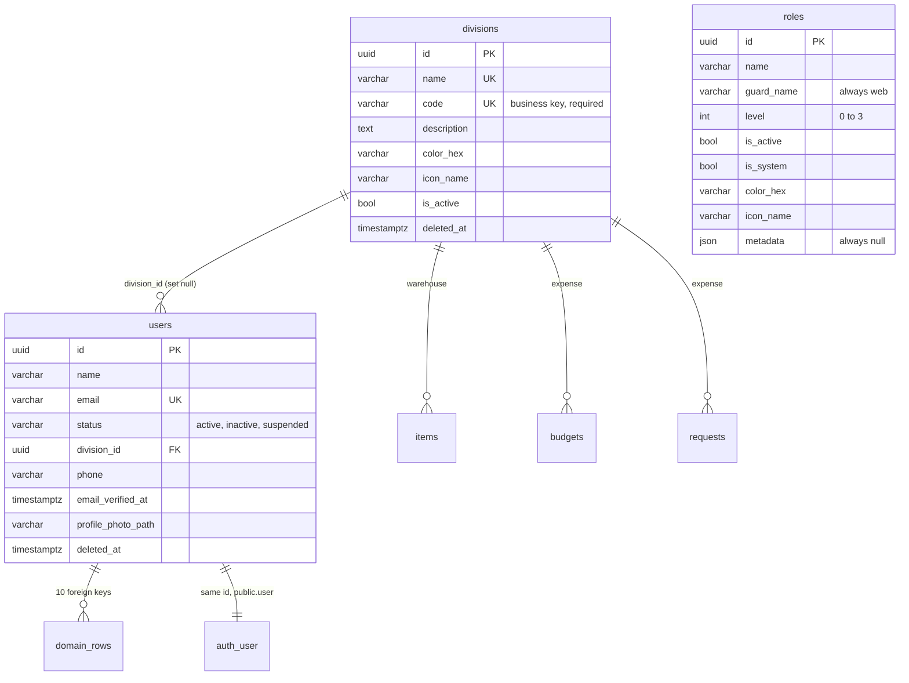
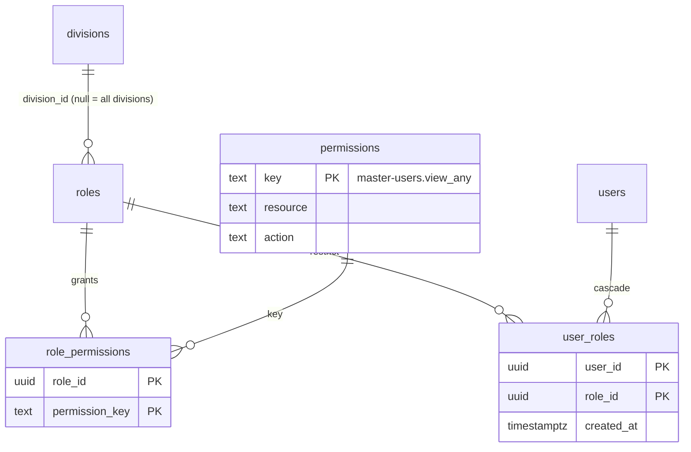

# Master entities review: Roles, Divisions, Users

Review date: **2026-10-06**. The owner accepted the recommendations in [section 5](#5-decisions-for-the-owner) on 2026-10-06. Phase 2 (migration `0029`), the status gate (D2), the matching role and user page edits and the API permission checks (ADR-0045) are built; D1 (division through roles, migration `0030`) and role assignment, with a guard against granting more than you hold, are built; what remains is the legacy RBAC import (#311) ([section 6](#6-suggested-slicing)). Evidence is cited as `repo:path:line` against `ubeann/vmb` (this repo, **new**), `ubeann/vmb-warehouse@development` (**legacy**, the deployed shape) and `ubeann/vmb-warehouse@revamp` (**revamp**, the legacy branch where the owner already redesigned Master; it holds `refactor/divisions-on-roles`, merged as its PR #174).

## 1. Where the backend stands

| Area                                                      | State                                                                                                                                                                                                                                                                                                     |
| --------------------------------------------------------- | --------------------------------------------------------------------------------------------------------------------------------------------------------------------------------------------------------------------------------------------------------------------------------------------------------- |
| Schema, migrations, import, seed                          | Done for the 30 legacy tables plus `roles` (0025) and `rate_limit` (0027). 28 migrations; `db:import` loads a legacy snapshot; `db:seed` fills every preview branch with fixtures.                                                                                                                        |
| Auth (#7, closed)                                         | Better Auth with database sessions; migrated users activate by email OTP (ADR-0033); sign-in gate on `deleted_at` (ADR-0034); rate limits in Postgres (ADR-0042); 12–128 character passwords with a breached check (ADR-0041).                                                                            |
| Master CRUD (#6, open)                                    | Store, API and pages exist for Divisions, Roles and Users, with soft delete and restore for Divisions and Users. `createUser` and `updateUser` dual-write `master.users` and Better Auth's identity in one CTE. The pages still carry the legacy minimal styling; #301–#306 restyle them on a "list kit". |
| **RBAC (#8, not started)**                                | Nothing enforces who may do what. `requireSession` only proves someone is signed in (`apps/api/src/require-session.ts`), so **any signed-in user can create users and delete roles through `/api/master/*`**. The web hides nothing. There is no table that gives a user a role or a role a permission.   |
| Trucking, Warehouse, Expense (#9–#16), cutover (#17, #18) | Schema only. No store, no API, no pages.                                                                                                                                                                                                                                                                  |

So the Master module is a working CRUD over three tables that are **not yet connected to each other in the way that matters**: a User has a Division but no Role, a Role has no Permissions, and a Permission does not exist.

## 2. The three entities today



`roles` stands alone: no foreign key points to it or leaves it. That is the heart of the gap.

- **Division** is the organisational unit. It is referenced by `users`, `warehouse.items`, `expense.budgets` and `expense.requests`, and legacy scoped most warehouse queries by the signed-in user's division.
- **User** is the durable business record every domain table references (10 foreign keys, ADR-0032). Better Auth owns credentials and sessions; the two rows share one UUID.
- **Role** was meant to be "a named bundle of permissions" (GLOSSARY). Today it is a labelled record with colour and icon.

## 3. Findings

Each finding says what is wrong, the evidence, and the fix. "Drop" means in a follow-up migration, never silently.

### Users

| #   | Finding                                                                                                                                                                                                                                                                                                                                                                                                           | Fix                                                                                                                                                     |
| --- | ----------------------------------------------------------------------------------------------------------------------------------------------------------------------------------------------------------------------------------------------------------------------------------------------------------------------------------------------------------------------------------------------------------------- | ------------------------------------------------------------------------------------------------------------------------------------------------------- |
| U1  | **`email_verified_at` is stale.** ADR-0032 says it "becomes Better Auth's `emailVerified`", and activation verifies the email in Better Auth's table. Nothing outside the seed writes `master.users.email_verified_at` (grep over `apps/` and `packages/`), yet the Users list reads it for its "Verified" column (`packages/db/src/master/users.ts:53`). A user who has activated can still show **Unverified**. | Drop the column. The list reads `public."user".email_verified`, joined on the shared id.                                                                |
| U2  | **`status` is display-only, and the glossary now promises more.** PR #307 defines Suspended as "can't sign in for now" and Inactive as "has left". The gate checks only `deleted_at` (`apps/api/src/sign-in-gate.ts`), and its comment says legacy never enforced status. Setting a User to Suspended today changes a label and nothing else.                                                                     | Gate on `deleted_at is null and status = 'active'`, and revoke sessions when status changes, as `deleteUser` already does. Amend ADR-0034.              |
| U3  | **One division per user** (BC-001). Operations need several. Revamp already removed `users.division_id` and let roles carry the division.                                                                                                                                                                                                                                                                         | See decision D1.                                                                                                                                        |
| U4  | **`name`, `email`, `image` live twice** (`master.users` and `public.user`). The CTE keeps them in step, but nothing enforces it.                                                                                                                                                                                                                                                                                  | Accepted by ADR-0032. Add a check to the import verifier (every `master.users` id has a `public.user` with the same email) rather than a schema change. |
| U5  | `created_at` and `updated_at` are nullable on every Master table (a Laravel habit). The app always sets them, SQL and the importer need not.                                                                                                                                                                                                                                                                      | Backfill, then `not null default now()`. Cross-cutting, so its own ticket.                                                                              |

### Roles

| #   | Finding                                                                                                                                                                                                                                                                                                                                                                                                                                                      | Fix                                                                                                                          |
| --- | ------------------------------------------------------------------------------------------------------------------------------------------------------------------------------------------------------------------------------------------------------------------------------------------------------------------------------------------------------------------------------------------------------------------------------------------------------------ | ---------------------------------------------------------------------------------------------------------------------------- |
| R1  | **`guard_name` is a Spatie concept.** Every role is `web`; the form pins it and the pages still print it (`apps/web/src/routes/(app)/master/roles/+page.svelte:89`). Better Auth has no guards.                                                                                                                                                                                                                                                              | Drop. `name` alone becomes unique.                                                                                           |
| R2  | **`level` never authorizes anything.** In legacy it is cast, shown, sorted and filtered, and seeded; no policy reads it (grep of `app/` finds it only in `Role.php`, `RoleResource`, `RoleFormBuilder`, `Create/EditRole` and the seeder). `packages/types/src/roles.ts` claims "higher levels inherit from lower ones in the legacy authorization layer"; that layer does not exist. Revamp dropped the column as "an unused hierarchy/access-level field". | Drop, after #8 settles permissions. Sort Roles by name (#303 sorts by level).                                                |
| R3  | **`metadata` is dead.** Always `null` in this repo's seed and never read by the store beyond passing it through. Revamp repurposed it to hold colour and icon; typed columns do that job better here.                                                                                                                                                                                                                                                        | Drop.                                                                                                                        |
| R4  | **A role cannot say which division it belongs to**, so the name carries it: "Manager Finance", "Manager Division". Revamp fixed this with `roles.division_id` (null = every division) and seeds `Manager - Finance`, `Staff - Finance`, and so on.                                                                                                                                                                                                           | Added by this PR as a nullable foreign key.                                                                                  |
| R5  | **Roles are hard-deleted and nothing says what that does.** Legacy cascaded the deletion into the assignment table, so deleting a role silently stripped access from everyone who held it.                                                                                                                                                                                                                                                                   | `user_roles.role_id` is `on delete restrict`: a role in use cannot be deleted. The UI says how many users hold it.           |
| R6  | **`is_active` on a role does nothing in legacy** (a toggle and an icon column). Kept, it should mean something.                                                                                                                                                                                                                                                                                                                                              | An inactive role grants nothing, enforced where permissions are resolved. See D4.                                            |
| R7  | **Super Admin is identified three ways in legacy**: an env var user id, the role name `Super Admin`, and Filament Shield's `super_admin`, which does not match the seeded name. The ledger already calls this "a landmine for the mapper".                                                                                                                                                                                                                   | Super Admin is a System Role holding every permission through ordinary grants. No env var, no name check, no bypass. See D6. |

### Divisions

| #   | Finding                                                                                                                                                                                                        | Fix                                                                                                                                                                                                                                        |
| --- | -------------------------------------------------------------------------------------------------------------------------------------------------------------------------------------------------------------- | ------------------------------------------------------------------------------------------------------------------------------------------------------------------------------------------------------------------------------------------ |
| V1  | **A Trashed division blocks its own name and code.** `name` and `code` are plain unique constraints and delete is soft, so after deleting "Finance" nobody can create another one.                             | Unique on the lower-cased value for live rows only (`where deleted_at is null`). Restore must then handle a 409.                                                                                                                           |
| V2  | **Uniqueness is case-sensitive**, while legacy compared division names case-insensitively in its checks. `Finance` and `finance` can coexist.                                                                  | Same indexes as V1, on `lower(name)` and `lower(code)`.                                                                                                                                                                                    |
| V3  | **Legacy authorizes by division name**: 58 call sites compare `division->name` to a literal (`Finance` 42, `Operations` 8, `Trucking` 7, `Executive` 1). Renaming a division silently changes who may do what. | Never check names. Authorization asks for a permission; scope asks for `roles.division_id`. `code` stays the stable business key.                                                                                                          |
| V4  | `color_hex` and `icon_name` are `varchar(255)` with defaults `#000000` and a rocket icon, and nothing checked the format.                                                                                      | **Decided:** keep two typed columns (not one jsonb `styles`), enforce `#RRGGBB` with a check (migration `0029`), keep hex in the database and derive OKLCH in CSS. Icons stay with #176. Reasons: [section 8](#8-colour-and-icon-storage). |
| V5  | `is_active` and `deleted_at` overlap. Revamp dropped `is_active`; PR #307 deliberately kept "Inactive" (kept on existing records, not choosable for new ones).                                                 | Keep, and keep the two meanings distinct. Nothing to change.                                                                                                                                                                               |

### What not to optimise

These tables hold a handful to a few dozen rows. `ilike '%term%'` search, the offset paging and the missing trigram indexes are fine, and adding indexes for them would cost writes and buy nothing. The one real gap, a foreign-key index on `users.division_id`, was closed in 0005. Every foreign key this PR adds has its index.

## 4. Proposed model

Two axes, taken from revamp's research and its sources (NIST RBAC, Casbin RBAC-with-domains): **a Role says what; a Division says where.** A Division never holds permissions. Permissions reach a User only through Roles, as a union, so nothing can conflict and nothing can subtract.



How a request would be authorized (not built here):

1. Resolve once per request: the keys from `user_roles → roles (is_active) → role_permissions`, plus the set of `roles.division_id` the user holds.
2. `requirePermission("master-users.create")` on each API route. Division scope is applied to the records the domain modules add (items, budgets, requests); nothing in Master is filtered by it. The web asks the same function to hide actions, but the API is the enforcement.
3. A resource's `all_division` permission (revamp's convention) lifts the division scope for a role that needs to see everything, instead of a second bypass.
4. The catalogue lives in code (`packages/types/src/permissions.ts`) and is projected into `master.permissions` so grants carry a foreign key. The Roles screen edits grants; nobody edits the catalogue by hand.

### Phase 2 (not in this PR): the cleanup migration

Once the decisions below are made, one migration carries the drops and constraints. Sketch:

```sql
alter table master.roles drop column guard_name, drop column level, drop column metadata;
alter table master.roles drop constraint master_roles_name_guard_name_unique;
create unique index master_roles_name_unique on master.roles (lower(name));

alter table master.users drop column email_verified_at;

alter table master.divisions drop constraint master_divisions_name_unique,
                             drop constraint master_divisions_code_unique;
create unique index master_divisions_name_live on master.divisions (lower(name)) where deleted_at is null;
create unique index master_divisions_code_live on master.divisions (lower(code)) where deleted_at is null;
alter table master.divisions add constraint divisions_color_hex_check check (color_hex ~ '^#[0-9A-Fa-f]{6}$');
alter table master.roles     add constraint roles_color_hex_check     check (color_hex ~ '^#[0-9A-Fa-f]{6}$');

-- only if D1 chooses "division follows roles":
alter table master.users drop column division_id;
```

Each statement either validates existing rows or fails with a named constraint, as the ledger's M-rows already do. The legacy snapshot must be checked first (any role with a duplicate lower-cased name, any division with a malformed colour).

## 5. Decisions for the owner

Recommendations first. The first three block the in-flight frontend tickets, so they are worth settling before #303 and #304 start.

| ID  | Decision                                            | Recommendation                                                                                                                                                                                                                                           | What it changes                                                                                                                                                            |
| --- | --------------------------------------------------- | -------------------------------------------------------------------------------------------------------------------------------------------------------------------------------------------------------------------------------------------------------- | -------------------------------------------------------------------------------------------------------------------------------------------------------------------------- |
| D1  | Where does a User's division live?                  | **On roles** (revamp's direction, BC-001): a user in several divisions holds several roles, and `users.division_id` goes. The alternative, keeping it as a "home division" next to role scope, keeps two sources of "which division" that will disagree. | #302's "users in this Division" becomes "users holding a role in it". #304's Division combobox and Inactive rule become a Roles multi-select in its Authorization section. |
| D2  | What do Suspended and Inactive Users do?            | **Both cannot sign in**; the gate and session revocation enforce it (U2). Trashed is the third way out. Three states that all mean "cannot sign in" is a lot, so say in the glossary how Inactive differs from Trashed.                                  | Backend ticket for the gate. #306's counts stay valid.                                                                                                                     |
| D3  | Keep `level`?                                       | **Drop** (R2). If a rank is wanted later, it should guard privilege escalation (you cannot grant a role above your own), which is a rule, not a label.                                                                                                   | #303 loses the Access level filter and column; default sort becomes name.                                                                                                  |
| D4  | What does `is_active` mean on a Role?               | **An inactive role grants nothing.** Otherwise drop the column.                                                                                                                                                                                          | Resolver reads `roles.is_active`; #303's Active/Inactive chip stays.                                                                                                       |
| D5  | Drop `guard_name`, `metadata`, `email_verified_at`? | **Yes**, in the phase 2 migration.                                                                                                                                                                                                                       | Small edits to the Roles pages, types and store.                                                                                                                           |
| D6  | Super Admin: bypass or grants?                      | **Grants.** A System Role that holds every key, and a test that fails when a catalogue key has no grant (this PR has it). One mechanism to audit.                                                                                                        | None on the frontend.                                                                                                                                                      |
| D7  | Is the permission catalogue editable in the UI?     | **No.** Code defines it, the UI edits grants. Legacy's `PermissionRegistry::sync()` hard-deleted permissions missing from code on every seed, which silently stripped roles.                                                                             | A sync that only adds, plus an explicit migration to remove a key.                                                                                                         |

## 6. Suggested slicing

1. **This PR** (draft, do not merge): the additive schema and its preview data. Accept it, or close it and keep the doc.
2. Phase 2 cleanup migration plus the matching page, type and store edits (D3–D5). Touches the files #303 and #304 will rebuild, so land it first or fold it into them.
3. Sign-in gate enforces `status` (D2); amend ADR-0034.
4. `requirePermission` middleware and division scoping on `/api/master/*`, with API tests that a signed-in user without the key gets 403. This is #8's core and the biggest security gap today.
5. Role assignment: the Users form's Authorization section and the Roles form's permission matrix.
6. Legacy RBAC export into the seed transform (D-003): roles, the role-to-permission matrix, and each user's role. Revamp's role seeder already shows the 8-role shape to map to.
7. `locals.can()` in the web so screens hide what the API would refuse.

## 7. What this PR contains

- `migrations/0028_master_rbac.sql`: `roles.division_id`, `master.permissions`, `master.role_permissions`, `master.user_roles`, each with its foreign-key index. Additive only: nothing is dropped, so the pages in the preview keep working.
- `packages/types/src/permissions.ts`: the catalogue for the three Master resources, in the legacy `resource.action` naming.
- Seed fixtures: the permission rows, an illustrative role matrix, Manager Finance scoped to the Finance division, and one user per role (the preview user is Super Admin).
- `packages/db/test/rbac.test.ts`: Super Admin holds every key; a role in use cannot be deleted; a role's grants go with it; a user's assignments go with the user; a division a role operates in cannot be hard-deleted; a permission key must equal its resource and action.
- Existing count assertions updated (34 tables, 11 foreign keys to `master.users`), and the insert-order test exempts the RBAC tables the pipeline rebuilds instead of porting (D-003).

### Looking at it on the preview

The preview comment shows the schema diff the migration produced. In the Neon console, on the PR's branch:

```sql
-- the matrix, one row per role
select r.name, d.code as division, count(rp.permission_key) as permissions
  from master.roles r
  left join master.divisions d on d.id = r.division_id
  left join master.role_permissions rp on rp.role_id = r.id
 group by r.name, d.code order by permissions desc;

-- who holds what
select u.email, r.name from master.user_roles ur
  join master.users u on u.id = ur.user_id
  join master.roles r on r.id = ur.role_id;
```

## 8. Colour and icon storage

**One jsonb `styles` column: no.** Two fixed scalars gain nothing from json, and lose the database's help: a `check` on the hex, `not null`, a default, and plain `where`/`order by`. The UI reads `colorHex` and `iconName` as separate props. Revamp's move into `metadata` is the same trade, and it left roles with a json column that held styling and nothing else. `icon_name` also exists on `warehouse.items`, which is not a "style", so a shared jsonb shape would not even be shared. A new typed column later is an instant `alter table` in Postgres, so extensibility is not a reason to give up validation now. Revisit only if styling grows past about four attributes.

**Keep hex in the database, use OKLCH in the app.** The app's own tokens are already OKLCH (`apps/web/src/app.css`, ADR-0036), and the colour a person picks arrives from `<input type="color">` as hex. Storing OKLCH in the database would mean a custom picker, a validator for three floats and a gamut rule, and every consumer outside the web app (the transactional emails ADR-0036 keeps in hex, exports, a future mobile client) converting back. What OKLCH is good for is derivation, which is a rendering concern: given one stored hex, CSS can compute the tinted background, the border and a readable foreground per theme, e.g. `oklch(from var(--chip) calc(l * 0.25 + 0.75) calc(c * 0.4) h)` for a light-mode tint and a different lightness curve in dark mode. That fixes the real problem with free hex, a pale yellow that is unreadable on a pale tint, without changing what is stored.

**Worth doing instead, later:** a small curated palette (about a dozen swatches, each defined once as light and dark OKLCH tokens that meet 4.5:1) offered in the picker, with the stored hex being the swatch's value. Free colour stays possible through the same column. This belongs with the picker work in #176 and the list kit's `StatusPill` tones, not with the schema.
